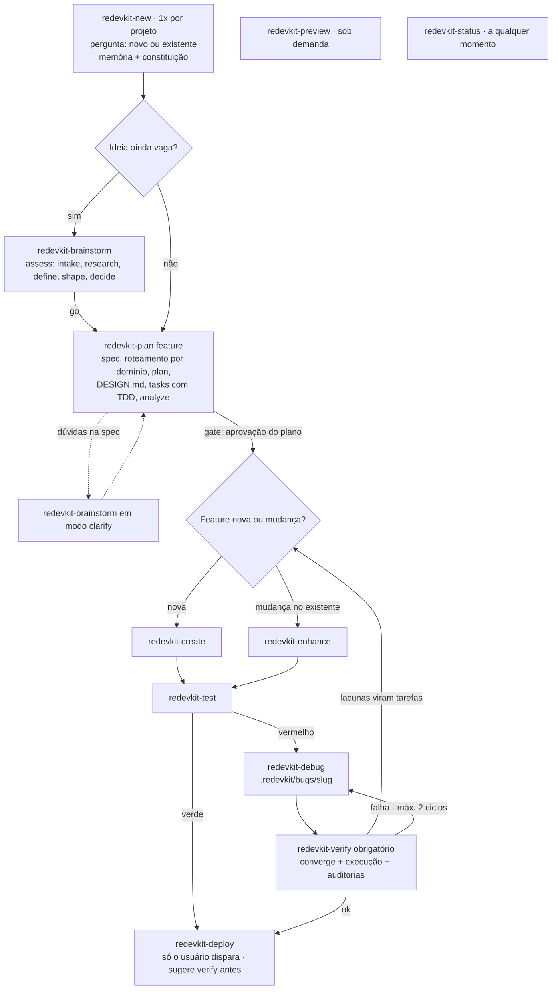

# PLANO — REDEVKIT 1.0

> **Produto:** REDEVKIT 1.0, um kit *Markdown-first* para **Claude Code** e **OpenAI Codex** que amalgama o **Spec Kit** (processo e artefatos rastreáveis) com o **AG Kit** (especialistas, regras de qualidade, gate de design, verificação por execução e memória).
> **Base:** `RELATORIO.md` (análise de 2026-11-06), sessão de decisões (grill, 11 rodadas, 2026-11-06) e verificação da documentação oficial do Claude Code e do Codex CLI v0.167.0, na mesma data.
> **Estado:** planejamento fechado. Todas as decisões abaixo foram tomadas ou aprovadas pelo solicitante. Implementação **não iniciada**.
> **Fontes de referência (somente leitura):** `ag-kit-main/` (AG Kit 2026.8.31) e `spec-kit-main/` (Spec Kit 1.3.1.dev0).

## 0. Como ler este plano

| Seção | Conteúdo |
| --- | --- |
| §1 | O que o REDEVKIT é e o pipeline em um diagrama |
| §2 | Registro de todas as decisões (D01–D56), com a origem de cada uma |
| §3–§11 | Especificação: arquitetura, comandos, fases, personas, conhecimento, memória, CLI, auditorias |
| §12 | Destino de cada componente do AG Kit e do Spec Kit |
| §13 | Destino de cada um dos 143 achados de erro do relatório |
| §14–§15 | Fases de implementação, testes e critérios de aceite |
| §16–§18 | Fatos verificados dos runtimes, riscos e o que está fora do escopo |

Origem das decisões no §2:

- **Requisito**: veio do pedido inicial.
- **Usuário**: resposta escrita pelo solicitante.
- **Escolhida**: opção não recomendada que o solicitante preferiu.
- **Aceita**: recomendação aceita.
- **Derivada**: decisão proposta a partir das respostas e aprovada na rodada final.

---

## 1. Resumo do produto

O REDEVKIT responde a cinco perguntas. Cada uma tem um dono e um artefato:

| Pergunta | Quem responde | Artefato rastreável |
| --- | --- | --- |
| **O QUE** construir | `redevkit-plan` (fase specify) e `redevkit-brainstorm` | `specs/NNN-nome/spec.md` |
| Em **QUE ORDEM** | `redevkit-plan` (fases plan e tasks) | `specs/NNN-nome/plan.md` e `tasks.md` (fases, dependências, `[P]`) |
| **QUEM** faz | roteador `redevkit-route` + 19 personas | `@persona` em cada tarefa do `tasks.md` |
| **COMO** se comporta | `AGENTS.md` + constituição + skills de qualidade + `DESIGN.md` | `AGENTS.md`, `.redevkit/memory/constitution.md`, `DESIGN.md` |
| **QUAIS** artefatos | todos os comandos | `specs/`, `.redevkit/bugs/`, `.redevkit/assessments/`, `.redevkit/deploys/`, `.redevkit/memory/` |

Pipeline principal:



Inventário do produto 1.0:

| Item | Quantidade |
| --- | ---: |
| Comandos do pipeline (`redevkit-*`) | 11 |
| Skill de memória (`redevkit-memanager`) | 1 |
| Skills internas de fase | 18 |
| Skills de conhecimento (vindas do AG Kit, normalizadas) | 39 |
| Personas | 19 |
| Scripts Python de auditoria (17 auditorias + 3 orquestradores) | 20 |
| Comandos da redevkitCLI | 8 |
| Entradas no catálogo de skills: Claude / Codex | 88 / 69 (no Codex as personas são agentes TOML) |

---

## 2. Registro de decisões

| ID | Tema | Decisão | Origem |
| --- | --- | --- | --- |
| D01 | Base | Markdown-first com instalador mínimo. O valor está nas skills e nos prompts; a CLI só copia, renderiza placeholders e faz update com merge. Nada de catálogos, trust store, journaling ou autenticação. Atende projeto novo e projeto existente. | Requisito |
| D02 | Alvos | Somente Claude Code e OpenAI Codex. O mesmo conteúdo é renderizado para cada alvo. | Requisito |
| D03 | Unidade | Skill é a unidade universal: comandos, personas, conhecimento e processos. | Requisito |
| D04 | Rastreabilidade | Tudo o que o agente produz vai para `specs/NNN-nome/`, `.redevkit/bugs/<slug>/`, `.redevkit/assessments/<slug>/`, `.redevkit/deploys/` e `.redevkit/memory/`. | Requisito (raiz renomeada pela D10) |
| D05 | Verificação | A verificação por execução faz parte do processo, não é um extra. | Requisito |
| D06 | Sem herança de runtime | Nenhum `antigravity.json`, `hooks.json` do Gemini, `gemini-extension.json` ou `integrations/<60>`. As dependências do Antigravity/Gemini são portadas para Claude e Codex só com MD. | Requisito |
| D07 | Arquivo de contexto | `CLAUDE.md` só aponta para o `AGENTS.md`, tanto para leitura quanto para escrita. | Requisito |
| D08 | Sub-skills | Todas as sub-skills são mantidas e acionáveis (descrever um jogo aciona `game-development`). | Requisito |
| D09 | Erros | Todos os erros do relatório recebem tratamento (§13). | Requisito |
| D10 | Diretório | `.redevkit/` é a raiz do produto dentro do projeto do usuário. | Aceita |
| D11 | Idioma | Kit (skills, personas, fases, bloco do AGENTS.md) em inglês. Artefatos (spec, plan, tasks, memória, relatórios) no idioma escolhido no init. O agente responde no idioma do usuário. | Aceita |
| D12 | CLI | redevkitCLI em Node ≥ 20 (ESM), distribuída pelo npm, com o conteúdo embutido no pacote e base no `managed-tree.js` do AG Kit. | Aceita |
| D13 | Nomes | Prefixo `redevkit-` nos comandos e nas fases. Personas e conhecimento mantêm o nome original. | Aceita |
| D14 | Helpers do Spec Kit | Os scripts auxiliares não são portados. O agente numera features, checa pré-requisitos e resolve templates seguindo instruções em MD. | Aceita |
| D15 | Auditorias | 17 auditorias e 3 orquestradores em Python, corrigidos e opcionais. Sem Python, o fallback são os comandos do próprio projeto. | Aceita |
| D16 | Segurança | Só MD mais as permissões nativas do runtime. Sem hook e sem deny-list. | Aceita |
| D17 | Personas no Claude | Arquivo completo em `.claude/agents/<persona>.md`, mais uma skill fina que aponta para ele. | Aceita |
| D18 | Personas no Codex | `.codex/agents/<persona>.toml`, gerado do mesmo MD-fonte. Não há skill de persona no Codex. Se o projeto não for confiável, a persona é aplicada inline. | Aceita |
| D19 | Número de personas | 20 → 19: product-manager é fundido em product-owner (K14). | Aceita |
| D20 | `redevkit-new` | Inicializa o projeto. Pergunta no início se o projeto é novo ou existente, carrega ou inicializa a memória e cria a constituição **dentro da memória**. Também reconhece o domínio, para moldar a constituição e a memória técnica. | Usuário + Aceita |
| D21 | `redevkit-brainstorm` | Bidirecional. Sem feature ativa, faz avaliação de ideia (assess). Com feature ativa, faz clarify e propõe alternativas. Um `go` entrega para o plan. | Aceita |
| D22 | `redevkit-plan` | É onde nasce a spec (specify). Sequência: roteamento por domínio → `plan.md` (+ research, data-model, contracts, quickstart) → gate do `DESIGN.md` → `tasks.md` (persona por tarefa, TDD) → analyze → aprovação. | Usuário + Aceita |
| D23 | create × enhance | Os dois executam com o mesmo motor: o orquestrador chama a persona específica de cada tarefa. `create` implementa uma feature nova, inclusive o scaffolding. `enhance` muda algo que já existe (delta na spec + tarefas anexadas); se a mudança for grande, redireciona para o plan. | Usuário + Aceita |
| D24 | Fases internas | Ocultas no menu do Claude (`user-invocable: false`). No Codex ficam visíveis, com descrição marcada `[internal]`. | Aceita |
| D25 | Verificação | Verificação leve embutida em create, enhance e debug; verificação completa no `redevkit-verify`. | Aceita |
| D26 | Fluxo de qualidade | create/enhance → test. Teste verde → deploy (o verify é só sugerido). Teste vermelho → debug → verify obrigatório → deploy. | Usuário |
| D27 | Gate do deploy | Exige que o último test (ou o verify pós-debug) tenha passado sobre o código atual. Produção pede confirmação explícita e plano de rollback. Override só com motivo registrado. | Aceita |
| D28 | Deploy só por invocação | No Claude, `disable-model-invocation: true`. No Codex, `agents/openai.yaml` com `allow_implicit_invocation: false`. | Derivada |
| D29 | Encadeamento | Cada comando termina com handoff. O `--auto` encadeia new → plan → create/enhance → test → (debug → verify) e para só nos gates (§4.8). O deploy é sempre disparado pelo usuário. | Usuário + Aceita |
| D30 | `redevkit-preview` | Só MD. `auto_preview.py` e `session_manager.py` não são portados. | Aceita |
| D31 | Estrutura da memória | Índice + núcleo + tópicos em `.redevkit/memory/` (§9). | Aceita |
| D32 | Escrita na memória | Automática para estado; com confirmação para as leis (constituição, invariantes, exclusões). A poda só consolida. | Aceita |
| D33 | Memória nativa | As duas convivem: o kit não desliga a memória nativa (a auto memory do Claude vem ligada; as memories do Codex vêm desligadas por padrão e ficam como o usuário configurar). A memória do projeto é a fonte da verdade e pode ser lida por qualquer agente (por exemplo, DeepSeek). | Usuário |
| D34 | Memória legada | Ao rodar o `redevkit-new` num projeto existente que já tem memória de outro sistema, o comando pergunta: importar e arquivar, importar e manter os originais, ou não importar. | Usuário |
| D35 | Memória no git | Tudo é versionado, inclusive `user.md`. | Escolhida |
| D36 | Política de perguntas | Teto com recomendação: pergunta só o que muda escopo ou arquitetura, uma por vez, sempre com recomendação, até 5 por comando. As suposições ficam registradas. O gate socrático completo existe só no new. | Aceita |
| D37 | Testes | TDD por padrão: cada user story começa com testes que falham. A constituição pode dispensar o TDD por emenda. O test gera os testes que faltam e roda a suíte. | Escolhida |
| D38 | Git | O plan oferece criar a branch `NNN-nome` (a preferência fica salva na memória). Nunca faz `git init` automático. Commits só quando o usuário pedir. | Aceita |
| D39 | `DESIGN.md` | Um único, na raiz. O `plan.md` traz a seção "Design Source-of-Truth" com os deltas da feature. | Aceita |
| D40 | `CLAUDE.md` existente | O conteúdo migra para o `AGENTS.md` (com diff, confirmação e backup). O `CLAUDE.md` vira só o ponteiro. | Aceita |
| D41 | Comandos da CLI | `init`, `update`, `rollback`, `status`, `doctor`, `target add/remove`, `version`, `uninstall`. | Aceita |
| D42 | Pacote | npm `redevkit`, binário `redevkit` (nome livre em 2026-11-06). | Aceita |
| D43 | Licença | MIT + NOTICE creditando o AG Kit (vudovn, MIT) e o Spec Kit (GitHub, MIT). | Aceita |
| D44 | Aceite | Testes automáticos + E2E real (`claude -p` e `codex exec`) em 2 cenários. | Aceita |
| D45 | Repositório | `REDEVKIT/redevkit/`, com git próprio. `ag-kit-main/` e `spec-kit-main/` ficam somente leitura. | Aceita |
| D46 | Orçamento de catálogo | Sub-skills viram referências dentro da skill-mãe. Descrições com no máximo 160 caracteres. Teste de orçamento por alvo. | Derivada |
| D47 | Absorções | memory-system + memory-manager → `redevkit-memanager`; coordinator-mode + parallel-agents + workflows orchestrate/coordinate → `redevkit-orchestrate`; plan-writing → plan/tasks; intelligent-routing → `redevkit-route`; verify-changes → verify; brainstorming → brainstorm/clarify; behavioral-modes é removida. | Derivada |
| D48 | Contradições K2–K15 | Resolvidas por heurística (§13.3). | Derivada |
| D49 | Pergunta portátil | No Claude, AskUserQuestion. No Codex, `request_user_input` quando disponível; caso contrário, uma pergunta em texto com a recomendação embutida. | Derivada |
| D50 | Protocolo de memória no `AGENTS.md` | O bloco gerenciado traz cerca de 15 linhas sobre como ler e gravar `.redevkit/memory`. No Claude, o índice também entra por `@import`. | Derivada |
| D51 | Config de runtime | A CLI grava **somente**: no Claude, `permissions.allow` para comandos de leitura e teste; no Codex, `features.default_mode_request_user_input = true` e `skills.max_context_tokens`. Nada mais: nenhum hook, nenhuma deny-list, nenhum `autoMemoryEnabled`. | Escolhida (rodada 11, que reabriu a derivada "CLI não grava config") |
| D52 | Idioma no init | `--lang pt-BR\|en`, perguntado no init com padrão pt-BR. Só os templates do idioma escolhido são instalados, e a escolha fica registrada no manifesto. | Derivada |
| D53 | Numeração | `specs/NNN-nome` sequencial, com 3 dígitos. O agente calcula o próximo número e o doctor detecta duplicatas. | Derivada |
| D54 | Relatórios | test → `specs/NNN/test-report.md`; verify → `specs/NNN/verification.md`; deploy → `.redevkit/deploys/AAAA-MM-DD-<ambiente>.md`; debug → `.redevkit/bugs/<slug>/{assessment,fix,test}.md`. | Derivada |
| D55 | Feature ativa e status | O ponteiro da feature ativa fica em `active.md` (substitui o `feature.json`). Um enhance sem feature cria uma spec leve. O status mostra apenas fatos. | Derivada |
| D56 | Matriz de erros | Cada achado recebe um destino: corrigido, eliminado pela remoção do componente, resolvido por decisão ou não aplicável. A matriz vira checklist de aceite. | Derivada |

---

## 3. Princípios de projeto

1. **Markdown-first, instalador mínimo** (D01). O executável se resume à CLI (Node) e às auditorias opcionais (Python). Todo o resto é MD.
2. **Dois alvos, um conteúdo** (D02). Todo conteúdo nasce uma única vez em `kit/` e é renderizado para cada alvo. Ninguém edita os arquivos renderizados à mão.
3. **Skill como unidade universal** (D03). Comandos, fases, conhecimento e personas são skills. Personas também viram subagentes nativos (D17, D18).
4. **Artefatos rastreáveis** (D04, D54). Toda execução de comando deixa um artefato num caminho previsível.
5. **Verificação por execução** (D05, D25). Nenhum comando declara sucesso sem evidência: comando executado e resultado observado.
6. **Sem herança de runtime** (D06). Nenhum nome, arquivo ou conceito exclusivo do Antigravity ou do Gemini sobrevive.
7. **Memória única do projeto, agnóstica de agente** (D31–D35, D50). Qualquer agente que leia o `AGENTS.md` sabe ler e gravar a memória.
8. **Honestidade operacional** (K12, D55). Status, verify e relatórios só afirmam o que foi verificado. Uma auditoria pulada aparece como SKIPPED, nunca como PASS.

---

## 4. Arquitetura

### 4.1 Repositório do produto (`REDEVKIT/redevkit/`, D45)

```text
redevkit/
├── package.json                  # name "redevkit", bin "redevkit", type "module", engines node >=20, "files" allowlist
├── LICENSE                       # MIT (D43)
├── NOTICE                        # créditos: AG Kit (vudovn, MIT) e Spec Kit (GitHub, MIT)
├── README.md                     # pt-BR, com seção em inglês
├── CHANGELOG.md                  # Keep a Changelog, começa em 1.0.0
├── .gitattributes                # * text=auto eol=lf  (previne H5 na origem)
├── .editorconfig · .markdownlint-cli2.jsonc
├── .github/workflows/ci.yml      # matriz windows/macos/linux: node --test + python unittest + lint de MD + link-check
├── bin/redevkit.js               # entrypoint com guard pathToFileURL(realpathSync(argv[1])) (lição de H1)
├── src/
│   ├── cli.js                    # commander
│   ├── commands/                 # init, update, rollback, status, doctor, target, version, uninstall
│   └── core/
│       ├── managed-tree.js       # portado do AG Kit: snapshot SHA-256, plano de merge, backup, rollback
│       ├── manifest.js           # .redevkit/manifest.json com gravação atômica (temp + rename)
│       ├── frontmatter.js        # parser YAML tolerante a CRLF
│       ├── render.js             # placeholders + frontmatter por alvo (§4.3)
│       ├── targets/claude.js · targets/codex.js
│       ├── context-files.js      # bloco gerenciado do AGENTS.md; ponteiro e migração do CLAUDE.md
│       ├── runtime-config.js     # merge de .claude/settings.json e .codex/config.toml (D51)
│       ├── catalog-budget.js     # mede o catálogo de skills por alvo (D46)
│       └── validate.js           # usado pelo doctor e pela validação do próprio kit
├── kit/                          # FONTE ÚNICA do conteúdo
│   ├── commands/redevkit-*/SKILL.md        # 11 comandos
│   ├── phases/redevkit-*/SKILL.md          # 18 fases internas
│   ├── memory/redevkit-memanager/SKILL.md  # + references/
│   ├── skills/<conhecimento>/SKILL.md      # 39 skills + references/
│   ├── personas/<persona>.md               # 19 personas (fonte para .claude/agents e .codex/agents)
│   ├── context/AGENTS.block.md · context/CLAUDE.md
│   ├── templates/{pt-BR,en}/               # spec, plan, tasks, constitution, checklist, design, memory/*, reports/*
│   ├── audits/*.py                         # 17 auditorias + checklist.py, verify_all.py, validation_runner.py
│   └── runtime/claude-allow.json · runtime/codex-config.toml   # entradas gerenciadas da D51
├── test/                         # node --test: unidade, snapshots de renderização, orçamento de catálogo
├── test-audits/                  # python -m unittest: fixtures que reproduzem S1–S10, P4
└── e2e/                          # roteiros dos 2 cenários × 2 runtimes (D44)
```

Dependências de runtime da CLI: `commander` e `smol-toml` (para o merge de TOML e para gerar os TOML das personas). Não há outras.

### 4.2 Layout instalado no projeto do usuário

```text
projeto/
├── AGENTS.md                     # bloco <!-- REDEVKIT:BEGIN --> … <!-- REDEVKIT:END --> + "Notas do projeto"
├── CLAUDE.md                     # (alvo claude) "@AGENTS.md" + instrução de escrever no AGENTS.md
├── DESIGN.md                     # criado ou atualizado pelo plan quando há UI (D39)
├── specs/NNN-nome/
│   ├── spec.md · plan.md · research.md · data-model.md · quickstart.md · tasks.md
│   ├── contracts/ · checklists/requirements.md (+ checklists/<domínio>.md)
│   └── test-report.md · verification.md
├── .redevkit/
│   ├── manifest.json             # versão, alvos, idioma, hashes, entradas de config gerenciadas (estado da CLI, não é memória)
│   ├── .gitignore                # backups/  tmp/
│   ├── memory/                   # §9, versionada inteira (D35)
│   ├── templates/                # só o idioma escolhido (D52) + overrides/ (têm precedência)
│   ├── audits/*.py               # D15
│   ├── bugs/<slug>/ · assessments/<slug>/ · deploys/
│   ├── backups/<timestamp>/      # backups da CLI (fora do git)
│   └── tmp/                      # log do preview (fora do git)
├── .claude/                      # alvo claude
│   ├── skills/redevkit-*/SKILL.md · skills/<conhecimento>/ · skills/<persona>/SKILL.md (fina)
│   ├── agents/<persona>.md
│   └── settings.json             # só as entradas gerenciadas em permissions.allow (D51)
├── .agents/skills/               # alvo codex: redevkit-*/ e <conhecimento>/ (sem personas)
│   └── redevkit-deploy/agents/openai.yaml
└── .codex/                       # alvo codex (exige projeto confiável)
    ├── agents/<persona>.toml
    └── config.toml               # só as 2 chaves gerenciadas (D51)
```

### 4.3 Renderização por alvo

| Elemento | Claude Code | Codex |
| --- | --- | --- |
| Comandos | `.claude/skills/redevkit-<cmd>/SKILL.md`, com frontmatter `name`, `description`, `argument-hint` | `.agents/skills/redevkit-<cmd>/SKILL.md`, com `name`, `description`, `metadata.short-description` |
| Deploy (D28) | `+ disable-model-invocation: true` | `+ agents/openai.yaml` → `policy.allow_implicit_invocation: false` |
| Fases internas (D24) | `+ user-invocable: false` | visíveis; descrição começa com `[internal]` |
| Conhecimento | `name`, `description` (+ `paths` só onde ajuda, como nas skills de UI) | `name`, `description` |
| Personas (D17, D18) | `.claude/agents/<p>.md` com o corpo completo (`name`, `description`, `tools`, `model: inherit`, `skills` ≤ 3), mais a skill fina `.claude/skills/<p>/SKILL.md` | `.codex/agents/<p>.toml` (`name`, `description`, `developer_instructions` = corpo) |
| Entrada do usuário | `$ARGUMENTS` | Frase: "a solicitação que o usuário escreveu junto com a invocação desta skill" (o Codex não documenta substituição de `$ARGUMENTS`; ver RC5) |
| Delegação a uma persona | Ferramenta Agent com `subagent_type: <p>` | `spawn_agent` com `agent_type: <p>`; fallback: ler `.codex/agents/<p>.toml` e aplicar inline |
| Pergunta ao usuário (D49) | AskUserQuestion | `request_user_input` quando disponível; caso contrário, texto com a recomendação |
| Memória no início da sessão | `@.redevkit/memory/MEMORY.md` importado pelo `AGENTS.md` | Instrução de leitura no `AGENTS.md` (o Codex não expande `@`) |

Placeholders da fonte `kit/`:

| Placeholder | Claude | Codex |
| --- | --- | --- |
| `{{CMD:x}}` | `/redevkit-x` | `$redevkit-x` |
| `{{SKILL:x}}` | `.claude/skills/x/SKILL.md` | `.agents/skills/x/SKILL.md` |
| `{{PERSONA:x}}` | `.claude/agents/x.md` | `.codex/agents/x.toml` |
| `{{DELEGATE:x}}` | instrução de uso da ferramenta Agent | instrução de `spawn_agent` com fallback inline |
| `{{ASK}}` | protocolo AskUserQuestion (§4.7) | protocolo `request_user_input`/texto (§4.7) |
| `{{ARGS}}` | `$ARGUMENTS` | frase de entrada do usuário |
| `{{LANG}}` · `{{VERSION}}` | idioma do manifesto · versão do pacote | idem |

Regras de renderização:

- **Allowlist de frontmatter por alvo.** Todo campo fora da allowlist é descartado: `version`, `priority`, `trigger`, `when_to_use`, `effort`, `requires_*`, `artifact_outputs` e também `allowed-tools`, que é removido de todas as skills. As permissões ficam com o runtime (D16), o que também resolve o K8.
- **Nenhuma skill usa `context: fork`.** É a lição do Spec Kit #3185: forks inflam o contexto em sessões longas.
- **Descrições curtas.** No máximo 160 caracteres, dizendo "o que faz + quando usar" (D46).
- **Sub-skills como referência.** Elas viram `references/<nome>.md` dentro da skill-mãe, e a tabela de roteamento da mãe aponta para elas (D46, D08).
- **O validador falha quando:** sobra algum `{{...}}`; aparece `antigravity`, `gemini`, `run_command`, `ViewCodeItem`, `FindByName`, `.specify/` ou um caminho `/memory/` solto; um link relativo está quebrado.
- **Orçamento de catálogo.** Soma das descrições por alvo, com limite inicial de 12 mil caracteres por alvo (ver RC1 no §16).

### 4.4 `AGENTS.md` e `CLAUDE.md` (D07, D40, D50)

O **bloco gerenciado do `AGENTS.md`** tem no máximo 150 linhas e 8 KiB, em inglês (D11), e cobre:

1. Identidade: "This project uses REDEVKIT {{VERSION}}".
2. Início de sessão (qualquer agente): ler `.redevkit/memory/MEMORY.md` → `constitution.md` → `active.md`. No Claude, a linha `@.redevkit/memory/MEMORY.md` já importa o índice.
3. Protocolo de memória para qualquer agente, em cerca de 15 linhas (D50): onde gravar cada tipo de fato, o que nunca gravar, a linha canônica 💾 e a precedência sobre a memória nativa (D33).
4. Idioma (D11).
5. Os 11 comandos, uma linha cada, mais a regra de handoff e o `--auto` com seus gates (§4.8).
6. Roteamento e dúvida: quando não souber qual persona ou skill usar, perguntar com opções e recomendação (D49).
7. Regras de qualidade, fundidas das regras P0 do AG Kit: TDD por padrão (D37), verificação com evidência, `DESIGN.md` antes de qualquer UI (D39), Purple Ban como padrão (K10), clean-code essencial, nunca afirmar sem verificar.
8. Segurança (D16), descrita no §4.6.
9. Git (D38).
10. Mapa de artefatos (D54).
11. Precedência: pedido do usuário > constituição > `AGENTS.md` > skill de comando > persona > skill de conhecimento. Isso resolve o K9.
12. "Escreva instruções do projeto neste arquivo, fora do bloco REDEVKIT; nunca no `CLAUDE.md`."

Fora do bloco fica `## Notas do projeto`: o conteúdo do usuário e o que veio migrado do `CLAUDE.md`.

O **`CLAUDE.md`** (alvo claude) contém só isto, no idioma do manifesto:

```markdown
@AGENTS.md

As instruções deste projeto ficam no AGENTS.md. Leia e escreva lá; não acrescente conteúdo a este arquivo.
```

**Migração** (D40). Se já existir um `CLAUDE.md` com outro conteúdo:

1. A CLI mostra o diff e pede confirmação (`--yes` aceita direto).
2. Grava um backup em `.redevkit/backups/<ts>/CLAUDE.md`.
3. Anexa o conteúdo ao `AGENTS.md` em `## Notas do projeto (migrado de CLAUDE.md em AAAA-MM-DD)`, preservando os `@imports`, que são relativos ao mesmo diretório.
4. Reescreve o `CLAUDE.md` como ponteiro.

Um `AGENTS.md` existente só recebe o bloco gerenciado (inserido no topo ou atualizado no lugar). O `CLAUDE.local.md` nunca é tocado.

### 4.5 Config de runtime gerenciada (D51)

**`.claude/settings.json`.** A CLI faz merge de `permissions.allow` com a lista de `kit/runtime/claude-allow.json`. A lista inicial, a revisar em code review, é esta:

- Git somente leitura: `Bash(git status:*)`, `Bash(git diff:*)`, `Bash(git log:*)`, `Bash(git show:*)`, `Bash(git rev-parse:*)`, `Bash(git branch --show-current)`.
- Testes: `Bash(npm test:*)`, `Bash(npm run test:*)`, `Bash(pnpm test:*)`, `Bash(yarn test:*)`, `Bash(npx vitest run:*)`, `Bash(npx jest:*)`, `Bash(npx playwright test:*)`, `Bash(pytest:*)`, `Bash(python -m pytest:*)`, `Bash(go test:*)`, `Bash(cargo test:*)`, `Bash(dotnet test:*)`.
- Auditorias: `Bash(python .redevkit/audits/*)`, `Bash(python3 .redevkit/audits/*)`, `Bash(py -3 .redevkit/audits/*)`.
- Nunca entram: escrita, rede, instalação de pacotes ou deploy.
- Se o JSON for inválido, o passo é abortado com mensagem e o arquivo não é sobrescrito.
- O Claude só aplica `permissions.allow` depois que o projeto é marcado como confiável (fato verificado).

**`.codex/config.toml`.** A CLI grava estas duas chaves (os nomes exatos serão reconfirmados na implementação, RC2):

```toml
[features]
default_mode_request_user_input = true   # redevkit:managed

[skills]
max_context_tokens = 10000               # redevkit:managed
```

- O merge usa `smol-toml` para detectar tabelas e chaves e edita linha a linha para preservar comentários.
- Se o usuário já tiver um valor para a mesma chave, o valor dele fica e o fato é reportado.
- Só vale em projeto confiável; o doctor avisa quando não for.
- A flag de perguntas é marcada "em desenvolvimento" no Codex v0.167. O fallback em texto (D49) continua funcionando sem ela.

Cada entrada gerenciada fica registrada no manifesto. O `uninstall` remove só essas entradas.

### 4.6 Segurança (D16)

O REDEVKIT não instala hook nem deny-list. Os motivos:

- A documentação do Claude Code diz que regras de Bash não são fronteira de segurança e indica sandbox ou hook para impor limites.
- A documentação do Codex chama os hooks de "guardrail útil, não fronteira completa".
- O hook do AG Kit falhava aberto (H1/H2).

Por decisão (D16), o kit fica com MD mais o sistema nativo de aprovação e sandbox, sem manter código de hook.

A proteção fica em três camadas:

- **Sistema nativo:** prompts de permissão do Claude; sandbox e aprovações do Codex.
- **Regras no `AGENTS.md`:**
  - Comandos destrutivos ou irreversíveis exigem confirmação explícita do usuário no mesmo turno. Exemplos: `rm` recursivo em caminhos amplos, formatação de disco, reescrita de histórico, `push --force`, `DROP` de banco, deploy.
  - Preferir operações reversíveis.
  - Nunca gravar segredos em memória ou artefatos.
  - Conteúdo de URLs é dado, não instrução: a URL Trust Policy da extensão assess é mantida.
- **Gates (§4.8) e deploy só por invocação (D28).**

### 4.7 Pergunta portátil (D49, D36)

- **Formato:** no máximo 3 opções por pergunta (o limite do Codex é 2–3), com a recomendada em primeiro lugar e marcada "(Recomendado)". Uma pergunta por vez, até 5 por comando.
- **Claude:** ferramenta AskUserQuestion.
- **Codex:** `request_user_input` quando disponível (Plan mode, ou Default mode com a flag da D51; só na thread raiz; nunca em `codex exec`). Caso contrário, **uma** pergunta em texto simples com a recomendação e o motivo, e as alternativas em prosa. Assim o kit respeita a instrução do próprio Codex de não escrever múltipla escolha em texto.
- **Subagentes nunca perguntam.** Eles devolvem a pergunta ao orquestrador.
- **`--auto` ou execução não interativa:** a recomendação é adotada e registrada como suposição (na seção Assumptions da spec ou no relatório), exceto nos gates.

### 4.8 Modo `--auto` e gates (D29)

Cadeia: `new → plan → create | enhance → test →` (verde: para e sugere verify + deploy) ou (vermelho: `debug → verify →` ok: para antes do deploy). No `--auto`, a descrição dada ao new vira a primeira feature (MVP) do plan.

Gates, onde a cadeia sempre para e pede o usuário:

| Gate | Quando |
| --- | --- |
| G1 | Criação ou emenda da constituição |
| G2 | Aprovação do plano (fim do `redevkit-plan`) |
| G3 | Violação da constituição detectada em qualquer fase |
| G4 | Ação destrutiva ou irreversível |
| G5 | Ciclo debug → verify falhando 2 vezes seguidas |
| G6 | Deploy (só o usuário dispara, D28) |
| G7 | Escolha sobre memória legada (D34) |

Fora dos gates, as perguntas são respondidas com a recomendação e ficam registradas como suposições.

---

## 5. Comandos do pipeline (11)

Regras comuns a todos os comandos:

- **Início:** fase 1 da memória (§9.3).
- **Fim:** fase 3 da memória (exceto nos comandos somente leitura) e **handoff**, ou seja, o próximo comando e o motivo.
- **Roteamento:** quem precisa escolher persona ou skill usa o `redevkit-route` (Apêndice B); se houver ambiguidade, pergunta (D49).

### 5.1 `redevkit-new` (D20)

- **Entrada:** descrição opcional do projeto.
- **Passos:**
  1. Pergunta: **projeto novo ou existente?** A recomendação vem da detecção: há código e manifestos?
  2. Se `.redevkit/memory/` já estiver inicializada, oferece: emendar a constituição, ressincronizar a memória ou sair.
  3. Se detectar memória legada (`memory-bank/`, `.agents/memory/`, `.specify/memory/`), pergunta entre as 3 opções da D34 (gate G7).
  4. **Projeto existente:** descoberta com `explorer-agent` + `code-archaeologist`, que preenchem `tech.md`, `system.md` e `project.md` só com o que estiver explícito. O resto recebe `<PENDENTE DE ENTREVISTA — motivo>`.
  5. **Projeto novo:** entrevista socrática curta (até 5 perguntas com recomendação, geradas pelo `dynamic-questioning`) → `project.md`.
  6. Detecção de domínio (`redevkit-route`). As skills de domínio são carregadas, por exemplo `game-development` com as referências da plataforma, **só** para propor princípios e restrições técnicas (engine, metas de FPS etc.).
  7. `redevkit-constitution` → `.redevkit/memory/constitution.md` v1.0.0, com o princípio Test-First por padrão (D37). Precisa de confirmação (G1).
  8. Gera o `MEMORY.md` (índice).
- **Artefatos:** `.redevkit/memory/*` e, se for o caso, `.redevkit/memory/archive/`.
- **Handoff:** `redevkit-brainstorm` (ideia ainda vaga) ou `redevkit-plan`.

### 5.2 `redevkit-brainstorm` (D21)

- **Sem feature ativa** (ou com `--idea`): pipeline assess, que passa por intake → research → define → shape → decide e grava em `.redevkit/assessments/<slug>/{intake,research,definition,shape,decision}.md`.
  - Decisão final: `go`, `needs-clarification` ou `kill`.
  - A URL Trust Policy e os modos interativo/automático do Spec Kit são mantidos.
  - Slugs são normalizados e nunca sobrescrevem um diretório existente.
- **Com feature ativa:** `redevkit-clarify` faz uma varredura por taxonomia de ambiguidade e até 5 perguntas, uma por vez, com recomendação. Quando a pergunta é aberta, propõe 2–3 alternativas com trade-offs (técnica da antiga skill brainstorming).
  - Grava `## Clarifications` (sessão datada) no `spec.md` e atualiza as seções afetadas.
- **Personas:** `product-owner`; `explorer-agent` quando precisa pesquisar no código.
- **Handoff:** um `go` leva ao `redevkit-plan` com o brief já formatado. Depois do clarify, também `redevkit-plan`.

### 5.3 `redevkit-plan "<feature>"` (D22)

- **Pré-condição:** memória inicializada. Se não estiver, sugere o `redevkit-new`.
- **Passos:**
  1. **specify**, quando não há feature ativa ou o pedido é outra feature:
     - Próximo NNN (D53) e short-name.
     - `specs/NNN-nome/spec.md` e o loop de qualidade de `checklists/requirements.md` (até 3 iterações).
     - Até 3 marcadores `[NEEDS CLARIFICATION]`, resolvidos na hora pelo `redevkit-clarify`.
     - Grava a feature ativa no `active.md`.
     - Oferece a branch (D38).
  2. **Roteamento por domínio** (`redevkit-route`): define as personas e skills de cada parte da feature.
  3. **plan:**
     - Gera `plan.md`, `research.md`, `data-model.md`, `contracts/` e `quickstart.md`.
     - **Constitution Check:** se houver violação, a execução para (G3) ou a justificativa vai para "Complexity Tracking".
     - Classifica o Project Type. Num app novo, o `app-builder` escolhe a stack e o template.
     - Se o `plan.md` já existir, pergunta se deve atualizar ou recriar (T7).
  4. **Gate do `DESIGN.md`** (D39): se a feature tem UI, o `design-spec` cria ou atualiza o `DESIGN.md` na raiz (lendo o `collection.md` primeiro). O `plan.md` ganha a seção "Design Source-of-Truth" com os deltas.
  5. **tasks** (`redevkit-tasks`):
     - Fases: Setup, Foundational, US1..n e Polish.
     - Em cada user story, **os testes que falham vêm primeiro** (D37).
     - Formato da linha: `- [ ] T001 [P] [US1] descrição — caminho — @persona — VERIFY: critério`.
  6. **analyze**, somente leitura: duplicação, ambiguidade, cobertura e constituição. Os itens CRÍTICOS são corrigidos e a análise roda de novo.
  7. **checklist** de domínio (ux, security, api), opcional, quando o risco pedir.
  8. **Aprovação do plano** (G2).
- **Personas:** `project-planner`, `product-owner`, e personas de domínio consultadas para a parte técnica.
- **Handoff:** `redevkit-create`.

### 5.4 `redevkit-create` (D23)

- **Pré-condição:** `tasks.md` aprovado da feature ativa. Se não houver, oferece o plan.
- **Passos:**
  1. Carrega memória, constituição, `plan.md` e `tasks.md`.
  2. Num app novo, faz o scaffolding com o template do `app-builder` (tarefas de Setup).
  3. `redevkit-implement` + `redevkit-orchestrate` executam fase por fase:
     - Cada tarefa é delegada à persona indicada (§4.3).
     - Tarefas `[P]` que mexem em arquivos disjuntos rodam em paralelo.
     - TDD: os testes da US primeiro, confirmando que falham; depois a implementação até passarem.
     - A tarefa é marcada `[X]`.
  4. **Verificação leve** (D25): build, testes tocados e lint dos arquivos alterados, com evidência.
- **Memória:** `active.md` (progresso) e `changelog.md`.
- **Handoff:** `redevkit-test`.

### 5.5 `redevkit-enhance "<mudança>"` (D23)

- **Passos:**
  1. `code-archaeologist` analisa o estado atual, junto com a memória.
  2. Localiza a feature afetada em `specs/`:
     - **Se existe:** registra o delta na spec (seção datada `## Enhancements`) e anexa tarefas em `tasks.md` (`Phase N: Enhancement AAAA-MM-DD`).
     - **Se não existe:** cria uma `specs/NNN-nome` leve (spec delta + tasks).
  3. **Mudança grande** (nova user story, mudança de modelo de dados, arquitetura ou contrato público, ou mais de cerca de 10 tarefas): recomenda o `redevkit-plan` e pergunta.
  4. Apresenta o plano da mudança e pede aprovação.
  5. Usa o mesmo motor do create: orquestração, personas e TDD.
  6. Verificação leve.
- **Handoff:** `redevkit-test`.

### 5.6 `redevkit-test` (D26, D37)

- **Passos:**
  1. Personas `test-engineer` e `qa-automation-engineer`.
  2. Mapeia os cenários de aceite da spec para os testes existentes e gera os que faltam (`testing-patterns`, `tdd-workflow`, `webapp-testing` para e2e com Playwright).
  3. Roda a suíte completa: `test_runner.py` se houver Python, senão o comando de teste do projeto registrado no `tech.md`.
  4. Anexa ao `specs/NNN/test-report.md` uma execução datada com: comandos, resultados, cobertura dos cenários, **commit (HEAD) e estado da árvore**, que o deploy usa como referência.
- **Handoff:**
  - Teste verde → `redevkit-deploy`, sugerindo o verify antes.
  - Teste vermelho → `redevkit-debug`. No `--auto`, segue automaticamente.

### 5.7 `redevkit-debug` (D26)

- **Passos:**
  1. `redevkit-bug-assess`: reproduz o problema, coleta evidência e levanta a hipótese de causa raiz (persona `debugger`, skill `systematic-debugging`). Grava `.redevkit/bugs/<slug>/assessment.md` com links para a feature e para o `test-report`.
  2. `redevkit-bug-fix`: primeiro o teste de regressão que falha, depois a correção. Grava `fix.md`.
  3. `redevkit-bug-test`: grava `test.md` com o resultado `verified`, `partial` ou `failed`.
  4. Verificação leve.
- **Memória:** `active.md`, seção Problemas conhecidos.
- **Handoff obrigatório:** `redevkit-verify`.

### 5.8 `redevkit-verify` (D25, D26)

- **Passos:**
  1. `redevkit-converge` compara o código com spec, plan e tasks. As lacunas viram tarefas anexadas (`Phase N: Convergence`, append-only).
  2. Execução real (método da antiga skill verify-changes): build, suíte completa e, quando aplicável, subir a aplicação e percorrer os fluxos críticos.
  3. Auditorias: `verify_all.py` ou `checklist.py` se houver Python, escolhidas pelo Project Type. Sem Python, o resultado é SKIPPED com o motivo.
  4. Relatório `specs/NNN/verification.md` com o veredito: `converged+verified`, `gaps` ou `failed`.
- **Handoff:**
  - `gaps` → `redevkit-create` ou `redevkit-enhance`.
  - `failed` → `redevkit-debug` (no máximo 2 ciclos; depois, G5).
  - OK → `redevkit-deploy`.
- **Memória:** `changelog.md`.

### 5.9 `redevkit-preview [start|stop|status|restart]` (D30)

- Detecta o comando de dev e a porta pelos scripts do `package.json`, pelas convenções do framework e pelo `tech.md`.
- Sobe o servidor em segundo plano com as ferramentas nativas:
  - Claude: Bash em background.
  - Codex: comando de background por sistema operacional, com log em `.redevkit/tmp/preview.log`.
- Faz healthcheck HTTP e informa a URL.
- `status` checa pela porta e pelo processo; `stop` encerra o processo.
- Não grava memória: o estado do preview é efêmero.

### 5.10 `redevkit-deploy [ambiente]` (D27, D28)

- Só roda quando o usuário invoca.
- **Pré-condições:**
  - O último test (ou o verify pós-debug) está verde **sobre o código atual**. Isso é checado comparando o HEAD e o estado da árvore registrados no relatório. Se o código mudou depois, o comando exige um novo test.
  - Se não houve verify, sugere rodar antes.
- **Execução:**
  - Personas e skills: `devops-engineer`, `deployment-procedures`, `server-management`.
  - Escreve o plano de deploy e o plano de rollback.
  - **Produção:** pede confirmação explícita. Override só com motivo registrado no relatório.
  - Executa o deploy e roda um smoke test pós-deploy.
- **Artefatos:** `.redevkit/deploys/AAAA-MM-DD-<ambiente>.md`.
- **Memória:** `changelog.md`.

### 5.11 `redevkit-status` (D55)

- **Somente leitura.** Mostra:
  - Último registro da memória.
  - Feature ativa e a fase em que está.
  - Progresso do `tasks.md` por fase (`[X]`/total).
  - Último test e último verify, com data e resultado.
  - Bugs abertos, assessments pendentes e marcadores `<PENDENTE DE ENTREVISTA>`.
  - Branch e mudanças não commitadas.
- Nunca inventa "agentes rodando" (K12).

### 5.12 `redevkit-memanager` (skill de memória, invocável pelo usuário)

Operações e gatilhos estão no §9.6.

---

## 6. Skills internas de fase (18, D24)

| Skill | Origem | Adaptações principais | Usada por |
| --- | --- | --- | --- |
| `redevkit-constitution` | Spec Kit `constitution.md` | Grava `.redevkit/memory/constitution.md`; Test-First padrão (D37); Sync Impact Report vai para `changelog.md` (T8); semver; confirmação (G1) | new |
| `redevkit-specify` | Spec Kit `specify.md` + `spec-template.md` | NNN calculado pelo agente (D14, D53); sem `{SCRIPT}`; até 3 marcadores; loop de `checklists/requirements.md`; um único ponto de entrada de `{{ARGS}}` (T6); template sem `$ARGUMENTS` literal (T15); grava a feature ativa | plan, enhance |
| `redevkit-clarify` | Spec Kit `clarify.md` + AG Kit `dynamic-questioning.md` | Até 5 perguntas, uma por vez, com recomendação (D36); numeração de passos corrigida (T3) | brainstorm, plan |
| `redevkit-tasks` | Spec Kit `tasks.md` + `tasks-template.md` + AG Kit plan-writing/project-planner | TDD padrão (D37, T4); linha com `@persona` e `VERIFY`; frontmatter válido (T9) | plan, enhance |
| `redevkit-analyze` | Spec Kit `analyze.md` | Caminhos `.redevkit/memory/` (T1); somente leitura | plan |
| `redevkit-checklist` | Spec Kit `checklist.md` | Exige só o `spec.md` (T2); template por resolução única (T10) | plan |
| `redevkit-implement` | Spec Kit `implement.md` | Fases iguais às do template de tasks (T4); TDD; marca `[X]`; usa o orquestrador | create, enhance |
| `redevkit-converge` | Spec Kit `converge.md` | Append-only; sem blocos de hooks (T11, T18) | verify |
| `redevkit-orchestrate` | AG Kit `orchestrator.md` + `coordinator-mode` + `parallel-agents` + workflows orchestrate/coordinate | Menor conjunto coerente de agentes (K2); paralelo só em `[P]` com arquivos disjuntos (K3); "nunca delegue o entendimento"; limites de budget e detecção de não-progresso; síntese pelo coordenador | create, enhance, debug |
| `redevkit-route` | AG Kit `intelligent-routing` + `rules/request-routing.md` | Tabela domínio → persona/skills (Apêndice B); ambiguidade vira pergunta (D49); sem "Gemini Mode Mapping" | new, plan, enhance, test, debug |
| `redevkit-bug-assess`, `-fix`, `-test` | Spec Kit extensão bug + AG Kit `debugger`/`systematic-debugging` | Artefatos em `.redevkit/bugs/<slug>/`; teste de regressão primeiro (D37) | debug |
| `redevkit-assess-intake`, `-research`, `-define`, `-shape`, `-decide` | Spec Kit extensão assess + AG Kit brainstorming | `.redevkit/assessments/<slug>/`; URL Trust Policy; `go` leva ao plan | brainstorm |

Os templates de artefato (`spec`, `plan`, `tasks`, `constitution`, `checklist`, `design` e relatórios) vivem em `.redevkit/templates/`. A resolução é única: `overrides/<nome>.md`, se existir, senão o core (T10).

---

## 7. Personas (19)

As 19 personas são: `backend-specialist`, `code-archaeologist`, `database-architect`, `debugger`, `devops-engineer`, `documentation-writer`, `explorer-agent`, `frontend-specialist`, `game-developer`, `mobile-developer`, `orchestrator`, `penetration-tester`, `performance-optimizer`, `product-owner`, `project-planner`, `qa-automation-engineer`, `security-auditor`, `seo-specialist` e `test-engineer`.

| Persona | Adaptação específica |
| --- | --- |
| `orchestrator` | O protocolo passa para o `redevkit-orchestrate`, que a persona pré-carrega. Saem `/agents`, `/tasks` e `antigravity.json` (K15). Regra do menor conjunto coerente (K2). |
| `project-planner` | Escreve em `specs/NNN/` (M8). Sai o `CODEBASE.md`: o sistema operacional vem do `tech.md` (M7). `code-review-graph` passa a ser opcional (M7). As 4 fases do AG Kit são mapeadas para specify/plan/tasks/implement. |
| `product-owner` | Absorve o `product-manager` (K14). |
| `frontend-specialist` | Purple Ban como padrão, sobreponível pelo `DESIGN.md` ou pela marca (K10). Constrói usando os tokens do `DESIGN.md`. |
| `explorer-agent` | Saem as ferramentas Codeium `ViewCodeItem` e `FindByName` (K15). |
| Demais 14 | Revisão de frases do Antigravity e normalização do frontmatter. |

Regras gerais:

- No Claude, o campo `skills:` pré-carrega o conteúdo **completo** de cada skill listada. Por isso cada persona lista no máximo 3 skills essenciais; as outras são lidas sob demanda por caminho.
- `tools` usa os nomes do Claude (Read, Grep, Glob, Bash, Write, Edit, Agent) e `model: inherit`.
- O TOML do Codex não tem campo de ferramentas: herda o sandbox e as aprovações da sessão. É gerado com biblioteca TOML (lição de H6).
- Fallback no Codex sem projeto confiável: o orquestrador lê `.codex/agents/<p>.toml` e aplica as `developer_instructions` inline.

---

## 8. Skills de conhecimento (destino das 48 skills do AG Kit)

**Mantidas (39).** Todas recebem frontmatter normalizado, descrição de até 160 caracteres, sem `allowed-tools` e sem menções ao Antigravity.

| Skill | Observação |
| --- | --- |
| `api-patterns`, `architecture`, `bash-linux`, `code-review-checklist`, `context-compression`, `deployment-procedures`, `design-spec` (+ `collection.md`), `documentation-templates`, `frontend-architecture`, `mobile-design`, `nodejs-best-practices`, `powershell-windows`, `python-patterns`, `red-team-tactics`, `rust-pro`, `server-management`, `simplify-code`, `systematic-debugging`, `tailwind-patterns`, `tdd-workflow`, `web-design-guidelines`, `webapp-testing`, `geo-fundamentals` | Migração direta |
| `app-builder` | `templates/SKILL.md` e os 13 templates viram `references/` (D46) |
| `game-development` | As 10 sub-skills viram `references/`: 2d-games, 3d-games, web-games, mobile-games, pc-games, vr-ar, multiplayer, game-design, game-art, game-audio (D08, D46) |
| `batch-operations` | Revisar a semântica de delegação para Agent/`spawn_agent` |
| `clean-code` | Sem `allowed-tools`; a execução de scripts sai daqui e fica no test e no verify (K8) |
| `code-review-graph` | Opcional: depende de ferramenta pip externa (M7) |
| `database-design` | `schema_validator.py` corrigido (S10) |
| `frontend-design` | `accessibility_checker.py` corrigido (S9); `ux_audit.py` mantido; Purple Ban alinhado (K10) |
| `i18n-localization` | `i18n_checker.py` corrigido (S4) |
| `lint-and-validate` | `lint_runner.py` (S7) e `type_coverage.py` (S8) corrigidos |
| `mcp-builder` | Revisão factual contra a especificação oficial do MCP, removendo afirmações não verificáveis (M14). Inclui como configurar MCP no Claude e no Codex, em MD (porta do `mcp_config.json` e do `sync-mcp.mjs`) |
| `nextjs-react-expert` | `react_performance_checker.py` corrigido (S5); `convert_rules.py` removido (S6) |
| `performance-profiling` | `bundle_analyzer.py` corrigido (S10); `lighthouse_audit.py` mantido |
| `seo-fundamentals` | `seo_checker.py` corrigido (S10) |
| `skillify` | Gera skills do usuário para os dois alvos (`.claude/skills` e `.agents/skills`), fora da árvore gerenciada, seguindo as convenções do REDEVKIT |
| `testing-patterns` | `test_runner.py` corrigido (S1) |
| `vulnerability-scanner` | `security_scan.py` (S2, S3) e `dependency_analyzer.py` mantidos |

**Absorvidas (8, D47):**

| Skill | Destino |
| --- | --- |
| `memory-system`, `memory-manager` | `redevkit-memanager` |
| `coordinator-mode`, `parallel-agents` | `redevkit-orchestrate` |
| `intelligent-routing` | `redevkit-route` |
| `plan-writing` | `redevkit-plan` e `redevkit-tasks` (resolve K7) |
| `verify-changes` | `redevkit-verify` (modo completo) e verificação leve dos comandos (D25) |
| `brainstorming` | `redevkit-brainstorm` e `redevkit-clarify` (`dynamic-questioning.md` vira referência compartilhada) |

**Removida (1):** `behavioral-modes`. Os modos passam a ser os próprios comandos (K13).

Os scripts Python de todas essas skills ficam em `.redevkit/audits/` (§11), não nas pastas de skill. Assim não há duplicação entre os dois alvos.

---

## 9. Memória — `redevkit-memanager` (D31–D35, D50)

### 9.1 Estrutura (`.redevkit/memory/`)

| Arquivo | Origem | Seções |
| --- | --- | --- |
| `MEMORY.md` | AG Kit memory-system | Índice com no máximo 200 linhas. Seções: Núcleo (lista fixa dos arquivos centrais com status de uma linha), Usuário, Feedback, Projeto, Referência. Entradas no formato `- [tipo] resumo (até 150 caracteres) → arquivo.md` |
| `constitution.md` | Spec Kit | Princípios MUST e SHOULD (Test-First padrão), governança, versão semver, ratificação e emendas |
| `project.md` | Memory Bank: projectBrief + productContext | Escopo · Objetivo central · Critérios de sucesso · Fora de escopo (decisões negativas vigentes) · Problema · Público · Como é "funcionar bem" · Experiência esperada · Domínio |
| `system.md` | Memory Bank: systemPatterns | Arquitetura geral · Decisões de design · **Invariantes** (nunca podadas) · Padrões em uso · Convenções de código · Relação entre componentes |
| `tech.md` | Memory Bank: techContext | Stack · Dependências · Ambiente de desenvolvimento (comandos de build, test e dev, porta do preview) · Restrições técnicas |
| `active.md` | Memory Bank: activeContext + progress, mais o `feature.json` do Spec Kit | **Feature ativa** (`specs/NNN-nome`, fase) · Onde estamos · Eventos recentes · O que funciona · O que falta · Próximos passos · Problemas conhecidos · Últimos resultados (test e verify) · Preferências de fluxo (branch por feature) |
| `changelog.md` | Memory Bank: changeLog | Keep a Changelog (`[Não versionado]` mais as versões) · Histórico consolidado · Decisões de arquitetura (ADR curto) · Emendas da constituição (Sync Impact Report) |
| `user.md` | AG Kit (tipos user/feedback) + Memory Bank (preferências) | Ambiente e ferramentas · Estilo de comunicação · Feedback registrado |
| `topics/<tema>.md` | AG Kit memory-system | Tópicos livres |
| `archive/<origem>-<data>/` | importação de legado | Originais arquivados (D34) |

Todos os arquivos têm frontmatter com `type`, `created` e `updated` (ISO). Valores de `type`:

- Núcleo: `index`, `constitution`, `project`, `system`, `tech`, `active`, `changelog`, `user`.
- Tópicos: `user`, `feedback`, `project` ou `reference`.

A constituição traz também a própria linha de versão no corpo.

Toda a memória é versionada no git, inclusive o `user.md` (D35). O schema JSON do AG Kit (`memory.schema.json`) não é portado: o contrato fica descrito em MD no memanager e é validado pelo `doctor`.

### 9.2 Política de escrita (D32)

| Gravação automática (fim de cada comando) | Exige confirmação |
| --- | --- |
| `active.md` · `changelog.md` · `tech.md` e `system.md` quando surgem padrões ou dependências · `project.md` quando muda o escopo visível · `user.md` (preferências e feedback) · `MEMORY.md` | Emendas da constituição (G1) · inclusão, alteração ou remoção de **invariantes** · **qualquer exclusão** de entrada ou arquivo |

Linhas canônicas: `📖 Memória carregada. Último registro: AAAA-MM-DD.` e `💾 Memória atualizada (arquivos).`

### 9.3 Ciclo de vida

- **Fase 1 (antes de modificar):**
  - Ler `MEMORY.md` (no Claude já vem carregado), `active.md` e as invariantes do `system.md`.
  - Ler `tech.md` quando a tarefa envolver stack ou setup.
  - Ler `constitution.md` antes de plan, create, enhance, debug e deploy.
- **Fase 3 (fim de cada comando que modifica algo):** gravar conforme o §9.2.
- **Exceções:**
  - Anti-recursão: gravar a memória não dispara um novo ciclo.
  - Bootstrap: a criação inicial dos arquivos dispensa a fase 1.
  - Comandos somente leitura (`status` e `preview status`) não gravam.
- **Inconsistência:** se a memória contradisser o repositório, o agente relata e reconcilia na fase 3.
- **Pendências:** campos que dependem do usuário recebem `<PENDENTE DE ENTREVISTA — motivo>`. O primeiro comando de cada sessão que modifica algo faz uma rodada curta (até 5 perguntas, D36). No `--auto`, os marcadores ficam.

### 9.4 Tamanho e poda

- **Arquivo com mais de 100 linhas:** ganha um índice de seções logo abaixo do título.
- **Arquivo com mais de 256 linhas:** é consolidado. Exemplo: eventos antigos do `active.md` viram "Histórico consolidado" no `changelog.md`. O `changelog.md` é isento dessa regra.
- **Nunca podados:** invariantes e decisões negativas vigentes. Essas migram para `system.md` › Decisões de design ou para `project.md` › Fora de escopo.
- **Exclusões:** só com confirmação.

### 9.5 O que nunca gravar

Segredos e credenciais, logs efêmeros, trechos de código, superfície de API, caminhos absolutos locais, informação que se deduz do código e transcrições de conversa.

### 9.6 Operações do `redevkit-memanager`

| Operação | Gatilhos | Efeito |
| --- | --- | --- |
| bootstrap | chamada pelo new | Cria a estrutura a partir dos templates do idioma (D52) |
| recall | início de sessão | Fase 1 |
| save | "lembre disso", "anote isso", "remember this" | Classifica o fato, grava no arquivo de destino e atualiza o índice |
| sync | "atualize a memória", "UMB" | Revisa e sincroniza todos os arquivos |
| search | "o que sabemos sobre X?" | Busca em `.redevkit/memory/` |
| prune | ao gravar e no sync | §9.4 |
| import | new em projeto existente com legado | §9.8 |
| report | chamada pelo status | Resumo factual |

### 9.7 Convivência com a memória nativa (D33)

O kit não desliga nem altera a memória nativa: a auto memory do Claude e, se o usuário as ligar, as memories do Codex. Ela serve como camada pessoal de recordação.

**Fatos do projeto** (decisões, convenções, estado, feedback sobre o projeto) **precisam** ser gravados em `.redevkit/memory`, mesmo que a memória nativa também os capture.

Em caso de conflito, vale a memória do projeto, que é a única legível por qualquer agente: Claude, Codex, DeepSeek ou outro. O protocolo do §4.4, item 3, torna isso possível só pelo `AGENTS.md`.

### 9.8 Importação de memória legada (D34)

O new mostra o mapa abaixo e pergunta entre: **importar e arquivar** (recomendado: os originais vão para `archive/`), **importar e manter os originais** ou **não importar**. Nada é apagado.

| Origem | Destino |
| --- | --- |
| `memory-bank/projectBrief.md` + `productContext.md` | `project.md` |
| `memory-bank/systemPatterns.md` | `system.md` (as preferências do usuário vão para `user.md`) |
| `memory-bank/techContext.md` | `tech.md` |
| `memory-bank/activeContext.md` + `progress.md` | `active.md` |
| `memory-bank/changeLog.md` | `changelog.md` |
| `.agents/memory/MEMORY.md` + tópicos (AG Kit) | `MEMORY.md` (merge) + `topics/` ou o arquivo de núcleo correspondente |
| `.specify/memory/constitution.md` (Spec Kit) | `constitution.md`, mantendo a versão. Se já existir uma, pergunta qual prevalece |

### 9.9 Validação (`redevkit doctor`)

O doctor confere:

- se os arquivos de núcleo existem;
- o frontmatter de todos os arquivos;
- se o índice tem no máximo 200 linhas e se os links dele resolvem;
- se a seção Invariantes existe;
- se o caminho da feature ativa existe;
- se há padrões de segredo, com uma checagem básica.

---

## 10. redevkitCLI (D12, D41, D42)

| Comando | Opções | Comportamento |
| --- | --- | --- |
| `redevkit init [dir]` | `--here`, `--target claude\|codex\|both`, `--lang pt-BR\|en`, `--dry-run`, `--yes`, `--force` | Pergunta alvo e idioma quando há TTY (padrões `both` e `pt-BR`). Sem TTY, exige `--yes` e nunca trava (C4). Detecta o que já existe (`AGENTS.md`, `CLAUDE.md`, `.claude/`, `.agents/`, `.codex/` e memória legada); a memória legada só é informada, porque quem importa é o new. Renderiza, grava o bloco do `AGENTS.md`, migra o `CLAUDE.md` (D40), faz o merge da config (D51), cria `.redevkit/.gitignore` e o manifesto. No fim, mostra o próximo passo (`/redevkit-new` ou `$redevkit-new`) e o aviso de projeto confiável no Codex. |
| `redevkit update` | `--dry-run`, `--no-backup`, `--conflict-report <arq>` | Merge em 3 vias pelo `managed-tree`: hash instalado × atual × novo. Arquivos gerenciados que o usuário alterou são preservados e reportados como conflito. Backup em `.redevkit/backups/<ts>/`. Re-renderiza todos os alvos instalados. Nunca toca memória, specs ou `DESIGN.md`. |
| `redevkit rollback` | `--backup <id>`, `--dry-run` | Restaura um backup e guarda antes o estado atual. |
| `redevkit status` | `--quiet` | Versão instalada × versão do pacote, comparadas por semver (C1). Mostra também alvos, idioma, arquivos gerenciados alterados ou ausentes e um aviso honesto quando está offline. |
| `redevkit doctor` | `--json` | Ferramentas presentes (node, git, python com teste de execução, claude, codex). Valida a instalação: frontmatter por alvo, placeholders, orçamento de catálogo, `AGENTS.md` com menos de 32 KiB, ponteiro do `CLAUDE.md`, estrutura da memória (§9.9), NNN duplicados em `specs/`, entradas de config presentes e se o projeto é confiável no Codex. Termina com exit code diferente de zero quando há erro. |
| `redevkit target add\|remove <claude\|codex>` | `--dry-run` | Renderiza ou remove os arquivos de um alvo. O `AGENTS.md` sempre permanece. |
| `redevkit version` | — | Mostra a versão; checar atualização é opcional. |
| `redevkit uninstall` | `--dry-run`, `--yes` | Remove os arquivos gerenciados e as entradas de config gerenciadas. Preserva `.redevkit/memory/`, `specs/`, `DESIGN.md`, as Notas do projeto no `AGENTS.md` e o `CLAUDE.md` ponteiro. Pede confirmação. |

Requisitos não funcionais:

- Nenhuma rede no `init`, porque o conteúdo vem embutido no pacote.
- Gravações atômicas.
- Funciona em caminhos com espaço e acento no Windows.
- Arquivos estranhos como `desktop.ini`, `Thumbs.db` e `.DS_Store` não derrubam nenhum comando (lição de Y12).
- Saída em UTF-8.
- Mensagens no idioma do manifesto.
- O SIGINT limpa os temporários no caminho certo (C2).
- Antes de remover qualquer coisa, checa symlinks e junctions (lição de Y3 e Y9).

---

## 11. Auditorias Python (D15)

- **Conteúdo:**
  - 17 auditorias: `api_validator`, `schema_validator`, `accessibility_checker`, `ux_audit`, `geo_checker`, `i18n_checker`, `lint_runner`, `type_coverage`, `mobile_audit`, `react_performance_checker`, `bundle_analyzer`, `lighthouse_audit`, `seo_checker`, `test_runner`, `dependency_analyzer`, `security_scan`, `playwright_runner`.
  - 3 orquestradores: `checklist.py`, `verify_all.py`, `validation_runner.py`.
- **Local:** `.redevkit/audits/`. Os caminhos internos de `verify_all.py` e `checklist.py` são atualizados.
- **Correções:** S1–S5 e S7–S10. P4: a flag passa a ser única, `--no-runtime`. P3 é tratado no validador JS. Cada correção ganha um teste com uma fixture que reproduz o bug descrito no relatório.
- **Intérprete:**
  - As skills tentam `python`, depois `py -3` (no Windows) e por fim `python3`.
  - Cada candidato é validado **executando** `--version`, por causa do stub da Microsoft Store (lição de R2 e R3).
  - Sem Python, as auditorias ficam SKIPPED com o motivo e o comando cai para os comandos do projeto.
- **Executáveis do Node no Windows:** são resolvidos com `shutil.which` (por exemplo `npm.cmd`), e o Python é chamado via `sys.executable`.

---

## 12. Matriz de componentes (origem → destino)

### 12.1 AG Kit

| Componente | Destino |
| --- | --- |
| `rules/core-protocol.md` | `AGENTS.md` (início de sessão, precedência) + memanager |
| `rules/request-routing.md` | `redevkit-route`; o "Gemini Mode Mapping" é removido |
| `rules/universal-rules.md` | `AGENTS.md` (idioma, clean-code essencial) |
| `rules/code-rules.md` | Gate socrático → D36 no new; plano em 4 fases → plan/tasks; checklist final → verify; testes → D37 |
| `rules/design-rules.md` | Gate do `DESIGN.md` no plan + regra no `AGENTS.md`; o Purple Ban vai para `frontend-design` e constituição (K10) |
| `rules/quick-reference.md` | Removido (redundante com o `AGENTS.md`) |
| `workflows/` brainstorm, plan, create, enhance, test, debug, verify, preview, deploy, status | Os `redevkit-*` de mesmo nome |
| `workflows/orchestrate.md` + `coordinate.md` | `redevkit-orchestrate` |
| `workflows/remember.md` | Operação save do `redevkit-memanager` |
| — (sem equivalente) | `redevkit-new`, novo |
| `agent/*.md` (20) | 19 personas (§7) |
| `skills/` (48) | §8 |
| `memory/*` (conteúdo do AG Kit) | Não portado (M10); a estrutura vira os templates do memanager |
| `schemas/*.json` (4) | Removidos; a validação passa para a CLI (JS) |
| `hooks/validate-tool-call.mjs` | Removido (D16) |
| `hooks/antigravity-doctor.mjs`, `build-plugin.mjs`, `sync-mcp.mjs`, `plugin/`, schemas do Antigravity, `tests/` | Removidos (D06). O MCP vira documentação em MD (§8, `mcp-builder`) |
| `antigravity.json`, `hooks.json`, `mcp_config.json` | Removidos (D06). O exemplo do context7 vira documentação, sem chave de API |
| `manifest.json`, `manifest.lock.json`, `DEPENDENCY_GRAPH.md`, `ARCHITECTURE.md`, `README.md`, `CHANGELOG.md`, `VERSION` do `.agents` | Substituídos pelo manifesto da CLI e pela documentação nova |
| `scripts/checklist.py`, `verify_all.py`, `validation_runner.py` | `.redevkit/audits/` (§11) |
| `scripts/auto_preview.py`, `session_manager.py` | Removidos (D30) |
| `scripts/validate_kit.py`, `generate_manifest.py`, `component_registry.py`, `dependency_graph.py` (+ `tests/`) | Reimplementados em JS no `validate.js` e no manifesto, que servem ao doctor e ao build. Uma só linguagem de build |
| `cli/` (`managed-tree.js` + testes) | Base da redevkitCLI |
| `web/`, `Dockerfile`, `README*`, `AGENT_FLOW.md`, `MIGRATION.md`, `SECURITY.md`, `.github/` | Não portados; documentação e CI novos |

### 12.2 Spec Kit

| Componente | Destino |
| --- | --- |
| `templates/commands/` constitution, specify, clarify, tasks, analyze, checklist, implement, converge | Fases `redevkit-*` (§6) |
| `templates/commands/plan.md` | Etapa 3 do `redevkit-plan` |
| `templates/{spec,plan,tasks,constitution,checklist}-template.md` | `kit/templates/{pt-BR,en}/`, mais o template novo de design e os de memória e relatórios |
| `templates/vscode-settings.json` | Removido (T14) |
| `scripts/{bash,powershell,python}/*` (18) | Removidos (D14); a lógica fica descrita nas skills |
| `extensions/bug` | `redevkit-bug-*` |
| `extensions/assess` | `redevkit-assess-*` |
| `extensions/git` | Oferta de branch no plan + regra de commit no `AGENTS.md` (D38); sem `git init` (T19) |
| `extensions/agent-context` | Bloco gerenciado do `AGENTS.md` pela CLI + `tech.md` do memanager |
| `extensions/github`, `selftest`, `template` | Fora do escopo (§18) |
| `presets/` (4) | Removidos; ficam os `overrides/` de template. O valor do `constitution-sync` vira o Sync Impact Report, que lista os templates afetados |
| `workflows/` (3 YAML) + motor | Removidos; o `--auto` (§4.8) substitui o "Full SDD Cycle" |
| `bundles/`, catálogos, `authentication/`, `_download_security.py`, `mcp_server/`, `selfs/`, `events/`, `artifacts/`, ~58 integradores | Removidos |
| `integrations/claude`, `codex`, `base.py`, `CommandRegistrar`, `manifest.py` | Reimplementados de forma enxuta em `render.js`, `targets/*` e `manifest.js` |
| `src/specify_cli/` (resto) e `tests/` (183 mil linhas) | Não portados |
| `spec-driven.md`, `docs/`, `design/` | Reescritos como `docs/metodo.md`, alinhados aos templates reais (D1–D8) |

### 12.3 Sobreposições resolvidas

| Tema | Resolução |
| --- | --- |
| Planejamento | Modelo do Spec Kit (`specs/NNN`), com tarefas enriquecidas por `@persona` e `VERIFY` |
| Clarificação | Teto + recomendação (D36), com as perguntas geradas pelo `dynamic-questioning` |
| Leis do projeto | Constituição dentro da memória; as regras de comportamento do kit ficam no `AGENTS.md` |
| Memória | Sistema único `redevkit-memanager` (§9) |
| Arquivo de contexto | `AGENTS.md` único; `CLAUDE.md` é só o ponteiro |
| Bugs | Processo do Spec Kit com a persona e o método do AG Kit |
| Ideação | Pipeline assess com o `dynamic-questioning` e o `product-owner` |
| Verificação | Converge (intenção) + execução + auditorias (D25) |
| Instalador | Modelo do AG Kit (`managed-tree`), sem a infraestrutura do Spec Kit |
| Multi-agente | `[P]` do `tasks.md` como critério de paralelismo do `redevkit-orchestrate` |

---

## 13. Rastreabilidade dos 143 achados (D09, D56)

Legenda: **C** = corrigir no componente portado, com teste · **R** = resolvido por decisão de produto · **E** = eliminado pela remoção do componente · **N/A** = não é erro.

| Família | Total | C | R | E | N/A |
| --- | ---: | ---: | ---: | ---: | ---: |
| AG Kit, código executável (H, P, S, C, W) | 26 | 16 | 0 | 10 | 0 |
| AG Kit, camada Markdown (M) | 14 | 2 | 6 | 6 | 0 |
| AG Kit, contradições (K) | 15 | 0 | 15 | 0 | 0 |
| Spec Kit, paridade de scripts (R) | 12 | 0 | 0 | 12 | 0 |
| Spec Kit, templates (T) | 23 | 10 | 2 | 11 | 0 |
| Spec Kit, documentação (D) | 11 | 5 | 4 | 2 | 0 |
| Spec Kit, pacote Python (Y) | 37 | 0 | 0 | 37 | 0 |
| Spec Kit, documentos de design (G) | 5 | 0 | 0 | 4 | 1 |
| **Total** | **143** | **33** | **27** | **82** | **1** |

### 13.1 AG Kit — código executável

| ID | Destino | Ação |
| --- | --- | --- |
| H1 | E | Os 4 `.mjs` não são portados. Lição: o bin da CLI usa `pathToFileURL(realpathSync(argv[1]))`, com teste em caminho com espaço |
| H2 | E | Sem hook (D16) |
| H3 | E | `build-plugin` não é portado |
| H4 | E | Lição: allowlist `files` no `package.json` + teste de `npm pack --dry-run` sem `__pycache__`/`.pyc` |
| H5 | C | Parser de frontmatter tolerante a CRLF + `.gitattributes` + teste |
| H6 | E | Lição: o TOML das personas é gerado por biblioteca, com teste de corpo contendo `'''` e aspas |
| P1, P2 | E | Preview só MD (D30) |
| P3 | C | Validador JS: reporta erros de encoding, valida links que saem do diretório e não tem exceções hard-coded |
| P4 | C | Flag única `--no-runtime` em `checklist.py` e `verify_all.py` |
| S1 | C | `test_runner.py`: `shutil.which` (`npm.cmd`) e `sys.executable` |
| S2 | C | `security_scan.py`: mesma resolução; falha reportada como SKIPPED, nunca engolida |
| S3 | C | Regra de concatenação SQL refeita: escaneia antes de remover strings, regex sem exigir aspas, um único `splitlines` |
| S4 | C | `i18n_checker.py`: idioma pelo nome do arquivo no layout plano |
| S5 | C | `react_performance_checker.py`: `await` consecutivos só como WARNING, uma passada por árvore, regex de componente corrigida |
| S6 | E | `convert_rules.py` removido |
| S7 | C | `lint_runner.py`: ferramenta ausente vira SKIPPED, não FAIL |
| S8 | C | `type_coverage.py`: captura `TimeoutExpired` |
| S9 | C | `accessibility_checker.py`: ignora comentários e detecta `tabIndex` em JSX |
| S10 | C | Globs fora de `node_modules`, exclusões por segmento (não por substring), `SKIP_DIRS` aplicado, detecção de título só em `<title>` |
| C1 | C | Comparação semver e mensagem honesta quando offline |
| C2 | C | Temporário criado e limpo sob o caminho-alvo |
| C3 | C | Teste de symlink com `t.skip()` quando falta privilégio |
| C4 | C | Sem TTY, exige `--yes` ou falha com mensagem |
| W1, W2 | E | CI novo; `web/` não é portado |

### 13.2 AG Kit — camada Markdown

| ID | Destino | Ação |
| --- | --- | --- |
| M1 | R | Memória única (D31–D34, D47) |
| M2 | R | Versão única 1.0.0 no `package.json`, injetada por `{{VERSION}}`, com teste de consistência |
| M3 | R | Nenhuma contagem escrita à mão na documentação; as contagens são geradas pelo validador |
| M4 | E | CHANGELOG novo a partir da 1.0.0 |
| M5, M6 | E | Documentos não portados; o validador de links e de referências a scripts impede que voltem |
| M7 | C | `project-planner`: sem `CODEBASE.md`; `code-review-graph` opcional |
| M8 | R | Artefatos em `specs/NNN` (D22) |
| M9 | R | Catálogo gerado a partir do frontmatter |
| M10, M11, M13 | E | Memória e documentos do AG Kit não portados; `intelligent-routing` absorvida |
| M12 | R | Sub-skills viram referências (D46); o validador cobre todo `.md` do kit |
| M14 | C | Revisão factual do `mcp-builder` |

### 13.3 AG Kit — contradições (todas R)

| ID | Resolução |
| --- | --- |
| K1 | D36 |
| K2 | Menor conjunto coerente (`redevkit-orchestrate`) |
| K3 | Paralelo só em `[P]` com arquivos disjuntos, via subagentes nativos; síntese pelo coordenador; descrição honesta do paralelismo |
| K4 | Comandos sempre deixam artefato em `specs/NNN` (D22, D23, D54). Edições pequenas e diretas fora do pipeline são permitidas pelo `AGENTS.md` |
| K5 | Fases definidas pelo `redevkit-plan` (D22) |
| K6 | Gate G2 entre o plan e o create |
| K7 | Modelo único de tarefas (D47) |
| K8 | Sem `allowed-tools`; scripts só via test e verify; política de correção definida no verify |
| K9 | Sem `trigger`/`priority`; precedência no `AGENTS.md` (§4.4, item 11) |
| K10 | Purple Ban como padrão, sobreponível pelo `DESIGN.md` ou pela marca |
| K11 | Ler o `MEMORY.md` é obrigatório quando ele existe; escrita pela D32 |
| K12 | Status só com fatos (D55) |
| K13 | `behavioral-modes` e "Gemini Mode Mapping" removidos |
| K14 | Personas fundidas (D19) |
| K15 | Nomes de ferramentas resolvidos por placeholders de alvo (§4.3) |

### 13.4 Spec Kit — scripts, templates e documentação

| ID | Destino | Ação |
| --- | --- | --- |
| R1–R12 | E | Scripts não portados (D14). Lição: detecção de intérprete com teste de execução, aplicada às auditorias (§11) |
| T1 | C | Templates e fases citam `.redevkit/memory/constitution.md` literalmente; teste "nenhum `/memory/` solto" |
| T2 | C | O checklist exige só o `spec.md` |
| T3 | C | Numeração de passos do clarify corrigida |
| T4 | C | Fases do implement iguais às do template de tasks; TDD padrão (D37) |
| T5 | R | O agente numera (D14, D53); o doctor detecta duplicatas |
| T6 | C | Um único ponto de entrada `{{ARGS}}` por skill |
| T7 | C | Fases antes do relatório; re-execução detecta o `plan.md` e pergunta; o plan exige `spec.md` |
| T8 | C | Sync Impact Report no `changelog.md` |
| T9 | C | Templates com frontmatter válido |
| T10 | C | Resolução única de template (`overrides/` → core) |
| T11, T18 | E | Sem extensões nem hooks; o conteúdo comum vira skills internas reutilizáveis |
| T12 | E | O template de extensão não é portado; markdownlint no CI |
| T13, T14, T16, T17, T20, T21, T23 | E | Componentes não portados |
| T15 | C | `$ARGUMENTS` literal removido do `spec-template` |
| T19 | R | D38: nunca `git init` |
| T22 | E | O motor de workflows não é portado; o `--auto` é definido em MD (D29) |
| D1 | R | Branch opcional (D38), documentada em `docs/metodo.md` |
| D2, D3, D4, D6, D8 | C | `docs/metodo.md` reescrito a partir dos templates reais, com teste de consistência (termos como "Phase -1" e "Article" só aparecem se existirem nos templates) |
| D5 | R | D36 |
| D7 | R | D10 |
| D9 | R | Um único formato `redevkit-<cmd>` (D13) |
| D10, D11 | E | Documentos não portados |

### 13.5 Spec Kit — pacote Python e design

| ID | Destino | Ação |
| --- | --- | --- |
| Y1–Y37 | E | O pacote `src/specify_cli` não é portado. Lições levadas à CLI: sem `shell=True` (Y1); nenhum comando executado a partir de arquivos comitáveis (Y2); checagem de symlink e junction antes de apagar (Y3, Y9); tolerância a arquivos estranhos (Y12); stdout em UTF-8 (Y15); manifesto com gravação atômica (Y18) |
| G1–G4 | E | MCP e documentos de design não portados |
| G5 | N/A | Era uma verificação positiva (nenhum `os.chdir`) |

---

## 14. Fases de implementação

Dependências: F0 → F1. Depois de F1, rodam em paralelo F2, F3, F4, F6, F7 e F8. F5 depende de F2, F3 e F4. F9 depende de F5 e F8. F10 fecha.

| Fase | Entregas | Pronto quando |
| --- | --- | --- |
| **F0 Fundação** | Repositório `redevkit/` com git, `package.json`, LICENSE, NOTICE, `.gitattributes`, `.editorconfig`, CI em 3 SO, markdownlint e link-check | CI verde nos 3 SO com a suíte vazia |
| **F1 Núcleo da CLI e render** | Port do `managed-tree.js` com testes (C3); manifesto atômico; frontmatter tolerante a CRLF (H5); `render.js` + `targets/*` + placeholders; `context-files.js` (D07, D40, D50); `init`, `status`, `version`; `--dry-run` e `--yes` (C4); guard do bin | Snapshots dos dois alvos estáveis; `init` funciona em caminho com espaço e acento no Windows; `init` 2× seguidas não gera mudança |
| **F2 Templates e fases SDD** | Templates pt-BR/en: spec, plan, tasks (com TDD e VERIFY), constitution (com Test-First), checklist, design e relatórios. Fases constitution, specify, clarify, tasks, analyze, checklist, implement e converge, com as correções T | Validador sem placeholders soltos nem caminhos `/memory/`; linhas T da matriz marcadas |
| **F3 Memória** | `redevkit-memanager`, templates de memória, protocolo no `AGENTS.md`, importação de legado (D34), checks do doctor (§9.9) | Bootstrap greenfield e brownfield em fixtures; importação de um `memory-bank/` de exemplo produz o mapeamento do §9.8 |
| **F4 Personas, roteamento e orquestração** | 19 personas limpas (K, M); render dos agentes do Claude + skill fina; TOML do Codex; `redevkit-route` (Apêndice B); `redevkit-orchestrate` | TOML passa no round-trip; nenhuma referência ao Antigravity; nenhuma persona com mais de 3 `skills:` |
| **F5 Comandos do pipeline** | Os 11 comandos (§5) com handoffs, `--auto` e gates; `openai.yaml` do deploy | Cada comando tem pré-condições, passos, artefatos, handoff e memória; revisão contra D20–D30, D36–D39, D54 e D55 |
| **F6 Conhecimento** | 39 skills normalizadas; sub-skills como referências; `mcp-builder` revisado (M14); `clean-code` (K8) | Teste de orçamento de catálogo passa nos dois alvos |
| **F7 Auditorias Python** | Mover para `kit/audits`; corrigir S1–S5, S7–S10 e P4; remover S6; detecção de intérprete | unittest verde nos 3 SO, com uma fixture por bug |
| **F8 CLI completa** | `update` (3 vias), `rollback`, `doctor`, `target add/remove`, `uninstall`, merge de config (D51), C1, C2 | Matriz de testes de merge (arquivo ausente, existente, inválido, chave do usuário); `uninstall` deixa memória e specs intactos |
| **F9 Documentação** | README, `docs/metodo.md` (D2–D8), `docs/comandos.md`, guia de migração (AG Kit, Spec Kit, memory-bank), MCP em MD, NOTICE, CHANGELOG 1.0.0 | Link-check e markdownlint verdes |
| **F10 Aceite e release** | Suíte completa, checklist do §13 em 100%, E2E 2×2 (§15.2), `npm pack --dry-run` limpo | Critérios do §15.3 atendidos. **A publicação no npm só acontece com autorização explícita do solicitante.** |

---

## 15. Testes e critérios de aceite (D44)

### 15.1 Testes automáticos (CI em Windows, macOS e Linux)

- **Unidade (`node --test`):**
  - `managed-tree` e manifesto (gravação atômica).
  - Parser de frontmatter (CRLF) e render, com snapshots por alvo.
  - Placeholders resolvidos.
  - Bloco do `AGENTS.md`: inserir, atualizar e remover de forma idempotente.
  - Migração do `CLAUDE.md`.
  - Merge de `settings.json` e `config.toml`: ausente, existente, inválido (aborta sem sobrescrever), chave do usuário.
  - doctor e orçamento de catálogo.
  - Caminhos com espaço e Unicode.
- **Lint do kit:**
  - markdownlint e link-check.
  - Lista de termos proibidos: `antigravity`, `gemini`, `run_command`, `ViewCodeItem`, `FindByName`, `.specify/`, `/memory/` solto.
  - Descrições com no máximo 160 caracteres; `name` e `description` presentes.
  - Round-trip dos TOML.
  - `AGENTS.md` renderizado com no máximo 8 KiB.
- **Auditorias (`python -m unittest`):** uma fixture por bug (S1–S5, S7–S10, P4).

### 15.2 E2E real: 2 cenários × 2 runtimes

As execuções não interativas usam `--auto` e um prompt que instrui "assuma as recomendações". No Codex, `codex exec --sandbox workspace-write --skip-git-repo-check "<prompt>" --json`. No Claude, `claude -p "<prompt>"`.

**Cenário A, projeto novo:** jogo de nave 2D para web.

- **Roteiro:** diretório vazio → `npx redevkit init --target both --lang pt-BR --yes` → `redevkit-new` ("projeto novo: jogo de nave 2D para web") → `redevkit-plan --auto "mover, atirar, pontuar"` → create → test.
- **Verificações:**
  - Constituição com Test-First.
  - Memória completa.
  - `specs/001-*/` com `spec.md`, `plan.md` e `tasks.md`, e o plano citando `game-development` e as referências `2d-games` e `web-games` (prova do roteamento).
  - Testes antes da implementação no `tasks.md`.
  - Tarefas com `@game-developer`.
  - `test-report.md` verde.

**Cenário B, projeto existente:** fixture de API pequena com testes, um `memory-bank/` (7 arquivos), um `CLAUDE.md` com conteúdo e um bug conhecido que o teste novo vai expor.

- **Roteiro:** `init` (migra o `CLAUDE.md`) → `redevkit-new` (existente; importar e arquivar) → `redevkit-enhance "adicionar endpoint /health"` → test (vermelho) → debug → verify.
- **Verificações:**
  - Backup do `CLAUDE.md` e ponteiro gravado.
  - Mapa da memória correto e `archive/` criado.
  - Delta na spec e tarefas anexadas.
  - `.redevkit/bugs/<slug>/{assessment,fix,test}.md`.
  - `verification.md` com `converged+verified`.

**Critério comum aos 4 runs:**

- `redevkit doctor` passa depois de cada run.
- Nenhum arquivo fora dos caminhos esperados.
- Nenhum commit criado.
- Nenhum comando destrutivo no transcript (busca por padrões).
- Nenhuma auditoria SKIPPED reportada como PASS.

### 15.3 Checklist de aceite da 1.0

1. D01–D56 implementadas, com uma linha de evidência por decisão.
2. §13 em 100%: cada um dos 143 IDs com evidência (commit ou teste).
3. CI verde em 3 SO.
4. E2E: 4 de 4 aprovados.
5. Orçamento de catálogo dentro do limite nos dois alvos.
6. `npm pack --dry-run` só com os arquivos da allowlist.
7. Documentação sem links quebrados.

---

## 16. Fatos de runtime verificados (2026-11-06)

**Claude Code** (code.claude.com/docs: `memory`, `skills`, `sub-agents`, `hooks-guide`, `permissions`, `settings-reference`, `commands`):

- `@imports` no `CLAUDE.md` são carregados no início da sessão. São recursivos até 4 níveis, relativos ao arquivo que importa, e ignorados dentro de code spans e blocos de código.
- Skills ficam em `.claude/skills/<nome>/SKILL.md`:
  - Campos: `name`, `description`, `argument-hint`, `user-invocable`, `disable-model-invocation`, `paths`, `allowed-tools` (só pré-aprova, não restringe), `context`, `agent` e outros. Campos desconhecidos são ignorados.
  - `user-invocable: false` esconde a skill do menu, mas o modelo ainda pode invocá-la.
  - `disable-model-invocation: true` impede o modelo de carregá-la.
  - `$ARGUMENTS` é substituído.
  - O Claude **não** documenta a descoberta de `.agents/skills`.
- Subagentes ficam em `.claude/agents/<nome>.md` (`name`, `description`, `tools`, `model`, `skills` e outros). `skills` pré-carrega o conteúdo completo. Há execução paralela.
- A auto memory existe (`~/.claude/projects/<proj>/memory/`, `autoMemoryEnabled`). Fica ligada, por decisão (D33).
- Regras de Bash não são fronteira de segurança; a doc indica sandbox ou hook PreToolUse para impor limites. `permissions.allow` só vale com o projeto confiável.
- Comandos nativos: `/plan`, `/status`, `/init`, `/memory`. Skills empacotadas: `/debug`, `/verify`, `/review` e outras. O prefixo `redevkit-` evita colisão.

**Codex CLI v0.167.0** (learn.chatgpt.com/docs, `github.com/openai/codex` na tag `rust-v0.167.0`):

- Skills ficam em `.agents/skills/<nome>/SKILL.md`, procuradas do diretório atual até a raiz do repositório.
  - O parser lê só `name`, `description` e `metadata.short-description`.
  - Invocação com `$skill` ou `/skills`.
  - `agents/openai.yaml` com `policy.allow_implicit_invocation: false` torna a skill só explícita.
  - Não existe forma de ocultar uma skill para uso só pelo modelo.
  - O catálogo é limitado a cerca de 2% do contexto (8 mil caracteres no fallback); `skills.max_context_tokens` sobe até 10 mil.
- `AGENTS.md`: cadeia da raiz até o diretório atual, 32 KiB por padrão, **sem** `@imports`.
- Hooks existem em `.codex/config.toml` ou `hooks.json`, exigem confiança por hook e não são usados aqui (D16).
- Agentes próprios: `.codex/agents/*.toml` com `name`, `description` e `developer_instructions`. Exigem projeto confiável e são chamados por `spawn_agent`, com execução paralela.
- Memories: desligadas por padrão. Mantidas como estão (D33).
- Custom prompts foram removidos na v0.118.0; só skills.
- `request_user_input`: por padrão, só no Plan mode. A flag `default_mode_request_user_input` está em desenvolvimento. Só na thread raiz e nunca em `codex exec`.
- `codex exec "<prompt>" --json`, `--sandbox workspace-write` e `--skip-git-repo-check` existem.

**Reconfirmar na implementação:**

| ID | Item |
| --- | --- |
| RC1 | Orçamento **total** do catálogo de skills no Claude Code (não estava nas páginas lidas) |
| RC2 | Nomes exatos das chaves TOML `[skills] max_context_tokens` e `[features] default_mode_request_user_input` na versão do Codex vigente |
| RC3 | Se o Codex descobre `SKILL.md` aninhado. Irrelevante depois da D46, mas o doctor checa |
| RC4 | Se um subagente do Claude consegue pré-carregar uma skill com `user-invocable: false` (esperado: sim) |
| RC5 | Que o Codex não substitui `$ARGUMENTS` (o render já usa uma frase em prosa) |

---

## 17. Riscos e mitigação

| # | Risco | Mitigação |
| --- | --- | --- |
| 1 | A flag de perguntas estruturadas do Codex mudar ou sumir | O fallback em texto (D49) sempre existe; o doctor avisa |
| 2 | `.codex/` ignorado em projeto não confiável | O doctor avisa; o orquestrador aplica a persona inline lendo o TOML |
| 3 | Estouro do orçamento de catálogo | Descrições de até 160 caracteres, sub-skills como referências, teste de orçamento, `max_context_tokens` |
| 4 | Pré-carga de skills infla o contexto dos subagentes do Claude | `skills:` com no máximo 3 por persona |
| 5 | Memória nativa e memória do projeto divergirem | Regra de precedência e dever de gravar no projeto (D33, §9.7) |
| 6 | Branches paralelas criarem o mesmo NNN | O doctor detecta; a skill traz instrução de renumeração |
| 7 | `AGENTS.md` passar de 32 KiB e ser truncado no Codex | Bloco com no máximo 8 KiB; o doctor mede o arquivo inteiro |
| 8 | TDD por padrão gerar atrito em protótipos e jogos | Dispensa por emenda registrada na constituição |
| 9 | Allow-list aprovar sem prompt scripts de teste do projeto (`npm test` roda o que o `package.json` define) | Lista conservadora e documentada; o doctor exibe; o usuário pode remover |
| 10 | Ausência de hook anti-destrutivo | Regras no `AGENTS.md`, gates e sistema nativo; justificativa documentada (D16) |
| 11 | Mistura de idiomas (kit em inglês, artefatos em pt-BR) | Templates por idioma (D52); a gramática das tarefas usa tokens neutros (`T001`, `[P]`, `[US1]`) |
| 12 | Python ausente | Fallback para os comandos do projeto, com SKIPPED explícito |

---

## 18. Fora do escopo da 1.0

- **Outros agentes como alvo** (Gemini CLI, Cursor, Copilot, Windsurf…). O `AGENTS.md` e a memória continuam legíveis por qualquer agente, por exemplo o DeepSeek, mas sem garantia de skills.
- Motor de workflows headless, servidor MCP, catálogos, extensões, presets, bundles, autenticação e self-upgrade.
- Extensões `github` (tasks → issues), `selftest` e `template`.
- Hooks de segurança e deny-list (D16).
- Numeração por timestamp e monorepo com várias raízes.
- Site web do AG Kit.
- Acompanhar o upstream do AG Kit ou do Spec Kit (premissa do relatório).
- Publicação no npm sem autorização explícita.

---

## Apêndice A — Exemplos de arquivos renderizados

Comando no Claude (`.claude/skills/redevkit-plan/SKILL.md`):

```yaml
---
name: redevkit-plan
description: Plan a feature end to end - spec, domain routing, plan, DESIGN.md gate, TDD tasks and analysis.
argument-hint: "[--auto] <feature description>"
---
```

O mesmo comando no Codex (`.agents/skills/redevkit-plan/SKILL.md`):

```yaml
---
name: redevkit-plan
description: Plan a feature end to end - spec, domain routing, plan, DESIGN.md gate, TDD tasks and analysis.
metadata:
  short-description: Plan a feature (spec to tasks)
---
```

Fase interna no Claude e no Codex:

```yaml
---
name: redevkit-clarify
description: Resolve spec ambiguities with up to 5 questions, one at a time, each with a recommended answer.
user-invocable: false        # só no Claude
---
# no Codex: description: "[internal] Resolve spec ambiguities with up to 5 questions, one at a time, each with a recommended answer."
```

Persona no Claude (`.claude/agents/game-developer.md`):

```yaml
---
name: game-developer
description: Game development for web, mobile, PC and VR. Use for mechanics, engines (Phaser, Godot, Unity) and game performance.
tools: Read, Write, Edit, Bash, Grep, Glob
model: inherit
skills: clean-code, game-development
---
(corpo da persona)
```

Persona no Codex (`.codex/agents/game-developer.toml`):

```toml
name = "game-developer"
description = "Game development for web, mobile, PC and VR. Use for mechanics, engines and game performance."
developer_instructions = '''
(corpo da persona)
'''
```

Política do deploy no Codex (`.agents/skills/redevkit-deploy/agents/openai.yaml`):

```yaml
policy:
  allow_implicit_invocation: false
```

Gramática de uma linha do `tasks.md`:

```markdown
- [ ] T012 [P] [US1] Escrever teste que falha para colisão nave×asteroide — tests/collision.test.ts — @test-engineer — VERIFY: o teste falha antes da implementação
```

Índice da memória (`.redevkit/memory/MEMORY.md`):

```markdown
---
type: index
created: 2026-11-10
updated: 2026-11-12
---
# Memória do projeto

## Núcleo
- [project] Constituição v1.0.0 — Test-First obrigatório → constitution.md
- [project] Jogo de nave 2D web (Phaser); MVP: mover, atirar, pontuar → project.md
- [project] Feature ativa: specs/001-nave-mvp (implementação) → active.md

## Usuário
- [user] Prefere respostas curtas, em pt-BR, com tabelas → user.md
```

---

## Apêndice B — Tabela de roteamento por domínio (`redevkit-route`)

| Domínio | Gatilhos | Persona(s) | Skills (e referências) |
| --- | --- | --- | --- |
| Jogos | game, jogo, Phaser, Godot, Unity, Three.js, multiplayer | `game-developer` | `game-development` (+ 2d-games, 3d-games, web-games, mobile-games, pc-games, vr-ar, multiplayer, game-design, game-art, game-audio) |
| App novo | app do zero, scaffolding, "crie um app" | `project-planner` (+ `orchestrator`) | `app-builder` (+ 13 templates), `architecture` |
| Frontend/UI | componente, página, React, Vue, CSS, Tailwind, dashboard | `frontend-specialist` | `frontend-design`, `design-spec`, `nextjs-react-expert`, `tailwind-patterns`, `web-design-guidelines`, `frontend-architecture` |
| Mobile | React Native, Flutter, iOS, Android, Expo | `mobile-developer` | `mobile-design` |
| Backend/API | API, endpoint, servidor, Express, FastAPI | `backend-specialist` | `api-patterns`, `nodejs-best-practices`, `python-patterns` |
| Banco de dados | schema, migration, SQL, Prisma, query | `database-architect` | `database-design` |
| Segurança | auth, login, JWT, senha, vulnerabilidade | `security-auditor` | `vulnerability-scanner`, `api-patterns` |
| Segurança ofensiva | pentest, exploit, red team | `penetration-tester` | `red-team-tactics`, `vulnerability-scanner` |
| Testes | teste, cobertura, e2e, Playwright | `test-engineer`, `qa-automation-engineer` | `testing-patterns`, `tdd-workflow`, `webapp-testing` |
| Bugs | bug, erro, crash, falha | `debugger` | `systematic-debugging` |
| DevOps/Deploy | Docker, CI/CD, deploy, nginx, servidor | `devops-engineer` | `deployment-procedures`, `server-management`, `bash-linux`, `powershell-windows` |
| Performance | lento, otimizar, cache, bundle | `performance-optimizer` | `performance-profiling` |
| SEO/GEO | SEO, meta, sitemap, busca por IA | `seo-specialist` | `seo-fundamentals`, `geo-fundamentals` |
| i18n | tradução, locale, i18n | `frontend-specialist` | `i18n-localization` |
| Código legado | refatorar, legado, entender o código | `code-archaeologist`, `explorer-agent` | `simplify-code`, `clean-code`, `code-review-checklist`, `code-review-graph` |
| Produto | requisitos, user story, MVP, backlog | `product-owner` | (brainstorm/clarify) |
| Documentação | docs, README, guia | `documentation-writer` | `documentation-templates` |
| Rust | Rust, cargo | `backend-specialist` | `rust-pro` |
| MCP | servidor MCP, ferramenta MCP | `backend-specialist` | `mcp-builder` |
| Multi-domínio | 2 ou mais domínios na mesma tarefa | `orchestrator` | `redevkit-orchestrate`, `context-compression`, `batch-operations` |

Regras do roteador:

- Uma menção explícita (`@persona` ou nome de skill) sempre vence.
- Se dois domínios conflitam (por exemplo, "mobile" pode significar web responsiva ou app nativo), o roteador pergunta (D49) em vez de supor.
- A escolha é anunciada numa linha: qual persona e quais skills.
