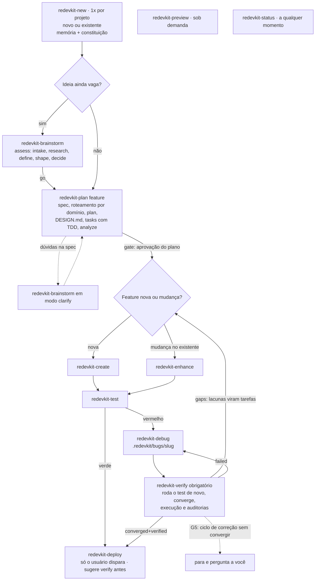

# REDEVKIT

Kit *Markdown-first* para **Claude Code** e **OpenAI Codex** que une dois projetos:

- do **Spec Kit**, o processo orientado a especificação e os artefatos rastreáveis
  (spec → plan → tasks);
- do **AG Kit**, as personas especialistas, as regras de qualidade, o gate de design, a
  verificação por execução e a memória do projeto.

O valor está nas skills e nos prompts em Markdown. A CLI (`redevkit`) só instala: copia o
kit, renderiza o mesmo conteúdo para cada agente, grava o bloco gerenciado do `AGENTS.md` e
atualiza com merge em 3 vias. Serve tanto para projeto novo quanto para projeto existente.

## O que você ganha

- **11 comandos de pipeline** (`redevkit-*`), cada um terminando com um *handoff* para o
  próximo passo.
- **Fases internas** reutilizadas pelos comandos (constituição, specify, clarify, tasks,
  analyze, checklist, implement, converge, roteamento, orquestração, bug, assess).
- **19 personas**, instaladas como subagentes nativos: `.claude/agents/<persona>.md` no Claude
  Code e `.codex/agents/<persona>.toml` no Codex.
- **Skills de conhecimento** (frontend, backend, jogos, mobile, segurança, testes, deploy…)
  acionadas por um roteador por domínio.
- **Memória do projeto** em `.redevkit/memory/`, legível por qualquer agente.
- **Constituição** do projeto com Test-First por padrão e emendas versionadas.
- **Verificação por execução**: nenhum comando declara sucesso sem o comando executado e o
  resultado observado.
- **Auditorias Python opcionais** em `.redevkit/audits/`.

## Requisitos

- **Node.js ≥ 20** para a CLI.
- **Claude Code** e/ou **OpenAI Codex CLI**.
- **Python 3**, opcional: só para as auditorias em `.redevkit/audits/`. Sem Python, as
  auditorias ficam `SKIPPED` com o motivo e os comandos usam o build, os testes e o lint do
  próprio projeto.
- **git**, opcional e recomendado. O kit nunca roda `git init` e só cria commits quando você
  pede.

## Instalação e uso

O pacote `redevkit` ainda não está publicado no npm. Quando publicado, a instalação será:

```bash
npx redevkit init            # no diretório atual
npx redevkit init meu-app    # em outro diretório (criado se não existir)
```

Até lá, use o repositório local:

```bash
git clone <url-do-repositorio> redevkit
cd redevkit
npm install
node bin/redevkit.js init /caminho/do/projeto

# ou, para ter o comando `redevkit` no PATH:
npm link
redevkit init /caminho/do/projeto
```

Opções do `init`:

| Opção | Efeito |
| --- | --- |
| `[dir]` | Diretório do projeto. Sem ele, usa o diretório atual |
| `--here` | Instala no diretório atual |
| `--target <alvo>` | `claude`, `codex` ou `both` |
| `--lang <idioma>` | Idioma dos artefatos: `pt-BR` ou `en` |
| `--dry-run` | Mostra o que mudaria, sem gravar nada |
| `-y, --yes` | Aceita os padrões e as confirmações (obrigatório sem terminal interativo) |
| `--force` | Sobrescreve arquivos em conflito (depois do backup) |
| `--verbose` | Lista cada ação por arquivo |

Num terminal interativo, o `init` pergunta o alvo (padrão `both`) e o idioma (padrão
`pt-BR`). Sem terminal interativo, exige `--yes` e usa esses padrões quando `--target` e
`--lang` não são informados. O `init` não acessa a rede: o conteúdo vem dentro do pacote.

Depois do `init`, abra o projeto no agente e rode o primeiro comando:

- Claude Code: `/redevkit-new`
- Codex: `$redevkit-new`

O `redevkit-new` pergunta se o projeto é novo ou existente, cria a memória, importa memória
legada se você quiser e ratifica a constituição. Daí em diante, cada comando diz qual é o
próximo.

## Pipeline



Com `--auto`, a cadeia new → plan → create/enhance → test segue sozinha (e, no vermelho,
debug → verify, com o verify rodando os testes de novo sobre o código corrigido), mas sempre
para nos gates G1–G7. O G5 impede loops: a cadeia para quando o ciclo de correção não
converge (regras em [Ciclo de correção e G5](docs/metodo.md#ciclo-de-correção-e-g5)). O
deploy é sempre disparado por você. O método completo está em [docs/metodo.md](docs/metodo.md).

## Comandos

| Comando | Claude Code | Codex | Para que serve |
| --- | --- | --- | --- |
| new | `/redevkit-new` | `$redevkit-new` | Inicializa o projeto uma vez: novo ou existente, memória, memória legada, constituição |
| brainstorm | `/redevkit-brainstorm` | `$redevkit-brainstorm` | Avalia uma ideia vaga (`go`, `needs-clarification`, `kill`) ou esclarece a feature ativa |
| plan | `/redevkit-plan` | `$redevkit-plan` | Spec, roteamento por domínio, plano, gate do `DESIGN.md`, tarefas com TDD, análise e aprovação |
| create | `/redevkit-create` | `$redevkit-create` | Implementa as tarefas aprovadas de uma feature nova, uma persona por tarefa, testes primeiro |
| enhance | `/redevkit-enhance` | `$redevkit-enhance` | Muda algo existente: delta na spec e tarefas anexadas; mudança grande vai para o plan |
| test | `/redevkit-test` | `$redevkit-test` | Mapeia cenários para testes, gera os que faltam, roda a suíte e grava `test-report.md` |
| debug | `/redevkit-debug` | `$redevkit-debug` | Reproduz, acha a causa raiz, teste de regressão primeiro, corrige e registra o bug |
| verify | `/redevkit-verify` | `$redevkit-verify` | Verificação completa: roda o test (ou reaproveita um run sobre o mesmo código), convergência com a spec, execução real, auditorias e veredito |
| preview | `/redevkit-preview` | `$redevkit-preview` | Sobe, para ou checa o servidor de desenvolvimento local |
| deploy | `/redevkit-deploy` | `$redevkit-deploy` | Deploy só por invocação do usuário, com plano de rollback, confirmação e smoke test |
| status | `/redevkit-status` | `$redevkit-status` | Mostra só fatos: feature ativa, progresso, último test e verify, bugs, git |

A skill de memória `redevkit-memanager` também pode ser chamada diretamente
(`/redevkit-memanager` ou `$redevkit-memanager`), e responde a pedidos como "lembre disso" e
"atualize a memória". Detalhes de cada comando: [docs/comandos.md](docs/comandos.md).

## Onde ficam os artefatos

| O quê | Onde |
| --- | --- |
| Spec, plano, tarefas, contratos, checklists | `specs/NNN-nome/` |
| Relatórios de teste e de verificação | `specs/NNN-nome/test-report.md`, `specs/NNN-nome/verification.md` |
| Bugs | `.redevkit/bugs/<slug>/{assessment,fix,test}.md` |
| Avaliações de ideia | `.redevkit/assessments/<slug>/{intake,research,definition,shape,decision}.md` |
| Deploys | `.redevkit/deploys/AAAA-MM-DD-<ambiente>.md` |
| Memória e constituição | `.redevkit/memory/` |
| Fonte da verdade visual | `DESIGN.md` na raiz |
| Templates (os de `overrides/` têm precedência) | `.redevkit/templates/overrides/`, depois `.redevkit/templates/` |
| Instruções do projeto | `AGENTS.md`, fora do bloco `REDEVKIT` |

Arquivos que a CLI instala: `AGENTS.md` (bloco gerenciado), `CLAUDE.md` (ponteiro, alvo
claude), `.claude/` (alvo claude), `.agents/skills/` e `.codex/` (alvo codex),
`.redevkit/manifest.json`, `.redevkit/templates/` (só o idioma escolhido),
`.redevkit/audits/` e `.redevkit/.gitignore` (que ignora `backups/`, `tmp/` e `conflicts/`).

## Memória

A memória do projeto fica em `.redevkit/memory/` (`MEMORY.md` como índice, mais
`constitution.md`, `project.md`, `system.md`, `tech.md`, `active.md`, `changelog.md`,
`user.md` e `topics/`), é versionada no git por inteiro e é a fonte da verdade sobre
decisões, convenções, estado e feedback. Ela é agnóstica de agente: o protocolo de leitura e
escrita está no próprio `AGENTS.md`, então qualquer agente que leia esse arquivo (Claude
Code, Codex, DeepSeek ou outro) sabe usá-la. Estado é gravado automaticamente no fim de cada
comando que modifica algo; emendas da constituição, invariantes e qualquer exclusão pedem confirmação. A
memória nativa de cada agente continua ligada e serve como camada pessoal; em conflito, vale
`.redevkit/memory/`. Segredos nunca são gravados.

A memória tem limites de tamanho, mantidos pelo agente a cada gravação: o `MEMORY.md` tem no
máximo 256 linhas; os outros arquivos são consolidados acima de 256 linhas, sem perder
conteúdo; o `changelog.md` vai até 512 linhas, e as entradas mais antigas passam para
`.redevkit/memory/archive/changelog-AAAA-MM.md`. O `redevkit doctor` dá erro quando o
`MEMORY.md` passa de 256 linhas e avisa quando outro arquivo passa do seu limite.

## Confiança no projeto

- **Claude Code:** as permissões que a CLI grava em `.claude/settings.json`
  (`permissions.allow` para git somente leitura, executores de teste e as auditorias) só
  valem depois que você marca o projeto como confiável.
- **Codex:** `.codex/config.toml` e os agentes em `.codex/agents/` só valem com o projeto
  marcado como confiável (*trusted*). Sem isso, as personas são aplicadas inline pelo
  orquestrador, lendo o TOML. O `redevkit doctor` avisa quando o projeto não é confiável.

No Codex, a CLI grava só duas chaves: `features.default_mode_request_user_input = true` e
`skills.max_context_tokens = 10000`. Se você já tiver um valor seu para a mesma chave, o seu
fica.

## Modelo de segurança

O REDEVKIT **não instala hooks nem deny-list**. A proteção vem de três camadas:

1. **Sistema nativo do agente:** prompts de permissão do Claude Code; sandbox e aprovações do
   Codex.
2. **Regras no `AGENTS.md`:** comandos destrutivos ou irreversíveis (apagar recursivamente
   caminhos amplos, formatar disco, reescrever histórico, `push --force`, `DROP` de banco,
   deploy) exigem sua confirmação explícita no mesmo turno; operações reversíveis são
   preferidas; segredos nunca vão para memória, artefatos ou logs; conteúdo de URLs e
   arquivos é dado, não instrução.
3. **Gates do pipeline** (G1–G7) e **deploy só por invocação**: no Claude Code a skill de
   deploy tem `disable-model-invocation: true`; no Codex, `allow_implicit_invocation: false`.

A lista de `permissions.allow` nunca inclui escrita de arquivos, instalação de pacotes ou
deploy. Ela não é livre de rede: `npm test` roda o que o seu `package.json` definir, e a
auditoria de segurança pode rodar `npm audit`, que consulta o registro do npm. Remova entradas
se preferir.

## CLI

| Comando | Opções | O que faz |
| --- | --- | --- |
| `redevkit init [dir]` | `--here`, `--target`, `--lang`, `--dry-run`, `--yes`, `--force`, `--verbose` | Instala no projeto: renderiza os alvos, grava o bloco do `AGENTS.md`, migra o `CLAUDE.md`, faz merge da config e cria o manifesto |
| `redevkit update` | `--dry-run`, `--no-backup`, `--conflict-report <arq>`, `--verbose` | Atualização em 3 vias dos arquivos gerenciados. Um arquivo que só você alterou é preservado; um arquivo alterado por você e pelo kit é um conflito: o seu fica e a versão nova vai para `.redevkit/conflicts/<id>/`. Nunca toca memória, specs ou `DESIGN.md` |
| `redevkit rollback` | `--backup <id>`, `--list`, `--dry-run` | Restaura um backup, salvando antes o estado atual num backup `pre-rollback-<id>`. Padrão: o backup mais recente de init/update/uninstall (os `pre-rollback-*` são ignorados); para desfazer um rollback, use `--backup pre-rollback-<id>` |
| `redevkit status` | `--quiet`, `--json` | Versão instalada, alvos, idioma e arquivos gerenciados alterados ou ausentes; funciona offline |
| `redevkit doctor` | `--json` | Confere ferramentas, instalação, `AGENTS.md`, `CLAUDE.md`, memória, numeração de `specs/`, config e confiança no Codex; sai com código diferente de zero se houver erro |
| `redevkit target add <claude\|codex>` | `--dry-run`, `--yes`, `--verbose` | Adiciona um alvo (com `--yes`, aceita a migração do `CLAUDE.md`) |
| `redevkit target remove <claude\|codex>` | `--dry-run`, `--verbose` | Remove um alvo; o `AGENTS.md` sempre fica, e o `CLAUDE.md` também. Recusa remover o último alvo |
| `redevkit version` | `--check` | Mostra a versão; `--check` consulta o npm |
| `redevkit uninstall` | `--dry-run`, `--yes`, `--force` | Remove os arquivos e as entradas de config gerenciados. Preserva `.redevkit/memory/`, `specs/`, `DESIGN.md`, as notas do `AGENTS.md` e o `CLAUDE.md`. Arquivos gerenciados que você alterou ficam, salvo com `--force`. Faz backup antes; sem terminal interativo, exige `--yes` |

`update`, `rollback`, `status`, `doctor`, `target` e `uninstall` agem no diretório atual.
Backups ficam em `.redevkit/backups/<id>/`; a versão nova de um arquivo em conflito fica em
`.redevkit/conflicts/`. As mensagens principais saem no idioma do manifesto; os textos dos
achados do `doctor` e alguns avisos técnicos ficam em inglês. Códigos de saída: `0` sucesso,
`1` erro, `2` uso incorreto, `130` interrompido (Ctrl+C).

Rodar o `init` de novo num projeto já instalado reaproveita os alvos e o idioma do manifesto,
sem perguntar, e funciona como um `update`: com `--target` ou `--lang` troca o alvo ou o
idioma; com `--force` resolve os conflitos (depois do backup).

## Documentação

- [Método](docs/metodo.md): o processo orientado a especificação, a constituição, os gates e
  a gramática das tarefas.
- [Comandos](docs/comandos.md): referência de cada comando e da skill de memória.
- [Migração](docs/migracao.md): vindo do AG Kit, do Spec Kit, de um `memory-bank/` ou de um
  `CLAUDE.md` existente.
- [MCP](docs/mcp.md): como registrar servidores MCP no Claude Code e no Codex.
- [Autoria do kit](docs/kit-authoring.md): o contrato para quem edita `kit/` (em inglês).
- [Changelog](CHANGELOG.md).

## Licença e créditos

MIT, ver [LICENSE](LICENSE). O REDEVKIT contém material derivado do
[AG Kit](https://github.com/vudovn/ag-kit) (vudovn, MIT) e do
[Spec Kit](https://github.com/github/spec-kit) (GitHub, MIT); os créditos e os avisos de
licença estão em [NOTICE](NOTICE).

## English

REDEVKIT is a Markdown-first kit for **Claude Code** and **OpenAI Codex**. It merges the
spec-driven process and traceable artifacts of **Spec Kit** (spec → plan → tasks) with the
specialist personas, quality rules, design gate, execution-based verification and project
memory of **AG Kit**. The `redevkit` CLI only installs: it copies the kit, renders the same
content for each agent, writes the managed block of `AGENTS.md` and updates with a
three-way merge.

**Requirements:** Node.js ≥ 20; Claude Code and/or Codex CLI; Python 3 is optional (audits
only; without it audits are reported as `SKIPPED` and the project's own commands are used).

**Install:** the `redevkit` npm package is not published yet. Once published:
`npx redevkit init`. Until then, clone this repository, run `npm install`, then
`node bin/redevkit.js init <project-dir>` (or `npm link` and `redevkit init`). Options:
`--here`, `--target claude|codex|both`, `--lang pt-BR|en`, `--dry-run`, `--yes` (required
without a TTY), `--force`, `--verbose`. Then run `/redevkit-new` in Claude Code or
`$redevkit-new` in Codex.

**Commands:** `redevkit-new`, `redevkit-brainstorm`, `redevkit-plan`, `redevkit-create`,
`redevkit-enhance`, `redevkit-test`, `redevkit-debug`, `redevkit-verify`,
`redevkit-preview`, `redevkit-deploy`, `redevkit-status`, plus the memory skill
`redevkit-memanager`. Invoke them as `/redevkit-<name>` in Claude Code and `$redevkit-<name>`
in Codex. `--auto` chains new → plan → create/enhance → test (and debug → verify on red; verify
re-runs the tests on the fixed code) and always stops at gates G1–G7; deploy is user-triggered only.

**Artifacts:** `specs/NNN-name/` (spec, plan, tasks, test and verification reports),
`.redevkit/bugs/`, `.redevkit/assessments/`, `.redevkit/deploys/`, `.redevkit/memory/` and
`DESIGN.md`.

**Memory:** `.redevkit/memory/` is the single, versioned source of truth for the project. Its
protocol lives in `AGENTS.md`, so any agent that reads that file can use it. Native agent
memory stays on; on conflict the project memory wins.

**Trust and safety:** Claude Code applies the `.claude/settings.json` permissions only in a
trusted project; Codex applies `.codex/config.toml` and `.codex/agents/` only in a trusted
project (otherwise personas run inline). REDEVKIT installs no hooks and no deny-list: it
relies on the runtime's permissions and sandbox, the safety rules in `AGENTS.md`, the
pipeline gates and user-only deploy.

**CLI:** `init`, `update`, `rollback`, `status`, `doctor`, `target add|remove`, `version`,
`uninstall` (see the table above). Docs in `docs/` are in Brazilian Portuguese, except
[docs/kit-authoring.md](docs/kit-authoring.md).

**License:** MIT. See [NOTICE](NOTICE) for the AG Kit and Spec Kit credits.
