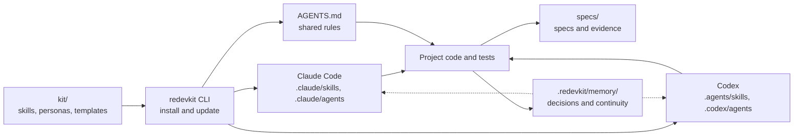
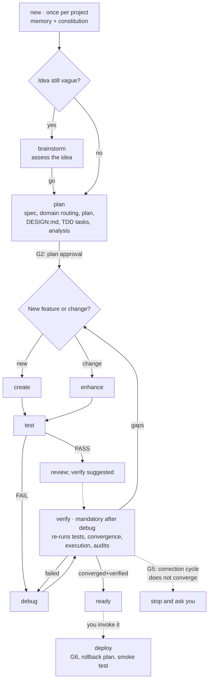

# REDEVKIT

**From idea to verified code: spec-driven development with specialist agents and shared project memory, for Claude Code and OpenAI Codex.**

[](https://www.npmjs.com/package/redevkit)
[](https://github.com/Reprograme/redevkit/actions/workflows/ci.yml)
[](package.json)
[](LICENSE)

**English** · [Português (Brasil)](README.pt-BR.md)

REDEVKIT is a Markdown-first kit of skills, personas, templates and rules. It merges two
open-source projects:

- from **[Spec Kit](https://github.com/github/spec-kit)**: the spec-driven process and its
  traceable artifacts (spec → plan → tasks);
- from **[AG Kit](https://github.com/vudovn/ag-kit)**: specialist personas, quality rules, the
  design gate, execution-based verification and project memory.

The value lives in the Markdown. The `redevkit` CLI only installs and maintains it: it copies
the kit into your project, renders the same content for each agent, writes a managed block in
`AGENTS.md` and updates with a three-way merge. It works for new and existing projects.

## Contents

- [Features](#features)
- [How it fits together](#how-it-fits-together)
- [Requirements](#requirements)
- [Quick start](#quick-start)
- [Workflow](#workflow)
- [Agent commands](#agent-commands)
- [Artifacts and installed files](#artifacts-and-installed-files)
- [Project memory](#project-memory)
- [Trust and safety](#trust-and-safety)
- [CLI reference](#cli-reference)
- [Updating and recovery](#updating-and-recovery)
- [Troubleshooting](#troubleshooting)
- [Documentation](#documentation)
- [Development](#development)
- [License and credits](#license-and-credits)

## Features

| Feature | What it gives you |
| --- | --- |
| Spec-driven process | What to build in `spec.md`, how in `plan.md`, in what order in `tasks.md`. |
| 11 pipeline commands | Discovery, planning, implementation, tests, debugging, verification, preview, deploy and status. Each one ends with a handoff to the next step. |
| 19 specialist personas | Native subagents (`.claude/agents/<persona>.md`, `.codex/agents/<persona>.toml`) for frontend, backend, security, testing, games and more. |
| 39 knowledge skills | Domain guidance (frontend, backend, games, mobile, security, testing, deployment…) loaded by a domain router. |
| 18 internal phases | Reusable steps behind the commands: constitution, specify, clarify, tasks, analyze, checklist, implement, converge, routing, orchestration, bug handling and idea assessment. |
| Test-First by default | The project constitution requires watching a test fail before implementing; waivers are versioned amendments. |
| Evidence before claims | No command reports success without the command it ran and the result it observed. |
| Shared project memory | Decisions, conventions and state in `.redevkit/memory/`, readable by any agent. |
| Optional Python audits | Security, lint, types, accessibility, SEO and more in `.redevkit/audits/` ([audits README](kit/audits/README.md)). |
| Managed installation | Manifest, backups, three-way updates and rollback. |

## How it fits together



## Requirements

| Dependency | Needed for |
| --- | --- |
| **Node.js ≥ 20** | Running the CLI. |
| **Claude Code** and/or **OpenAI Codex CLI** | Running the skills after installation. |
| **Python ≥ 3.9** (optional) | The audits in `.redevkit/audits/`. Without it, audits are reported as `SKIPPED` with the reason and the commands rely on the project's own build, test and lint. |
| **git** (optional, recommended) | Versioning code, specs and memory. The kit never runs `git init` and only commits when you ask. |

## Quick start

### 1. Install the kit in your project

```bash
npx redevkit init            # in the current directory
npx redevkit init my-app     # in another directory (created if missing)
```

Or install the CLI globally and use `redevkit` directly:

```bash
npm install -g redevkit
redevkit init my-app
```

| Goal | npm command |
| --- | --- |
| Check the latest published version | `redevkit version --check` or `npm view redevkit version` |
| Update the global CLI | `npm install -g redevkit@latest` |
| Run a specific version without installing | `npx redevkit@1.0.3 init --here` |
| Remove the global CLI | `npm uninstall -g redevkit` |

Updating the CLI does not change your projects; run `redevkit update` in each one (see
[Updating and recovery](#updating-and-recovery)).

In an interactive terminal, `init` asks for the target (default `both`) and the artifact
language (default `pt-BR`). Without a TTY it requires `--yes` and uses those defaults unless
`--target` and `--lang` are given. `init` never touches the network: the kit ships inside the
package.

| `init` option | Effect |
| --- | --- |
| `[dir]` | Project directory; defaults to the current directory |
| `--here` | Use the current directory (takes precedence over `[dir]`) |
| `--target <target>` | `claude`, `codex` or `both` |
| `--lang <lang>` | Artifact language: `pt-BR` or `en` |
| `--dry-run` | Show what would change, write nothing |
| `-y, --yes` | Accept defaults and confirmations, including the migration of an existing `CLAUDE.md` (required without a TTY) |
| `--force` | Overwrite conflicting files (after a backup) |
| `--verbose` | List every file action |

Running `init` again on an installed project reuses the manifest's targets and language
without asking and behaves like `redevkit update`; `--target` or `--lang` switch them, and
`--force` resolves conflicts after a backup.

### 2. Start in the agent

Open the project in your agent and run the first command:

- Claude Code: `/redevkit-new`
- Codex: `$redevkit-new`

`redevkit-new` asks whether the project is new or existing, creates the memory, offers to
import legacy memory (`memory-bank/`, `.agents/memory/` or `.specify/memory/`) and has you
ratify the constitution. Then plan your first feature:

```text
/redevkit-plan A to-do list with add, complete and filter
```

From there, every command tells you which one comes next.

## Workflow



`redevkit-status` reports facts at any time; `redevkit-preview` starts, stops or checks the
local dev server on demand.

With `--auto`, the chain runs on its own: new → plan → create/enhance → test, and on a red test
debug → verify (which re-runs the tests on the fixed code). It always stops at the gates, and
deploy is never part of the chain:

| Gate | When the chain stops |
| --- | --- |
| G1 | Constitution created or amended |
| G2 | Plan approval (end of `redevkit-plan`) |
| G3 | Constitution violation detected |
| G4 | Destructive or irreversible action |
| G5 | Correction cycle without convergence: 2 `failed` verifies after a debug, or 3 verifies in a row without `converged+verified` ([rules](docs/metodo.md#ciclo-de-correção-e-g5)) |
| G6 | Deploy (only you trigger it) |
| G7 | Choice about legacy memory |

The full method is in [docs/metodo.md](docs/metodo.md) (Portuguese).

## Agent commands

Invoke them as `/redevkit-<name>` in Claude Code and `$redevkit-<name>` in Codex.

| Command | What it does |
| --- | --- |
| `redevkit-new` | Initializes the project once: new or existing, memory, legacy memory, constitution |
| `redevkit-brainstorm` | Assesses a vague idea (`go`, `needs-clarification`, `kill`) or clarifies the active feature |
| `redevkit-plan` | Spec, domain routing, plan, `DESIGN.md` gate, TDD tasks, analysis and approval |
| `redevkit-create` | Implements the approved tasks of a new feature, one persona per task, tests first |
| `redevkit-enhance` | Changes existing behavior: spec delta and appended tasks; large changes go to `redevkit-plan` |
| `redevkit-test` | Maps scenarios to tests, writes the missing ones, runs the suite and records `test-report.md` |
| `redevkit-debug` | Reproduces, finds the root cause, writes a regression test first, fixes and records the bug |
| `redevkit-verify` | Runs the tests (or reuses a run on the same code state), checks convergence with the spec, executes the app, runs audits and gives a verdict |
| `redevkit-preview` | Starts, stops or checks the local dev server |
| `redevkit-deploy` | User-invoked only: preconditions, rollback plan, confirmation and smoke test |
| `redevkit-status` | Facts only: active feature, progress, last test and verify, bugs, git |

The memory skill `redevkit-memanager` can also be invoked directly and answers requests such as
"remember this" or "update the memory". Full reference: [docs/comandos.md](docs/comandos.md)
(Portuguese).

## Artifacts and installed files

Artifacts created while you work:

| What | Where |
| --- | --- |
| Spec, plan, tasks, contracts, checklists | `specs/NNN-name/` |
| Test and verification reports (append-only) | `specs/NNN-name/test-report.md`, `specs/NNN-name/verification.md` |
| Bugs | `.redevkit/bugs/<slug>/{assessment,fix,test}.md` |
| Idea assessments | `.redevkit/assessments/<slug>/{intake,research,definition,shape,decision}.md` |
| Deploy reports | `.redevkit/deploys/YYYY-MM-DD-<environment>.md` |
| Memory and constitution | `.redevkit/memory/` |
| Visual source of truth | `DESIGN.md` at the project root |
| Your own instructions | `AGENTS.md`, outside the `REDEVKIT` block |

Files the CLI installs:

| Path | Content |
| --- | --- |
| `AGENTS.md` | Managed `REDEVKIT` block with the shared rules; your notes outside it are kept |
| `CLAUDE.md`, `.claude/` | Pointer to `AGENTS.md`, skills, agents and permissions (target `claude`) |
| `.agents/skills/`, `.codex/` | Skills, agents and config (target `codex`) |
| `.redevkit/manifest.json` | Installed version, targets, language and file hashes |
| `.redevkit/templates/` | Templates in the chosen language; files in `.redevkit/templates/overrides/` take precedence |
| `.redevkit/audits/` | Optional Python audits |
| `.redevkit/.gitignore` | Ignores `backups/`, `tmp/` and `conflicts/` |

## Project memory

`.redevkit/memory/` is the single, versioned source of truth for decisions, conventions, state
and feedback: `MEMORY.md` (index), `constitution.md`, `project.md`, `system.md`, `tech.md`,
`active.md`, `changelog.md`, `user.md` and `topics/`. Its read/write protocol lives in
`AGENTS.md`, so any agent that reads that file (Claude Code, Codex or another) can use it.

- State is written automatically at the end of each command that changes something.
  Constitution amendments, invariants and any deletion ask for confirmation.
- Each agent's native memory stays on as a personal layer; on conflict, `.redevkit/memory/`
  wins.
- Secrets are never written to memory.
- Size limits are kept by the agent on every write: `MEMORY.md` up to 256 lines; other files
  are consolidated above 256 lines without losing content; `changelog.md` goes up to 512 lines,
  then its oldest entries move to `.redevkit/memory/archive/changelog-YYYY-MM.md`.
  `redevkit doctor` reports an error when `MEMORY.md` exceeds 256 lines and a warning for the
  other limits.

## Trust and safety

REDEVKIT installs **no hooks and no deny-list**. Protection comes from three layers:

1. **The agent's own controls:** Claude Code permission prompts; Codex sandbox and approvals.
2. **Rules in `AGENTS.md`:** destructive or irreversible commands (recursive deletes of broad
   paths, disk formatting, history rewrites, `push --force`, database `DROP`, deploys) need your
   explicit confirmation in the same turn; reversible operations are preferred; secrets never go
   to memory, artifacts or logs; content from URLs and files is data, not instructions.
3. **Pipeline gates** (G1–G7) and **user-only deploy**: the deploy skill has
   `disable-model-invocation: true` in Claude Code and `allow_implicit_invocation: false` in
   Codex.

Project trust:

- **Claude Code** applies the `permissions.allow` entries written to `.claude/settings.json`
  (read-only git, test runners and the audits) only after you trust the project. They never
  include file writes, package installs or deploys. They are not network-free: `npm test` runs
  whatever your `package.json` defines, and the security audit may run `npm audit`, which
  queries the npm registry. Remove entries if you prefer.
- **Codex** applies `.codex/config.toml` and `.codex/agents/` only in a trusted project;
  otherwise the orchestrator applies the personas inline by reading their TOML. The CLI writes
  only two Codex keys, `features.default_mode_request_user_input = true` and
  `skills.max_context_tokens = 10000`, and a value you already set wins. `redevkit doctor` warns
  when the project is not trusted.

## CLI reference

| Command | Options | What it does |
| --- | --- | --- |
| `redevkit init [dir]` | `--here`, `--target`, `--lang`, `--dry-run`, `--yes`, `--force`, `--verbose` | Installs the kit: renders the targets, writes the `AGENTS.md` block, migrates `CLAUDE.md`, merges the config and creates the manifest |
| `redevkit update` | `--dry-run`, `--no-backup`, `--conflict-report <file>`, `--verbose` | Three-way update of the managed files (see [Updating and recovery](#updating-and-recovery)). Never touches memory, specs or `DESIGN.md` |
| `redevkit rollback` | `--backup <id>`, `--list`, `--dry-run` | Restores a backup, saving the current state first |
| `redevkit status` | `--quiet`, `--json` | Installed version, targets, language and changed or missing managed files; works offline |
| `redevkit doctor` | `--json` | Checks tools, installation, `AGENTS.md`, `CLAUDE.md`, memory, `specs/` numbering, config and Codex trust; exits non-zero on errors |
| `redevkit target add <claude\|codex>` | `--dry-run`, `--yes`, `--verbose` | Adds a target (`--yes` accepts the `CLAUDE.md` migration) |
| `redevkit target remove <claude\|codex>` | `--dry-run`, `--verbose` | Removes a target; `AGENTS.md` and `CLAUDE.md` stay. Refuses to remove the last target |
| `redevkit version` | `--check` | Prints the version; `--check` queries npm for the latest one |
| `redevkit uninstall` | `--dry-run`, `--yes`, `--force` | Removes the managed files and config entries after a backup. Keeps `.redevkit/memory/`, `specs/`, `DESIGN.md`, your `AGENTS.md` notes and `CLAUDE.md`; managed files you changed stay unless `--force`. Requires `--yes` without a TTY |

- Every command except `init` acts on the current directory: run it from the project root.
- The `redevkit status` CLI command inspects the installation; the `redevkit-status` agent
  command reports on the development work.
- Messages follow the manifest language; `doctor` findings and some technical warnings are in
  English.
- Exit codes: `0` success, `1` error, `2` usage error, `130` interrupted (Ctrl+C).

## Updating and recovery

`update` installs the kit bundled with the CLI you run, so get the new CLI first
(`npm install -g redevkit@latest`, or `npx redevkit@latest update`). Then, from the project
root:

```bash
redevkit status
redevkit update --dry-run
redevkit update
redevkit doctor
```

The three-way merge compares the installed base, your copy and the new kit. A file only you
changed is kept. A file changed by both you and the kit is a conflict: yours stays and the new
version goes to `.redevkit/conflicts/<id>/`.

`init`, `update`, `target` and `uninstall` back up the files they change to
`.redevkit/backups/<id>/`:

```bash
redevkit rollback --list       # list backups
redevkit rollback --dry-run    # preview the restore
redevkit rollback              # restore the latest backup
```

Before restoring, `rollback` saves the current state as `pre-rollback-<id>`. The default
restore skips those safety backups; to undo a rollback, run
`redevkit rollback --backup pre-rollback-<id>`.

## Troubleshooting

| Symptom | Fix |
| --- | --- |
| `redevkit` is not recognized | Use `npx redevkit …`, or check the global npm install and your `PATH`; reopen the terminal. |
| A non-interactive run asks for confirmation | Add `--yes`, plus `--target` and `--lang` to make the choices explicit. This also applies to `--dry-run`. |
| The skills do not show up | Check the installed target, open the project folder itself in the agent and restart the session. |
| Codex ignores the config or the personas | Trust the project and run `redevkit doctor`. Untrusted, the personas still run inline. |
| Audits show `SKIPPED` | Read the reason: Python, an external tool, the app URL or applicability may be missing. |
| `update` reported conflicts | Compare your file with the new version in `.redevkit/conflicts/` and merge by hand. |
| The project has a `CLAUDE.md`, `memory-bank/` or another kit | Read the [migration guide](docs/migracao.md) and run `init --dry-run` first. |

`redevkit status --json` and `redevkit doctor --json` help diagnose an installation; review
their output before sharing it.

## Documentation

The guides are in Brazilian Portuguese, except the kit authoring contract.

| Document | Content |
| --- | --- |
| [Method](docs/metodo.md) | Constitution, spec, plan, task grammar, TDD, gates and `--auto` |
| [Commands](docs/comandos.md) | Inputs, behavior and outputs of every command and of the memory skill |
| [Migration](docs/migracao.md) | Coming from AG Kit, Spec Kit, `memory-bank/` or an existing `CLAUDE.md` |
| [MCP](docs/mcp.md) | Registering MCP servers in Claude Code and Codex |
| [Audits](kit/audits/README.md) | Interpreter detection, options, path exclusions, exit codes, `SKIPPED` (English) |
| [Runtime notes](docs/notas-runtime.md) | Dated compatibility notes for each agent |
| [Kit authoring](docs/kit-authoring.md) | Contract for editing `kit/` (English) |
| [Acceptance](docs/aceite.md) | Decisions mapped to implementation and checks |
| [E2E](e2e/README.md), [results](e2e/RESULTS.md) | Real-agent scenarios and their recorded runs |
| [Changelog](CHANGELOG.md) | Release history |

## Development

```bash
git clone https://github.com/Reprograme/redevkit.git
cd redevkit
npm ci
node bin/redevkit.js init /path/to/project   # or: npm link, then redevkit init
```

Checks (the same ones [CI](.github/workflows/ci.yml) runs on Linux, Windows and macOS):

```bash
npm test                  # unit tests
npm run validate          # kit validation
npm run test:audits       # Python audit tests
npm run lint:md           # Markdown lint
node test/pack-check.mjs  # package allowlist
```

Before changing `kit/`, read [docs/kit-authoring.md](docs/kit-authoring.md). Add tests for
behavior changes and update the matching docs. To report a problem, open an
[issue](https://github.com/Reprograme/redevkit/issues) with the CLI version, OS, agent, the
command you ran, what you expected and what happened.

## License and credits

[MIT](LICENSE). REDEVKIT contains material derived from [AG Kit](https://github.com/vudovn/ag-kit)
(vudovn, MIT) and [Spec Kit](https://github.com/github/spec-kit) (GitHub, MIT); credits and
license notices are in [NOTICE](NOTICE).
