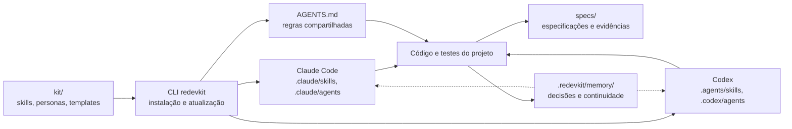
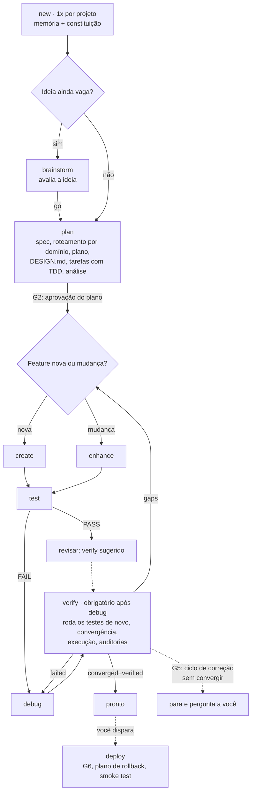

# REDEVKIT

**Da ideia ao código verificado: desenvolvimento orientado a especificação, com agentes especialistas e memória de projeto compartilhada, para Claude Code e OpenAI Codex.**

[](https://www.npmjs.com/package/redevkit)
[](https://github.com/Reprograme/redevkit/actions/workflows/ci.yml)
[](package.json)
[](LICENSE)

[English](README.md) · **Português (Brasil)**

O REDEVKIT é um kit *Markdown-first* de skills, personas, templates e regras. Ele une dois
projetos de código aberto:

- do **[Spec Kit](https://github.com/github/spec-kit)**: o processo orientado a especificação e
  os artefatos rastreáveis (spec → plan → tasks);
- do **[AG Kit](https://github.com/vudovn/ag-kit)**: as personas especialistas, as regras de
  qualidade, o gate de design, a verificação por execução e a memória do projeto.

O valor está no Markdown. A CLI `redevkit` só instala e mantém o kit: copia o kit para o seu
projeto, renderiza o mesmo conteúdo para cada agente, grava um bloco gerenciado no `AGENTS.md`
e atualiza com merge em 3 vias. Serve para projeto novo e para projeto existente.

## Sumário

- [Recursos](#recursos)
- [Como as peças se conectam](#como-as-peças-se-conectam)
- [Requisitos](#requisitos)
- [Início rápido](#início-rápido)
- [Fluxo de trabalho](#fluxo-de-trabalho)
- [Comandos no agente](#comandos-no-agente)
- [Artefatos e arquivos instalados](#artefatos-e-arquivos-instalados)
- [Memória do projeto](#memória-do-projeto)
- [Confiança e segurança](#confiança-e-segurança)
- [Referência da CLI](#referência-da-cli)
- [Atualização e recuperação](#atualização-e-recuperação)
- [Solução de problemas](#solução-de-problemas)
- [Documentação](#documentação)
- [Desenvolvimento](#desenvolvimento)
- [Licença e créditos](#licença-e-créditos)

## Recursos

| Recurso | O que oferece |
| --- | --- |
| Processo orientado a especificação | O que construir em `spec.md`, como em `plan.md` e em que ordem em `tasks.md`. |
| 11 comandos de pipeline | Descoberta, planejamento, implementação, testes, depuração, verificação, preview, deploy e status. Cada um termina com um *handoff* para o próximo passo. |
| 19 personas especialistas | Subagentes nativos (`.claude/agents/<persona>.md`, `.codex/agents/<persona>.toml`) para frontend, backend, segurança, testes, jogos e outros. |
| 39 skills de conhecimento | Orientação por domínio (frontend, backend, jogos, mobile, segurança, testes, deploy…) carregada por um roteador. |
| 18 fases internas | Etapas reutilizadas pelos comandos: constituição, specify, clarify, tasks, analyze, checklist, implement, converge, roteamento, orquestração, bugs e avaliação de ideias. |
| Test-First por padrão | A constituição do projeto exige ver o teste falhar antes de implementar; dispensas são emendas versionadas. |
| Evidência antes do resultado | Nenhum comando declara sucesso sem o comando executado e o resultado observado. |
| Memória de projeto compartilhada | Decisões, convenções e estado em `.redevkit/memory/`, legíveis por qualquer agente. |
| Auditorias Python opcionais | Segurança, lint, tipos, acessibilidade, SEO e outras em `.redevkit/audits/` ([README das auditorias](kit/audits/README.md), em inglês). |
| Instalação gerenciada | Manifesto, backups, atualização em 3 vias e rollback. |

## Como as peças se conectam



## Requisitos

| Dependência | Para quê |
| --- | --- |
| **Node.js ≥ 20** | Executar a CLI. |
| **Claude Code** e/ou **OpenAI Codex CLI** | Executar as skills depois da instalação. |
| **Python ≥ 3.9** (opcional) | As auditorias em `.redevkit/audits/`. Sem ele, as auditorias ficam `SKIPPED` com o motivo e os comandos usam o build, os testes e o lint do próprio projeto. |
| **git** (opcional, recomendado) | Versionar código, specs e memória. O kit nunca roda `git init` e só faz commit quando você pede. |

## Início rápido

### 1. Instale o kit no projeto

```bash
npx redevkit init            # no diretório atual
npx redevkit init meu-app    # em outro diretório (criado se não existir)
```

Ou instale a CLI globalmente e use `redevkit` direto:

```bash
npm install -g redevkit
redevkit init meu-app
```

Num terminal interativo, o `init` pergunta o alvo (padrão `both`) e o idioma dos artefatos
(padrão `pt-BR`). Sem terminal interativo, exige `--yes` e usa esses padrões, a menos que
`--target` e `--lang` sejam informados. O `init` não acessa a rede: o kit vem dentro do pacote.

| Opção do `init` | Efeito |
| --- | --- |
| `[dir]` | Diretório do projeto; sem ele, usa o diretório atual |
| `--here` | Usa o diretório atual (tem precedência sobre `[dir]`) |
| `--target <alvo>` | `claude`, `codex` ou `both` |
| `--lang <idioma>` | Idioma dos artefatos: `pt-BR` ou `en` |
| `--dry-run` | Mostra o que mudaria, sem gravar nada |
| `-y, --yes` | Aceita padrões e confirmações, inclusive a migração de um `CLAUDE.md` existente (obrigatório sem terminal interativo) |
| `--force` | Sobrescreve arquivos em conflito (depois do backup) |
| `--verbose` | Lista cada ação por arquivo |

Rodar o `init` de novo num projeto já instalado reaproveita os alvos e o idioma do manifesto,
sem perguntar, e funciona como um `redevkit update`; `--target` ou `--lang` trocam esses
valores, e `--force` resolve os conflitos depois do backup.

### 2. Comece no agente

Abra o projeto no agente e rode o primeiro comando:

- Claude Code: `/redevkit-new`
- Codex: `$redevkit-new`

O `redevkit-new` pergunta se o projeto é novo ou existente, cria a memória, oferece importar
memória legada (`memory-bank/`, `.agents/memory/` ou `.specify/memory/`) e pede que você
ratifique a constituição. Depois, planeje a primeira feature:

```text
/redevkit-plan Uma lista de tarefas com inclusão, conclusão e filtros
```

Daí em diante, cada comando diz qual é o próximo.

## Fluxo de trabalho



O `redevkit-status` mostra os fatos a qualquer momento; o `redevkit-preview` sobe, para ou
checa o servidor de desenvolvimento local sob demanda.

Com `--auto`, a cadeia segue sozinha: new → plan → create/enhance → test e, no teste vermelho,
debug → verify (que roda os testes de novo sobre o código corrigido). Ela sempre para nos
gates, e o deploy nunca faz parte da cadeia:

| Gate | Quando a cadeia para |
| --- | --- |
| G1 | Criação ou emenda da constituição |
| G2 | Aprovação do plano (fim do `redevkit-plan`) |
| G3 | Violação da constituição detectada |
| G4 | Ação destrutiva ou irreversível |
| G5 | Ciclo de correção sem convergir: 2 verify `failed` depois de um debug, ou 3 verify seguidos sem `converged+verified` ([regras](docs/metodo.md#ciclo-de-correção-e-g5)) |
| G6 | Deploy (só você dispara) |
| G7 | Escolha sobre memória legada |

O método completo está em [docs/metodo.md](docs/metodo.md).

## Comandos no agente

Chame como `/redevkit-<nome>` no Claude Code e `$redevkit-<nome>` no Codex.

| Comando | Para que serve |
| --- | --- |
| `redevkit-new` | Inicializa o projeto uma vez: novo ou existente, memória, memória legada, constituição |
| `redevkit-brainstorm` | Avalia uma ideia vaga (`go`, `needs-clarification`, `kill`) ou esclarece a feature ativa |
| `redevkit-plan` | Spec, roteamento por domínio, plano, gate do `DESIGN.md`, tarefas com TDD, análise e aprovação |
| `redevkit-create` | Implementa as tarefas aprovadas de uma feature nova, uma persona por tarefa, testes primeiro |
| `redevkit-enhance` | Muda algo existente: delta na spec e tarefas anexadas; mudança grande vai para o `redevkit-plan` |
| `redevkit-test` | Mapeia cenários para testes, gera os que faltam, roda a suíte e grava o `test-report.md` |
| `redevkit-debug` | Reproduz, acha a causa raiz, escreve o teste de regressão primeiro, corrige e registra o bug |
| `redevkit-verify` | Roda os testes (ou reaproveita um run sobre o mesmo estado do código), confere a convergência com a spec, executa a aplicação, roda as auditorias e dá o veredito |
| `redevkit-preview` | Sobe, para ou checa o servidor de desenvolvimento local |
| `redevkit-deploy` | Só por invocação sua: pré-condições, plano de rollback, confirmação e smoke test |
| `redevkit-status` | Só fatos: feature ativa, progresso, último test e verify, bugs, git |

A skill de memória `redevkit-memanager` também pode ser chamada diretamente e responde a pedidos
como "lembre disso" e "atualize a memória". Referência completa: [docs/comandos.md](docs/comandos.md).

## Artefatos e arquivos instalados

Artefatos criados durante o trabalho:

| O quê | Onde |
| --- | --- |
| Spec, plano, tarefas, contratos, checklists | `specs/NNN-nome/` |
| Relatórios de teste e de verificação (só acréscimo) | `specs/NNN-nome/test-report.md`, `specs/NNN-nome/verification.md` |
| Bugs | `.redevkit/bugs/<slug>/{assessment,fix,test}.md` |
| Avaliações de ideia | `.redevkit/assessments/<slug>/{intake,research,definition,shape,decision}.md` |
| Relatórios de deploy | `.redevkit/deploys/AAAA-MM-DD-<ambiente>.md` |
| Memória e constituição | `.redevkit/memory/` |
| Fonte da verdade visual | `DESIGN.md` na raiz do projeto |
| Suas próprias instruções | `AGENTS.md`, fora do bloco `REDEVKIT` |

Arquivos que a CLI instala:

| Caminho | Conteúdo |
| --- | --- |
| `AGENTS.md` | Bloco gerenciado `REDEVKIT` com as regras compartilhadas; suas notas fora dele são preservadas |
| `CLAUDE.md`, `.claude/` | Ponteiro para o `AGENTS.md`, skills, agentes e permissões (alvo `claude`) |
| `.agents/skills/`, `.codex/` | Skills, agentes e config (alvo `codex`) |
| `.redevkit/manifest.json` | Versão instalada, alvos, idioma e hashes dos arquivos |
| `.redevkit/templates/` | Templates no idioma escolhido; os de `.redevkit/templates/overrides/` têm precedência |
| `.redevkit/audits/` | Auditorias Python opcionais |
| `.redevkit/.gitignore` | Ignora `backups/`, `tmp/` e `conflicts/` |

## Memória do projeto

`.redevkit/memory/` é a fonte da verdade única e versionada sobre decisões, convenções, estado
e feedback: `MEMORY.md` (índice), `constitution.md`, `project.md`, `system.md`, `tech.md`,
`active.md`, `changelog.md`, `user.md` e `topics/`. O protocolo de leitura e escrita está no
`AGENTS.md`, então qualquer agente que leia esse arquivo (Claude Code, Codex ou outro) sabe
usá-la.

- O estado é gravado automaticamente no fim de cada comando que modifica algo. Emendas da
  constituição, invariantes e qualquer exclusão pedem confirmação.
- A memória nativa de cada agente continua ligada como camada pessoal; em conflito, vale
  `.redevkit/memory/`.
- Segredos nunca são gravados na memória.
- Os limites de tamanho são mantidos pelo agente a cada gravação: `MEMORY.md` com até 256
  linhas; os outros arquivos são consolidados acima de 256 linhas, sem perder conteúdo; o
  `changelog.md` vai até 512 linhas e, depois disso, as entradas mais antigas passam para
  `.redevkit/memory/archive/changelog-AAAA-MM.md`. O `redevkit doctor` dá erro quando o
  `MEMORY.md` passa de 256 linhas e avisa nos outros limites.

## Confiança e segurança

O REDEVKIT **não instala hooks nem deny-list**. A proteção vem de três camadas:

1. **Os controles do próprio agente:** prompts de permissão do Claude Code; sandbox e
   aprovações do Codex.
2. **Regras no `AGENTS.md`:** comandos destrutivos ou irreversíveis (apagar recursivamente
   caminhos amplos, formatar disco, reescrever histórico, `push --force`, `DROP` de banco,
   deploy) exigem sua confirmação explícita no mesmo turno; operações reversíveis são
   preferidas; segredos nunca vão para memória, artefatos ou logs; conteúdo de URLs e arquivos
   é dado, não instrução.
3. **Gates do pipeline** (G1–G7) e **deploy só por invocação sua**: a skill de deploy tem
   `disable-model-invocation: true` no Claude Code e `allow_implicit_invocation: false` no
   Codex.

Confiança no projeto:

- **Claude Code** aplica as entradas de `permissions.allow` gravadas em `.claude/settings.json`
  (git somente leitura, executores de teste e as auditorias) só depois que você marca o projeto
  como confiável. Elas nunca incluem escrita de arquivos, instalação de pacotes ou deploy. Não
  são livres de rede: `npm test` roda o que o seu `package.json` definir, e a auditoria de
  segurança pode rodar `npm audit`, que consulta o registro do npm. Remova entradas se preferir.
- **Codex** aplica `.codex/config.toml` e `.codex/agents/` só com o projeto marcado como
  confiável (*trusted*); sem isso, o orquestrador aplica as personas inline, lendo o TOML. A CLI
  grava só duas chaves do Codex, `features.default_mode_request_user_input = true` e
  `skills.max_context_tokens = 10000`, e um valor que você já tenha definido prevalece. O
  `redevkit doctor` avisa quando o projeto não é confiável.

## Referência da CLI

| Comando | Opções | O que faz |
| --- | --- | --- |
| `redevkit init [dir]` | `--here`, `--target`, `--lang`, `--dry-run`, `--yes`, `--force`, `--verbose` | Instala o kit: renderiza os alvos, grava o bloco do `AGENTS.md`, migra o `CLAUDE.md`, faz merge da config e cria o manifesto |
| `redevkit update` | `--dry-run`, `--no-backup`, `--conflict-report <arq>`, `--verbose` | Atualização em 3 vias dos arquivos gerenciados (ver [Atualização e recuperação](#atualização-e-recuperação)). Nunca toca memória, specs ou `DESIGN.md` |
| `redevkit rollback` | `--backup <id>`, `--list`, `--dry-run` | Restaura um backup, salvando antes o estado atual |
| `redevkit status` | `--quiet`, `--json` | Versão instalada, alvos, idioma e arquivos gerenciados alterados ou ausentes; funciona offline |
| `redevkit doctor` | `--json` | Confere ferramentas, instalação, `AGENTS.md`, `CLAUDE.md`, memória, numeração de `specs/`, config e confiança no Codex; sai com código diferente de zero se houver erro |
| `redevkit target add <claude\|codex>` | `--dry-run`, `--yes`, `--verbose` | Adiciona um alvo (com `--yes`, aceita a migração do `CLAUDE.md`) |
| `redevkit target remove <claude\|codex>` | `--dry-run`, `--verbose` | Remove um alvo; `AGENTS.md` e `CLAUDE.md` ficam. Recusa remover o último alvo |
| `redevkit version` | `--check` | Mostra a versão; `--check` consulta a mais recente no npm |
| `redevkit uninstall` | `--dry-run`, `--yes`, `--force` | Remove os arquivos e as entradas de config gerenciados, depois do backup. Preserva `.redevkit/memory/`, `specs/`, `DESIGN.md`, suas notas do `AGENTS.md` e o `CLAUDE.md`; arquivos gerenciados que você alterou ficam, salvo com `--force`. Sem terminal interativo, exige `--yes` |

- Todos os comandos, exceto o `init`, agem no diretório atual: rode-os na raiz do projeto.
- O comando de terminal `redevkit status` inspeciona a instalação; o comando de agente
  `redevkit-status` acompanha o desenvolvimento.
- As mensagens seguem o idioma do manifesto; os achados do `doctor` e alguns avisos técnicos
  ficam em inglês.
- Códigos de saída: `0` sucesso, `1` erro, `2` uso incorreto, `130` interrompido (Ctrl+C).

## Atualização e recuperação

O `update` instala o kit que vem com a CLI que você executa; então, primeiro obtenha a CLI nova
(`npm install -g redevkit@latest` ou `npx redevkit@latest update`). Depois, na raiz do
projeto:

```bash
redevkit status
redevkit update --dry-run
redevkit update
redevkit doctor
```

O merge em 3 vias compara a base instalada, a sua cópia e o kit novo. Um arquivo que só você
alterou é preservado. Um arquivo alterado por você e pelo kit é um conflito: o seu fica e a
versão nova vai para `.redevkit/conflicts/<id>/`.

`init`, `update`, `target` e `uninstall` fazem backup dos arquivos que vão mudar em
`.redevkit/backups/<id>/`:

```bash
redevkit rollback --list       # lista os backups
redevkit rollback --dry-run    # mostra o que seria restaurado
redevkit rollback              # restaura o backup mais recente
```

Antes de restaurar, o `rollback` salva o estado atual como `pre-rollback-<id>`. A restauração
padrão ignora esses backups de segurança; para desfazer um rollback, rode
`redevkit rollback --backup pre-rollback-<id>`.

## Solução de problemas

| Sintoma | Como resolver |
| --- | --- |
| `redevkit` não é reconhecido | Use `npx redevkit …`, ou confira a instalação global do npm e o `PATH`; reabra o terminal. |
| A execução sem terminal interativo pede confirmação | Acrescente `--yes`, e também `--target` e `--lang` para deixar as escolhas explícitas. Vale inclusive com `--dry-run`. |
| As skills não aparecem | Confira o alvo instalado, abra no agente a própria pasta do projeto e reinicie a sessão. |
| O Codex ignora a config ou as personas | Marque o projeto como confiável e rode `redevkit doctor`. Sem confiança, as personas ainda rodam inline. |
| Auditorias aparecem como `SKIPPED` | Leia o motivo: pode faltar Python, uma ferramenta externa, a URL da aplicação ou o projeto não ter o que auditar. |
| O `update` reportou conflitos | Compare o seu arquivo com a versão nova em `.redevkit/conflicts/` e faça o merge à mão. |
| O projeto tem `CLAUDE.md`, `memory-bank/` ou outro kit | Leia o [guia de migração](docs/migracao.md) e rode `init --dry-run` antes. |

`redevkit status --json` e `redevkit doctor --json` ajudam a diagnosticar a instalação; revise
a saída antes de compartilhá-la.

## Documentação

| Documento | Conteúdo |
| --- | --- |
| [Método](docs/metodo.md) | Constituição, spec, plano, gramática das tarefas, TDD, gates e `--auto` |
| [Comandos](docs/comandos.md) | Entradas, comportamento e saídas de cada comando e da skill de memória |
| [Migração](docs/migracao.md) | Vindo do AG Kit, do Spec Kit, de um `memory-bank/` ou de um `CLAUDE.md` existente |
| [MCP](docs/mcp.md) | Como registrar servidores MCP no Claude Code e no Codex |
| [Auditorias](kit/audits/README.md) | Detecção do intérprete, opções, exclusão de caminhos, códigos de saída, `SKIPPED` (em inglês) |
| [Notas de runtime](docs/notas-runtime.md) | Notas datadas de compatibilidade de cada agente |
| [Autoria do kit](docs/kit-authoring.md) | Contrato para quem edita `kit/` (em inglês) |
| [Aceite](docs/aceite.md) | Decisões mapeadas para a implementação e as verificações |
| [E2E](e2e/README.md), [resultados](e2e/RESULTS.md) | Cenários com agentes reais e as execuções registradas |
| [Changelog](CHANGELOG.md) | Histórico de versões (em inglês) |

## Desenvolvimento

```bash
git clone https://github.com/Reprograme/redevkit.git
cd redevkit
npm ci
node bin/redevkit.js init /caminho/do/projeto   # ou: npm link e depois redevkit init
```

Checks (os mesmos que a [CI](.github/workflows/ci.yml) roda no Linux, Windows e macOS):

```bash
npm test                  # testes unitários
npm run validate          # validação do kit
npm run test:audits       # testes das auditorias Python
npm run lint:md           # lint do Markdown
node test/pack-check.mjs  # allowlist do pacote
```

Antes de mudar `kit/`, leia [docs/kit-authoring.md](docs/kit-authoring.md). Acrescente testes
para mudanças de comportamento e atualize a documentação correspondente. Para relatar um
problema, abra uma [issue](https://github.com/Reprograme/redevkit/issues) com a versão da CLI,
o sistema operacional, o agente, o comando executado, o que você esperava e o que aconteceu.

## Licença e créditos

[MIT](LICENSE). O REDEVKIT contém material derivado do [AG Kit](https://github.com/vudovn/ag-kit)
(vudovn, MIT) e do [Spec Kit](https://github.com/github/spec-kit) (GitHub, MIT); os créditos e
os avisos de licença estão em [NOTICE](NOTICE).
