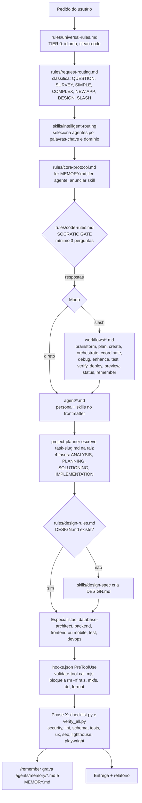
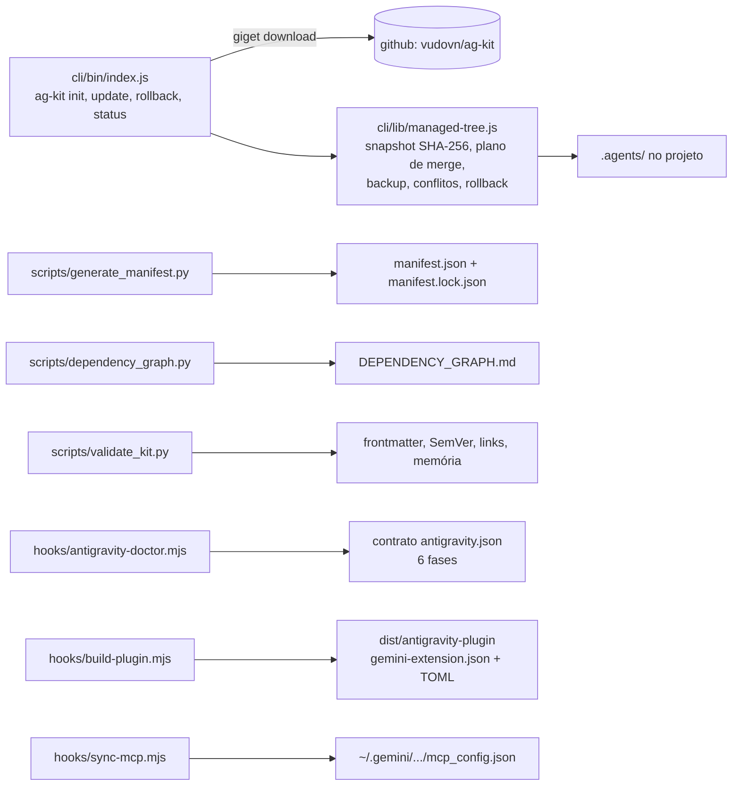
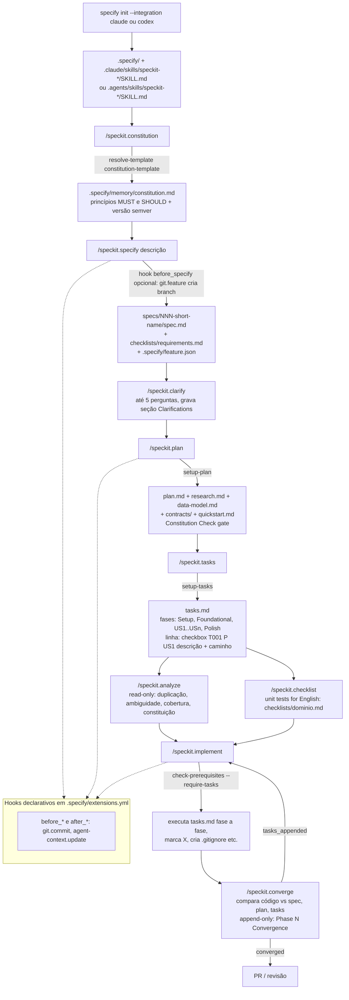
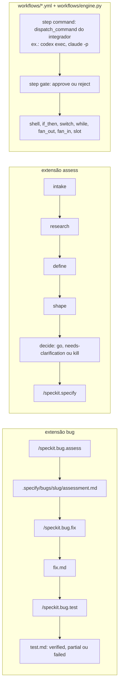
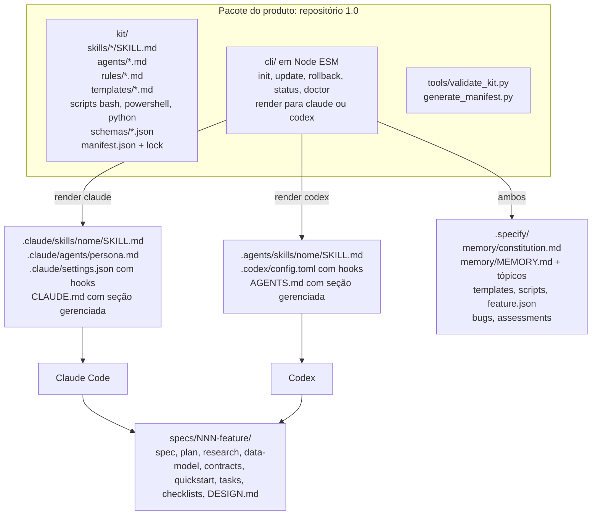
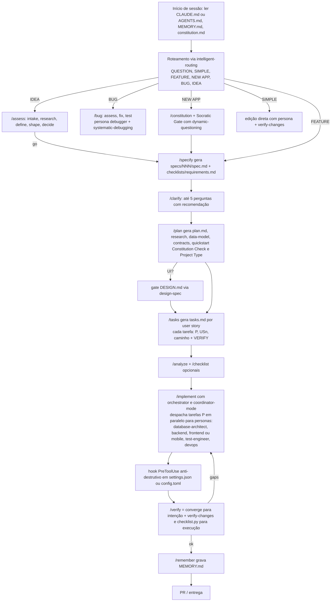

# RELATÓRIO — Amálgama de AG Kit + Spec Kit em um único produto (v1.0) para Claude Code e Codex

> Workspace analisado: `D:\Ricardo Candido\Temp\REDEVKIT`
> Repositórios: `ag-kit-main` (AG Kit 2026.8.31) e `spec-kit-main` (GitHub Spec Kit 1.3.1.dev0)
> Data da análise: 2026-11-06
> Premissas dadas pelo solicitante: o novo produto nasce em **1.0**, **não** mantém compatibilidade nem acompanha atualizações futuras de AG Kit ou Spec Kit, e tem como alvos **apenas Claude Code e OpenAI Codex**.

---

## 0. Sumário executivo

**O que cada repositório é, em uma frase**

- **AG Kit** é um *kit de comportamento*: ~31 mil linhas de Markdown (20 agentes-persona, 48 skills, 13 workflows de slash-command, 6 regras, memória persistente) mais uma camada fina de runtime para o Google Antigravity (hook de segurança, doctor, sync de MCP, builder de plugin) e uma CLI npm de instalação/atualização com merge e rollback. O "produto" é o diretório `.agents/`. Ele responde à pergunta **"QUEM faz e COMO se comporta"**.
- **Spec Kit** é um *kit de processo*: uma metodologia (Spec-Driven Development) materializada em 9 comandos-prompt (`constitution → specify → clarify → plan → tasks → analyze/checklist → implement → converge`), scripts auxiliares em três linguagens (bash/pwsh/python), e uma CLI Python de ~79 mil linhas que instala tudo isso em ~60 agentes de codificação e ainda gerencia extensões, presets, bundles, catálogos, um motor de workflows e um servidor MCP. Ele responde à pergunta **"O QUE construir, em QUE ORDEM, com QUAIS artefatos rastreáveis"**.

**Veredito de sobreposição**: a interseção real é pequena (planejamento, checklists, hooks de ciclo de vida, arquivo de contexto do agente, memória vs. constituição). A complementaridade é grande: o Spec Kit fornece a *espinha dorsal de artefatos* (`specs/NNN-feature/{spec,plan,tasks}.md`, constituição, convergência), e o AG Kit fornece os *especialistas, as regras de qualidade, a gate de design (`DESIGN.md`), a verificação por execução e a memória* que o Spec Kit deliberadamente não tem.

**Recomendação central**: construir o produto 1.0 como um **pacote Markdown-first** (skills + agentes + regras + templates) instalado por **uma CLI mínima** (Node, reaproveitando `cli/lib/managed-tree.js` do AG Kit), gerando **apenas dois layouts**: `.claude/skills/*/SKILL.md` + `CLAUDE.md` (Claude Code) e `.agents/skills/*/SKILL.md` + `AGENTS.md` (Codex). Descartar: toda a camada Antigravity/Gemini do AG Kit, o site Next.js, e do Spec Kit os ~60 integradores, catálogos remotos, bundles, autenticação, motor de workflows, servidor MCP e auto-upgrade. Detalhes na Seção 5.

**Erros encontrados**: a Seção 6 consolida 130+ achados (sintáticos, lógicos, semânticos, de execução e de documentação) com arquivo e linha, obtidos por leitura e por execução real (testes, validadores, `specify init`). Nenhum dos dois repositórios tem erro de sintaxe. Os achados de maior impacto:

- **AG Kit — hook de segurança inoperante** (`.agents/hooks/validate-tool-call.mjs:109` e os outros três `.mjs`): o guard `import.meta.url === file://argv[1]` nunca casa no Windows nem em caminhos com espaço; `rm -rf /` passa com exit 0 e o doctor "passa" sem executar nada. As regexes também são contornáveis (`rm -rf ~`, `rm -r -f /`, `del /s /q C:\*`...).
- **AG Kit — árvore modificada localmente**: a skill `memory-manager` (Reprograme v3.5, em português) não está registrada e quebra `check:agents`, os testes e o CI; é também um segundo sistema de memória incompatível com `memory-system`.
- **AG Kit — scripts quebrados por plataforma**: `auto_preview.py` não sobe em POSIX (`Popen(lista, shell=True)`); `test_runner.py` e `security_scan.py` não encontram `npm` no Windows; regra de SQL em `security_scan.py` é código morto; `i18n_checker.py` ignora o layout plano.
- **AG Kit — 15 contradições normativas** entre regras, agentes e workflows (perguntas obrigatórias vs. opcionais, mínimo de 3 agentes vs. "menor conjunto", plano obrigatório vs. "não travar", paralelo vs. sequencial no mesmo arquivo) e documentação com três versões e scripts inexistentes.
- **Spec Kit — templates não reutilizáveis sem a CLI**: nove comandos citam `/memory/constitution.md`; o caminho só fica certo porque `CommandRegistrar.rewrite_project_relative_paths` o reescreve na instalação. O motor de nomes `create-new-feature.*` está instalado e **nunca é chamado** pelos comandos centrais.
- **Spec Kit — paridade bash/PowerShell/Python quebra no Windows real**: `common.sh` só sonda `python3` (stub da Store) e cai num fallback que não faz unescape de JSON; `common.ps1` não sonda a execução do `python3` e falha na composição de presets; PowerShell grava `specs\001-x` enquanto os outros gravam `specs/001-x`.
- **Spec Kit — doutrina vs. implementação**: `spec-driven.md` descreve "Nove Artigos", "Phase -1 gates" e branch automático que não existem nos templates; `design/mcp.md` promete inventário MCP para toda folha da CLI (existe para 4 de ~60) e proíbe um facade genérico que o servidor implementa invocando a CLI como subprocesso.
- **Spec Kit — infraestrutura desproporcional**: dos 79 mil linhas, ≈9–11 mil são necessárias para Claude+Codex; o resto é ecossistema remoto (catálogos, trust store, journaling, 41 integradores, motor de workflows com interpolação `shell=True`, MCP).

---

## 1. Escopo e método

| Item | Detalhe |
| --- | --- |
| Leitura | Todos os documentos de arquitetura, regras, workflows, agentes principais, skills de orquestração/memória/planejamento, templates de comando e de artefato, manifestos de extensão/preset/workflow/bundle, módulos de integração Claude/Codex, scripts bash/python centrais, CLI do AG Kit. |
| Execução | Compilação Python (`compileall`), testes unitários do AG Kit (`unittest`, `node --test`), doctor e hook do AG Kit, testes de CLI, compilação e subconjunto de testes do Spec Kit, `specify init` real para Claude e Codex, scripts auxiliares do Spec Kit em projeto de teste. Resultados na Seção 6 e Apêndice B. |
| Fora de escopo | Site `web/` do AG Kit (apenas inspeção de configuração), documentação `docs/` do Spec Kit (amostragem), testes completos do Spec Kit (183 mil linhas; executado subconjunto). |

---

## 2. Repositório A — `ag-kit-main` (AG Kit 2026.8.31)

### 2.1 Identidade e propósito

AG Kit (autor: vudovn, MIT) se define como "Antigravity-first agent engineering kit". O produto entregue é a árvore `.agents/` copiada para dentro do projeto do usuário. Google Antigravity é o runtime "de produção"; outros runtimes são "best-effort". A memória do próprio kit registra: *"AG Kit only supports Gemini CLI and Google Antigravity (not other AI coding tools)"* (`.agents/memory/MEMORY.md:5`).

### 2.2 Inventário real (medido no disco)

| Componente | Quantidade medida | Quantidade declarada nos docs | Observação |
| --- | ---: | ---: | --- |
| Arquivos totais (sem node_modules) | 446 | — | |
| Agentes (`.agents/agent/*.md`) | 20 | 20 | ok |
| Skills (diretórios de 1º nível em `.agents/skills/`) | 48 | 47 | o 48º é `memory-manager` (nome interno `reprograme-memory-manager`, em português, v3.5.0) — adição local não inventariada |
| Arquivos `SKILL.md` (incluindo sub-skills de `game-development` e `app-builder/templates`) | 59 | — | |
| Workflows (slash commands) | 13 | 13 | ok |
| Regras | 6 | 6 | ok |
| Scripts Python de skill | 18 | 18 em ARCHITECTURE; 16 em AGENT_FLOW; "10 total" em code-rules | três números diferentes |
| Scripts Python de toolkit (`.agents/scripts/`) | 9 (+1 teste) | 7 + 2 internos | ok |
| Utilitários de runtime (`.agents/hooks/*.mjs`) | 4 | 4 | ok |
| Linhas de Markdown em `.agents/` | 31 573 | — | o "código" real do produto |
| Linhas de Python em `.agents/` | 6 326 | — | validadores e auditorias |
| Linhas de JS na CLI (`cli/`) | 1 265 | — | instalador com merge/backup/rollback |
| Versão | `2026.8.31` (CalVer) em `VERSION` e nos três `package.json` | docs citam 2026.7.26 e 2026.5.31 | ver Seção 6 |

### 2.3 Arquitetura e pipeline



Camada de ferramentas (fora do fluxo do agente):



### 2.4 Componentes em destaque

**Regras (P0, sempre ativas)**: `core-protocol` (ler memória, ler agente, anunciar skill, prioridade P0>P1>P2), `request-routing` (classificador em 7 tipos + checklist de roteamento), `universal-rules` (idioma, clean-code), `code-rules` (gate socrático, plano em 4 fases, checklist final), `design-rules` (gate `DESIGN.md` por glob de arquivos UI), `quick-reference`.

**Agentes**: 20 personas com frontmatter `tools`, `model`, `skills`. Os de maior valor para a fusão são `orchestrator` (contrato de delegação, limites de budget, ownership de arquivos, resolução de conflitos — texto maduro e runtime-neutro), `project-planner` (4 fases, naming dinâmico, INPUT→OUTPUT→VERIFY), `frontend-specialist`/`mobile-developer` (regras anti-clichê, Purple Ban), `security-auditor`, `test-engineer`, `debugger`, `explorer-agent`, `code-archaeologist`.

**Skills de "infraestrutura cognitiva"** (as mais reutilizáveis): `coordinator-mode`, `parallel-agents`, `verify-changes`, `memory-system`, `context-compression`, `brainstorming` (+`dynamic-questioning.md`), `plan-writing`, `design-spec` (+ `collection.md` com 70+ DESIGN.md reais), `intelligent-routing`, `clean-code`, `systematic-debugging`, `skillify`, `simplify-code`, `batch-operations`.

**Skills de domínio**: `app-builder` (13 templates de scaffolding), `nextjs-react-expert` (58 regras Vercel), `web-design-guidelines`, `api-patterns`, `database-design`, `mobile-design`, `game-development` (10 sub-skills), `vulnerability-scanner`, `red-team-tactics`, `seo/geo-fundamentals`, `i18n`, `performance-profiling`, `testing-patterns`, `webapp-testing`, `tdd-workflow`, `deployment-procedures`, `server-management`, `python-patterns`, `rust-pro`, `nodejs-best-practices`, `tailwind-patterns`, `bash-linux`, `powershell-windows`, `mcp-builder`, `code-review-graph`.

**Memória**: `.agents/memory/MEMORY.md` (índice ≤200 linhas) + arquivos-tópico com frontmatter (`type`, `created`, `updated`), schema JSON em `.agents/schemas/memory.schema.json`. Há ainda a skill local `memory-manager` ("Reprograme Memory Manager v3.5") que propõe um modelo *diferente* (`memory-bank/` com 7 arquivos), ou seja, dois sistemas de memória coexistem.

**Scripts executáveis**: `checklist.py`/`verify_all.py` orquestram 18 auditorias (segurança, lint, type coverage, schema, testes, UX, acessibilidade, SEO, GEO, mobile, i18n, bundle, Lighthouse, Playwright). São utilitários Python sem dependências pesadas, portáveis.

**CLI**: `ag-kit init|update|rollback|status`, com `managed-tree.js` — snapshot SHA-256, plano de atualização que preserva arquivos modificados localmente, backups com timestamp em `.ag-kit-backups/`, relatório de conflitos JSON. É a melhor peça de código executável do repositório.

### 2.5 Dependências de runtime (o que não funciona fora do Antigravity/Gemini)

| Elemento | Onde | Por que não porta diretamente |
| --- | --- | --- |
| `hooks.json` com `matcher: "run_command"` | `.agents/hooks.json` | Claude Code usa `.claude/settings.json` → `hooks.PreToolUse[].matcher: "Bash"` e payload `tool_input.command`; Codex usa `.codex/config.toml`. O hook lê `tool_args.CommandLine`. |
| `antigravity.json` (6 fases, `requiredCliCommands: changelog/plugin/update`) | `.agents/antigravity.json` | contrato exclusivo do Antigravity CLI |
| `sync-mcp.mjs` grava em `~/.gemini/config/mcp_config.json` | `.agents/hooks/sync-mcp.mjs` | Claude Code usa `.mcp.json` / `claude mcp add`; Codex usa `~/.codex/config.toml` |
| `build-plugin.mjs` gera `gemini-extension.json` + comandos TOML | `.agents/hooks/` | formato Gemini CLI |
| "Gemini Mode Mapping" (plan/ask/edit) | `rules/request-routing.md:83-93` | modos do Antigravity IDE |
| `/agents`, `/tasks` como "runtime source of truth" | `orchestrator.md`, `AGENT_FLOW.md` | views do Antigravity |
| Diretório `.agents/` com `agent/`, `rules/`, `workflows/` | toda a árvore | Claude Code descobre `.claude/skills`, `.claude/agents`, `.claude/commands`; Codex descobre `.agents/skills/*/SKILL.md` e `AGENTS.md`. Só `skills/` coincide com o Codex. |
| `trigger: always_on | model_decision | glob` nas regras | `rules/*.md` | semântica do Antigravity; não existe em Claude/Codex (precisa virar conteúdo de `CLAUDE.md`/`AGENTS.md` ou `paths:` em skills do Claude) |

### 2.6 Erros encontrados no AG Kit

Ver Seção 6.1 (tabela consolidada com arquivo:linha).

---

## 3. Repositório B — `spec-kit-main` (GitHub Spec Kit 1.3.1.dev0)

### 3.1 Identidade e propósito

Spec Kit (GitHub, MIT) implementa **Spec-Driven Development**: a especificação é a fonte da verdade e o código é "expressão" dela. Três processos prontos: SDD (núcleo), *bug fixing* e *idea assessment* (extensões empacotadas). A CLI `specify` (Python ≥3.11, Typer) faz o bootstrap do projeto e gerencia um ecossistema de componentes (integrações, extensões, presets, workflows, steps, bundles, catálogos).

### 3.2 Inventário real

| Componente | Quantidade | Observação |
| --- | ---: | --- |
| Arquivos totais | 1 021 | |
| Código-fonte Python (`src/specify_cli`) | 79 194 linhas | ver tabela por subpacote na Seção 3.5 |
| Testes Python (`tests/`) | 364 arquivos / 183 263 linhas | 2,3× o tamanho do código |
| Comandos-prompt centrais (`templates/commands/`) | 9 | constitution, specify, clarify, plan, tasks, analyze, checklist, implement, converge |
| Templates de artefato | 5 + 1 json | spec, plan, tasks, constitution, checklist, vscode-settings |
| Scripts auxiliares | 6 × 3 linguagens | bash, PowerShell 5.1, Python — paridade obrigatória |
| Integrações de agente (`src/specify_cli/integrations/`) | ~60 | claude, codex, copilot, gemini, cursor, cline, … |
| Extensões empacotadas | 7 | git, github, agent-context, assess, bug, selftest, template |
| Presets | 4 | lean, scaffold, self-test, constitution-sync |
| Workflows (YAML) | 3 | speckit, bugfix, assess |
| Bundles | 2 | assess, bugfix |
| Dependências runtime | 11 | typer, click, rich, readchar, pyyaml, packaging, pathspec, json5, mcp, pydantic, lark |
| Versão | 1.3.1.dev0 (`pyproject.toml`); CHANGELOG 1.3.0 em 2026-11-03 | |

### 3.3 Arquitetura e pipeline

Pipeline SDD (o que os prompts realmente fazem):



Processos paralelos (extensões) e motor de workflows:



### 3.4 Como o Spec Kit se instala no Claude Code e no Codex

Ambos os integradores herdam `SkillsIntegration`, ou seja, **os comandos já são entregues como skills** (um diretório por comando com `SKILL.md`), o que coincide exatamente com o formato nativo que o produto 1.0 precisa:

| | Claude Code (`integrations/claude/__init__.py`) | Codex (`integrations/codex/__init__.py`) |
| --- | --- | --- |
| Raiz | `.claude/skills/` | `.agents/skills/` |
| Nome | `speckit-<comando>/SKILL.md` | `speckit-<comando>/SKILL.md` |
| Argumentos | `$ARGUMENTS` | `$ARGUMENTS` |
| Frontmatter extra | `user-invocable: true`, `disable-model-invocation`, `argument-hint` | — |
| Eventos nativos | `.claude/settings.json` (`SessionStart`, `PreToolUse`, …) | `.codex/config.toml` |
| Execução não-interativa | `claude -p` (base) | `codex exec "<prompt>" --json` |
| Scripts | `.specify/scripts/{bash,powershell,python}` selecionados por `--script` | idem |
| Contexto do agente | `CLAUDE.md` via extensão `agent-context` (opt-in) | `AGENTS.md` via `agent-context` |

A renderização substitui `{SCRIPT}`, `{ARGS}`, `__AGENT__` e `__SPECKIT_COMMAND_<NOME>__` (→ `/speckit-plan` no Claude, `$speckit-plan` no Codex, conforme `_invocation_style.DOLLAR_SKILLS_AGENTS`) e reescreve `/memory/` → `.specify/memory/` **em tempo de instalação**. Os arquivos em `templates/commands/*.md` não são utilizáveis sem essa renderização (ver Seção 6.2, T1).

Layout real observado após `specify init demo --integration claude --script sh --ignore-agent-tools --non-interactive` (e o equivalente para Codex), executado nesta análise:

```text
.claude/skills/speckit-{analyze,checklist,clarify,constitution,converge,implement,plan,specify,tasks}/SKILL.md   # Codex: .agents/skills/...
.specify/.gitignore                        # ignora feature.json, local-config.yml, integrations/packages*
.specify/init-options.json                 # {"ai":"claude","ai_skills":true,"feature_numbering":"sequential","script":"sh",...}
.specify/integration.json                  # default_integration + invoke_separator "-"
.specify/integrations/claude.manifest.json # sha256 por SKILL.md, ownership "whole"   (Codex: codex.manifest.json)
.specify/integrations/speckit.manifest.json
.specify/memory/constitution.md            # template ainda não preenchido
.specify/scripts/bash/*.sh                 # 6 scripts, 1 935 linhas
.specify/templates/{checklist,constitution,plan,spec,tasks}-template.md
.specify/workflows/speckit/workflow.yml + workflow-registry.json
```

As duas árvores `.specify/` são byte a byte idênticas; a diferença é só o diretório de skills, o nome do manifesto, três linhas de frontmatter que o Claude recebe a mais (`argument-hint`, `user-invocable`, `disable-model-invocation`) e o prefixo de invocação (`/speckit-x` vs `$speckit-x`). Nada é escrito fora de `.specify/` e do diretório de skills: **não** são gerados `.claude/settings.json`, `.codex/config.toml`, `.gitignore` de raiz nem `git init` (hooks nativos só aparecem quando uma extensão declara `events:`).

### 3.5 Núcleo vs. periferia (tamanho por subpacote)

A tabela abaixo (linhas de Python) é a base para decidir o que **não** levar para o produto 1.0; os valores finais estão na Seção 6.2 com a auditoria.

| Subpacote | Papel | Veredito para 1.0 |
| --- | --- | --- |
| `command_init.py`, `_project.py`, `_assets.py`, `agents.py` (CommandRegistrar), `integrations/base.py` + `claude/` + `codex/` | bootstrap e renderização de skills | **essencial** (reescrever enxuto) |
| `templates/`, `scripts/` (core_pack) | o método | **essencial** (reaproveitar conteúdo) |
| `extensions/` (bug, assess, agent-context, git) | processos adicionais | **conteúdo essencial**, mecanismo de catálogo descartável |
| `integrations/<outros ~58>` | outros agentes | descartar |
| `bundles/`, `catalogs.py`, `*/catalog/`, `authentication/`, `_download_security.py` | ecossistema remoto | descartar |
| `workflows/` (engine, expressions Lark, steps, overlay) | automação headless | descartar na 1.0 (opcional 2.0) |
| `mcp_server/` | expor comandos via MCP | descartar |
| `selfs/` (self-upgrade), `events/` | manutenção da CLI, eventos nativos | descartar / simplificar |
| `presets/` | composição de templates (append/prepend/wrap) | descartar; usar overrides simples |

### 3.6 Erros encontrados no Spec Kit

Ver Seção 6.2.

---

## 4. Projeção: onde se sobrepõem e onde se complementam

### 4.1 Mapa conceitual lado a lado

| Conceito | AG Kit | Spec Kit | Relação |
| --- | --- | --- | --- |
| Unidade de instalação | `.agents/` (Markdown + JSON) | `.specify/` + skills por agente | complementar: um traz comportamento, o outro processo |
| Entrada do usuário | slash workflows `/plan`, `/create`, … | skills `/speckit-*` | **sobreposição parcial** (`/plan` ≈ `/speckit-plan`, `/brainstorm` ≈ `/speckit-clarify`, `/verify` ≈ parte de `/speckit-converge`) |
| Princípios do projeto | `rules/*.md` (P0 fixas do kit) + `memory/project-conventions.md` | `.specify/memory/constitution.md` (por projeto, versionada, com gates no plan) | **sobreposição**: ambos impõem "leis"; a constituição é por projeto e verificável; as regras são do kit |
| Memória entre sessões | `memory/MEMORY.md` + tópicos; skill `memory-system`; skill `memory-manager` (memory-bank) | não existe (só constituição + `.specify/feature.json`) | **complementar** — AG Kit supre |
| Planejamento | `project-planner` → `{task-slug}.md` na raiz, 4 fases, tarefas INPUT→OUTPUT→VERIFY | `spec.md` → `plan.md` (+research, data-model, contracts, quickstart) → `tasks.md` por user story, em `specs/NNN-nome/` | **sobreposição direta** — escolher o modelo do Spec Kit (rastreável, multi-feature) e enriquecer tarefas com o VERIFY do AG Kit |
| Clarificação | Socratic Gate: mín. 3 perguntas, "STOP" sempre | `specify`: máx. 3 marcadores; `clarify`: máx. 5 perguntas, uma por vez, com recomendação | **conflito de filosofia** — resolver (Seção 4.4) |
| Especialistas / personas | 20 agentes com skills | nenhum (o prompt assume um agente genérico) | **complementar** — AG Kit supre |
| Design visual | gate `DESIGN.md` + `design-spec` + `frontend-design` | nada | **complementar** |
| Verificação | `verify-changes`, `checklist.py`, `verify_all.py`, Phase X | `analyze` (consistência de artefatos), `checklist` (qualidade de requisitos), `converge` (código vs. spec), `bug.test` | **complementar** — Spec Kit verifica *intenção*, AG Kit verifica *execução* |
| Hooks | `PreToolUse` nativo bloqueando comandos destrutivos | hooks declarativos before/after por comando (git commit, agent-context) + eventos nativos | **sobreposição de nome, não de função** — ambos cabem |
| Arquivo de contexto do agente | `CLAUDE.md` do repo; regras injetadas via `.agents/rules` | extensão `agent-context` gerencia seção `<!-- SPECKIT START/END -->` em `CLAUDE.md`/`AGENTS.md` | **sobreposição** — unificar num gerador único de `CLAUDE.md`/`AGENTS.md` |
| Bugs | `/debug` + `systematic-debugging` + `debugger` | extensão `bug` (assess → fix → test com relatórios) | **sobreposição** — fundir: processo do Spec Kit, método/persona do AG Kit |
| Ideação | `/brainstorm` + `brainstorming` + `product-owner` | extensão `assess` (intake → research → define → shape → decide) | **sobreposição** — fundir: pipeline do Spec Kit, perguntas dinâmicas do AG Kit |
| Instalador | CLI Node com merge/backup/rollback | CLI Python com transações/journal/trust store | **sobreposição** — ficar com o modelo simples do AG Kit |
| Validação do próprio kit | `validate_kit.py`, manifest + lock SHA-256 | 183 mil linhas de testes, contract tests | complementar: levar `validate_kit`/manifest; não levar a suíte |
| Scaffolding de app | `app-builder` (13 templates) | nenhum | complementar |
| Auditorias executáveis | 18 scripts Python | nenhum | complementar |
| Multi-agente | `orchestrator`, `coordinator-mode`, `parallel-agents` | tasks `[P]` em `tasks.md`; motor de workflows headless | complementar: o `[P]` do Spec Kit vira entrada do `coordinator-mode` |

### 4.2 Diagrama de sobreposição

```mermaid
flowchart LR
    subgraph AG["AG Kit: comportamento"]
      A1["20 agentes-persona"]
      A2["48 skills de domínio"]
      A3["Regras P0 e roteamento"]
      A4["Memória persistente"]
      A5["Gate DESIGN.md"]
      A6["18 auditorias Python"]
      A7["Hook anti-destrutivo"]
      A8["CLI merge e rollback"]
      A9["app-builder templates"]
    end
    subgraph X["Interseção"]
      X1["Planejamento<br/>/plan vs plan + tasks"]
      X2["Clarificação<br/>Socratic vs clarify"]
      X3["Leis do projeto<br/>rules vs constitution"]
      X4["Contexto do agente<br/>CLAUDE.md e AGENTS.md"]
      X5["Bugs<br/>/debug vs bug.*"]
      X6["Ideação<br/>/brainstorm vs assess.*"]
      X7["Verificação<br/>/verify vs converge"]
      X8["Instalador"]
    end
    subgraph SK["Spec Kit: processo"]
      S1["Constituição por projeto"]
      S2["spec, plan, tasks rastreáveis"]
      S3["analyze + checklist"]
      S4["converge append-only"]
      S5["Scripts bash, pwsh, py"]
      S6["Render de skills Claude e Codex"]
      S7["~60 integradores"]
      S8["Catálogos, bundles, auth"]
      S9["Motor de workflows + MCP"]
    end
    AG --- X --- SK
```



### 4.3 Onde se complementam (ganho líquido ao fundir)

1. **Espinha + músculos**: `specs/NNN-feature/` (Spec Kit) passa a ser o único lugar de planos; os agentes do AG Kit são os executores das fases de `tasks.md`. O `[P]` do Spec Kit vira critério de dispatch paralelo do `coordinator-mode`.
2. **Constituição + regras**: a constituição por projeto (Spec Kit) absorve as regras de projeto do AG Kit (`clean-code`, `design-rules`, Purple Ban), ficando as regras de *comportamento do kit* em `CLAUDE.md`/`AGENTS.md`.
3. **Convergência + verificação por execução**: `converge` diz *o que falta*; `verify-changes` + `checklist.py` provam *que o que existe funciona*. Um único comando `/verify` pode encadear os dois.
4. **Design**: o gate `DESIGN.md` entra como etapa obrigatória do `/plan` quando `Project Type` contém UI, e `plan.md` ganha a seção "Design Source-of-Truth".
5. **Memória**: `/remember` e a leitura de `MEMORY.md` no início da sessão suprem a lacuna de contexto do Spec Kit entre features.
6. **Bugs e ideias**: `bug.assess/fix/test` ganham a persona `debugger` e a skill `systematic-debugging`; `assess.*` ganha `dynamic-questioning` e `product-owner`.

### 4.4 Conflitos a resolver (decisões de produto)

| Conflito | AG Kit diz | Spec Kit diz | Decisão recomendada para 1.0 |
| --- | --- | --- | --- |
| Quantas perguntas antes de agir | mínimo 3, sempre, mesmo quando o usuário já respondeu ("ask 2 edge-case questions") | máximo 3 marcadores no specify, máximo 5 no clarify, "make informed guesses" | Adotar o modelo do Spec Kit (limite superior, perguntas com recomendação) e usar `dynamic-questioning.md` para *gerar* as perguntas. Gate socrático obrigatório só em `NEW APP`. |
| Onde fica o plano | `{task-slug}.md` na raiz do projeto, "NUNCA em docs/" | `specs/NNN-nome/plan.md` | Spec Kit. Um plano por feature, numerado, versionável. |
| Tamanho do plano | `plan-writing`: "máx. 10 tarefas, 1 página" | `tasks.md`: dezenas de tarefas por user story | Spec Kit para `tasks.md`; o princípio "curto" do AG Kit vale para `plan.md` (alto nível). |
| Código antes de testes | `code-rules`: "Testing mandatory, pyramid" | `tasks`: "Tests are OPTIONAL unless requested" | Decidir na constituição do projeto (Spec Kit já prevê isso). Padrão 1.0: testes opcionais no `tasks`, mas `/verify` obrigatório. |
| Mínimo de agentes | `/orchestrate`: "mínimo 3 agentes ou não é orquestração" | — | Remover a regra; usar "menor conjunto coerente" do `orchestrator.md`. |
| Nome do arquivo de contexto | `CLAUDE.md` do repo + `.agents/rules` | `CLAUDE.md` / `AGENTS.md` com marcadores | Gerar ambos a partir de um único template com marcadores (modelo `agent-context`). |
| Dois sistemas de memória | `memory-system` (MEMORY.md) e `memory-manager` (memory-bank/) | — | Escolher `memory-system` (schema validável) e migrar o que for útil do memory-bank (activeContext/progress) para `tech-decisions.md`/`feedback-history.md`. |

---

## 5. Proposta de amálgama — produto 1.0

### 5.1 Princípios de design

1. **Markdown-first, instalador mínimo**: o valor está nos prompts/skills; a CLI só copia, renderiza placeholders e faz update com merge. Nada de catálogos, trust store, journaling, auth.
2. **Dois alvos, um conteúdo**: a mesma skill é renderizada para `.claude/skills/` e `.agents/skills/`; a única diferença é frontmatter (Claude aceita `argument-hint`, `user-invocable`, `disable-model-invocation`, `paths`, `context: fork`; Codex aceita apenas `name` e `description`).
3. **Skill como unidade universal**: comandos (`/plan`), personas (`@backend-specialist`), conhecimento (`api-patterns`) e processos (`bug-assess`) são todos skills. Em Claude Code, personas podem adicionalmente ser exportadas como `.claude/agents/*.md` (subagentes nativos).
4. **Artefatos rastreáveis**: tudo que o agente produz vai para `specs/NNN-feature/`, `.specify/bugs/<slug>/`, `.specify/assessments/<slug>/`, `.specify/memory/`.
5. **Verificação por execução** é parte do processo, não um extra.
6. **Sem herança de runtime**: nenhum arquivo `antigravity.json`, `hooks.json` Gemini, `gemini-extension.json`, nem `integrations/<60>`.

### 5.2 Arquitetura alvo



### 5.3 Pipeline unificado



### 5.4 Layout de instalação

```text
projeto/
├── CLAUDE.md                      # seção gerenciada <!-- KIT START/END --> (Claude)
├── AGENTS.md                      # idem (Codex)
├── .claude/
│   ├── skills/<skill>/SKILL.md    # comandos + conhecimento (Claude)
│   ├── agents/<persona>.md        # subagentes nativos (opcional)
│   └── settings.json              # hooks PreToolUse → validate-tool-call
├── .agents/
│   └── skills/<skill>/SKILL.md    # comandos + conhecimento (Codex)
├── .codex/config.toml             # hooks (Codex), se suportado
├── .specify/
│   ├── memory/constitution.md
│   ├── memory/MEMORY.md + *.md    # memória do AG Kit
│   ├── templates/*.md             # spec/plan/tasks/constitution/checklist/design
│   ├── scripts/{bash,powershell,python}/
│   ├── feature.json
│   ├── bugs/<slug>/ · assessments/<slug>/
│   └── kit/manifest.json          # versão instalada + hashes (managed-tree)
├── specs/NNN-feature/...
└── DESIGN.md                      # quando houver UI
```

### 5.5 O que levar de cada repositório (matriz de decisão)

| Componente | Origem | Ação | Justificativa |
| --- | --- | --- | --- |
| 9 comandos SDD (`templates/commands/*.md`) | Spec Kit | **manter, adaptar** | núcleo do método; remover blocos de hooks repetidos (≈60 linhas por comando) e `__SPECKIT_COMMAND_*__` → nomes finais |
| Templates spec/plan/tasks/constitution/checklist | Spec Kit | manter; acrescentar seção *Design Source-of-Truth* em plan e coluna VERIFY em tasks | |
| Scripts `create-new-feature`, `check-prerequisites`, `setup-plan`, `setup-tasks`, `resolve-template`, `common` | Spec Kit | manter bash + PowerShell + Python; simplificar `resolve-template` (sem presets/extensões → só overrides + core) | paridade já existe e é testada |
| Extensões `bug`, `assess`, `agent-context`, `git` | Spec Kit | **converter em skills nativas** (sem mecanismo de extensão) | o conteúdo é bom; o mecanismo é pesado |
| `integrations/claude`, `integrations/codex`, `SkillsIntegration`, `CommandRegistrar.build_skill_frontmatter` | Spec Kit | **reescrever enxuto** em JS na CLI (≈300 linhas) | só precisamos de 2 renderizadores |
| Workflow engine, expressions (Lark), steps, overlay, MCP server, catalogs, bundles, auth, download security, selfs, presets, outros ~58 integradores, 183k linhas de testes | Spec Kit | **descartar** | fora do alvo (2 runtimes, sem ecossistema remoto) |
| `orchestrator.md`, `project-planner.md`, personas de domínio (19) | AG Kit | **manter**; remover frases Antigravity (`/agents`, `/tasks`, `antigravity.json`); project-planner passa a escrever em `specs/NNN/` | |
| Skills de orquestração/memória/verificação/brainstorm/design-spec/plan-writing/clean-code/routing | AG Kit | **manter** | runtime-neutras |
| Skills de domínio (≈30) | AG Kit | manter, revisar factualmente | alto volume, baixo risco |
| `game-development` (10 sub-skills), `red-team-tactics`, `rust-pro`, `geo-fundamentals` | AG Kit | opcional / pacote "extra" | nicho |
| `app-builder` + 13 templates | AG Kit | manter como skill do `/plan` para `Project Type = new app` | |
| Regras P0 (`core-protocol`, `request-routing`, `universal-rules`, `code-rules`, `design-rules`) | AG Kit | **fundir num único `CLAUDE.md`/`AGENTS.md` gerado** (≈120 linhas) + template de constituição | Claude/Codex não têm `trigger:`/`priority:` |
| `memory-system` + schema + `/remember` | AG Kit | manter; mover para `.specify/memory/` | |
| `memory-manager` (Reprograme v3.5, memory-bank) | AG Kit (local) | **decidir**: ou vira a memória oficial ou é absorvida | é o único componente em português e de autoria local; não pode coexistir com `memory-system` |
| 18 scripts de auditoria + `checklist.py`/`verify_all.py`/`validation_runner.py` | AG Kit | manter em `.specify/scripts/audits/` | prova por execução |
| `validate-tool-call.mjs` | AG Kit | manter; **adaptar payload** para Claude (`tool_input.command`) e Codex | regex boas; extrair campo diferente |
| `antigravity-doctor.mjs`, `sync-mcp.mjs`, `build-plugin.mjs`, `antigravity.json`, `hooks.json`, `web/` | AG Kit | **descartar** | Antigravity/Gemini |
| `cli/lib/managed-tree.js` (+ testes) | AG Kit | **manter como base da CLI** | merge seguro, backup, rollback, hashes |
| `generate_manifest.py`, `component_registry.py`, `dependency_graph.py`, `validate_kit.py` | AG Kit | manter como ferramentas de build do kit | garantem integridade do pacote |

### 5.6 Instalador mínimo (recomendação)

- **Linguagem**: Node ≥ 20 (ESM), reaproveitando `managed-tree.js`. Motivo: Claude Code e Codex já exigem Node; evita exigir Python/uv para instalar. Python fica só para os scripts de auditoria (opcional) e para as variantes `py` dos helpers.
- **Comandos**: `kit init --target claude|codex|both [--script sh|ps|py]`, `kit update`, `kit rollback`, `kit status`, `kit doctor` (valida frontmatter, placeholders, hooks instalados).
- **Renderização**: ler `kit/skills/*/SKILL.md`, substituir `{SCRIPT}`, `{ARGS}`, `__CMD_<NOME>__` (→ `/nome` em Claude, `$nome` ou `/nome` em Codex), injetar frontmatter por alvo, gravar em `.claude/skills` e/ou `.agents/skills`. Personas → `.claude/agents/*.md` (Claude) e skills (Codex).
- **Distribuição**: npm (`npx @org/kit init`), com o conteúdo embutido no pacote (sem download de repositório em tempo de instalação, ao contrário do `giget` do AG Kit, que depende de rede e do branch `main`).

### 5.7 Riscos e decisões em aberto

1. **Nome do produto e prefixo de comandos** (`/kit-plan`? `/plan`?): comandos curtos colidem com skills internas do Claude Code (`/plan` já existe como modo). Sugestão: prefixo curto único, por exemplo `/rk-*`.
2. **Hooks no Codex**: o suporte a `PreToolUse` em `.codex/config.toml` deve ser verificado na versão alvo do Codex antes de prometer o hook anti-destrutivo nos dois runtimes.
3. **Volume de contexto**: as personas do AG Kit são longas (`frontend-specialist.md` ≈ 600 linhas). Como skills são carregadas sob demanda, isso é aceitável, mas `CLAUDE.md`/`AGENTS.md` deve ficar curto (<150 linhas).
4. **PowerShell 5.1**: manter a paridade tripla dos scripts custa manutenção; alternativa é manter só `sh` e `py` e exigir Git Bash no Windows. Decisão a tomar.
5. **Memória**: `memory-system` vs `memory-manager` (ver 4.4).
6. **Prefixo de invocação no Codex**: o Spec Kit usa `$speckit-nome` para Codex e `/speckit-nome` para Claude. O produto 1.0 precisa de um único placeholder (`__CMD_NOME__`) resolvido por alvo, e os textos dos prompts não podem citar o prefixo literalmente.
7. **Hook anti-destrutivo**: além de corrigir o guard (H1) e o campo do payload, as regexes precisam de reforço (H2) antes de serem anunciadas como proteção; alternativa é usar o hook do Claude Code só como "aviso" e deixar a permissão nativa decidir.

---

## 6. Catálogo de erros encontrados

> Legenda de categoria: **SIN** sintático · **LOG** lógico · **SEM** semântico/contradição · **EXE** execução/runtime · **DOC** documentação divergente do código. Severidade: **A** alta (quebra uso ou induz erro no agente), **M** média, **B** baixa.

### 6.1 AG Kit

Contexto importante: a árvore **não é a original**. A pasta `.agents/skills/memory-manager/` (arquivos de 2026-07-30, diretório gravado em 2026-11-05 21:27, um minuto depois do resto) é uma adição local. Ela é a única causa das falhas do registro (manifest/lock/grafo) abaixo: copiando `.agents` para um diretório temporário e removendo essa skill, `generate_manifest --check`, `dependency_graph --check`, `validate_kit` e os 17 testes unitários passam.

#### 6.1.1 Execução (resultado real dos comandos, Windows 10, Python 3.14.4, Node 24.19.0)

| Comando | Resultado |
| --- | --- |
| `python -m compileall -q .agents` | OK |
| `python -m unittest discover -s .agents/scripts/tests -v` | **3 falhas** (registro/lock/grafo desatualizados; "48 skills" vs "47") |
| `generate_manifest.py .agents --check` | exit 1: `Stale generated registry files: manifest.json, manifest.lock.json` |
| `dependency_graph.py .agents --check` | exit 1: `DEPENDENCY_GRAPH.md is stale` |
| `validate_kit.py .agents` | exit 1, 6 erros: `memory-manager` sem `allowed-tools`, `name` ≠ pasta, manifest/lock/grafo stale, `ARCHITECTURE.md` conta 47 vs 48 |
| `node .agents/hooks/antigravity-doctor.mjs` | **exit 0 sem nenhuma saída** (o doctor não rodou — ver H1) |
| `node --test .agents/hooks/tests/antigravity.test.mjs` | 7 passam / **1 falha**: `hook process returns non-zero for blocked command` (`0 !== 1`) |
| `printf '{"tool_args":{"CommandLine":"rm -rf /"}}' \| node validate-tool-call.mjs` | **exit 0, sem saída — comando destrutivo liberado** |
| `node --check` em todos os `.mjs`/`.js` | OK |
| `npm --prefix cli test` | 11 passam / 1 falha (`symlink` exige Developer Mode no Windows; ambiental) |
| `verify_all.py . --no-runtime` sobre o próprio repo | 13 passam / 2 falham (2× `dangerouslySetInnerHTML` legítimos para JSON-LD; 1 falso positivo de acessibilidade) |

#### 6.1.2 Erros em código executável

| # | Arquivo:linha | Cat. | Sev. | Descrição |
| --- | --- | --- | --- | --- |
| H1 | `.agents/hooks/validate-tool-call.mjs:109`, `antigravity-doctor.mjs:265`, `sync-mcp.mjs:78`, `build-plugin.mjs:120` | EXE | **A** | Guard de entrada `import.meta.url === \`file://${process.argv[1]}\`` compara `file://C:\Users\...` com `file:///C:/Users/RICARD%7E1/...`. Em Windows, ou em qualquer caminho com espaço/caractere codificável, `main()` nunca executa e o processo sai com 0. **O hook anti-destrutivo falha aberto para todo comando**; doctor, sync e build viram no-ops "bem-sucedidos". A CLI (`cli/bin/index.js:431-442`) já faz certo com `pathToFileURL(realpathSync(...))`. O CI passa só porque o runner Linux não tem espaços no caminho. |
| H2 | `validate-tool-call.mjs:5-31` | LOG | M | Regexes contornáveis (verificado chamando `evaluateCommand`): passam `rm -rf ~`, `rm -rf $HOME`, `rm -rf /etc`, `rm -rf --no-preserve-root /`, `rm -r -f /`, `rm --recursive --force /`, `rm -rf "/"`, `bash -c "rm -rf /"`, `$(rm -rf /)`, comando após quebra de linha (sem flag `m`), `find / -delete`, `shred`, `wipefs`, `dd of=/dev/mmcblk0`, `format /fs:ntfs C:`, `diskpart`, `del /s /q C:\*`, `rd /s /q C:\`, `Remove-Item C:\ -Recurse -Force` (ordem das flags), aliases `rm -r -fo C:\`. Falso positivo: `echo "dd if=x of=/dev/sda"` é bloqueado. Fail-open por projeto em payload >1 MiB, JSON inválido ou forma desconhecida (`:80-97`). |
| H3 | `build-plugin.mjs:206-207` | LOG | M | Copia `hooks.json` com `command: node .agents/hooks/validate-tool-call.mjs` mas coloca o script em `hooks/validate-tool-call.mjs` dentro do bundle; o hook do plugin aponta para arquivo inexistente. |
| H4 | `build-plugin.mjs:120-133` | LOG | B | `fs.cpSync` copia tudo, inclusive `__pycache__`/`.pyc`; o "inventário SHA-256 determinístico" depende do estado local (18 entradas espúrias observadas). |
| H5 | `antigravity-doctor.mjs:26`, `build-plugin.mjs:136` | EXE | B | `text.startsWith('---\n')` falha com CRLF; sem `.gitattributes`, checkouts com `autocrlf` fazem o doctor reportar "Missing YAML frontmatter" em todos os workflows. |
| H6 | `build-plugin.mjs:148` | SIN | B | `tomlMultiline` substitui `'''` por `'\''`, que não é escape válido em string literal multilinha TOML. |
| P1 | `.agents/scripts/auto_preview.py:76-83`, `:23`, `:120` | EXE | **A** | `Popen(["npm","run","dev"], shell=True)` com lista: em POSIX executa `sh -c npm` com `run dev` como `$0/$1` → preview nunca sobe em macOS/Linux. `:23` condicional morto (`Path(".agents") if exists else Path(".agents")`); sem `.agents` no cwd, `open(LOG_FILE)` lança `FileNotFoundError`. `:120` URL fixa em `localhost:3000` ignorando a porta pedida. |
| P2 | `session_manager.py:59` | LOG | B | Conjunto de exclusão lista `".agents"` duas vezes; campos `created`/`modified` sempre 0. |
| P3 | `validate_kit.py:322`, `:269-273`, `:662` | LOG | B | `UnicodeDecodeError` não tratado em `.py` não-UTF-8; links que saem de `.agents` são ignorados (por isso `hooks/README.md:112 → ../../PRODUCTION_CHECKLIST.md` nunca é reportado); exceção hard-coded para `documentation-templates`. |
| P4 | `checklist.py` vs `verify_all.py` | SEM | B | Flags inconsistentes: `--skip-runtime` num, `--no-runtime` no outro. |
| S1 | `skills/testing-patterns/scripts/test_runner.py:1036,1047,1052,1061` | EXE | **A** | Executa `["npm","test"]`/`["npx",...]` sem `shell`/`.cmd` → `FileNotFoundError` no Windows (verificado: `Command not found: npm`); usa `"python"` em vez de `sys.executable`. `lint_runner.py:85-99` tem o workaround, este não. |
| S2 | `skills/vulnerability-scanner/scripts/security_scan.py:166` | EXE | M | Mesmo problema com `npm audit`; a exceção é engolida como nota → auditoria de dependências nunca roda no Windows, silenciosamente. |
| S3 | `security_scan.py:54, :113-140, :209` | LOG | M | Regra "SQL string concatenation" é código morto: as strings são removidas antes do scan e a regex exige aspas. Verificado: `"SELECT ... " + userId` → 0 achados. `splitlines()` chamado duas vezes por match. |
| S4 | `skills/i18n-localization/scripts/i18n_checker.py:362` | LOG | M | `language = path.parent.name`: no layout plano (`messages/en.json`) todo arquivo recebe idioma `messages` → verificação de completude silenciosamente pulada. Verificado com `en.json` (3 chaves) vs `vi.json` (1 chave): 0 issues. |
| S5 | `skills/nextjs-react-expert/scripts/react_performance_checker.py:1013, :1067, :1115` | SEM | M | Qualquer par de `await` consecutivos (mesmo dependentes) vira CRITICAL e faz `run()` retornar False (bloqueia `verify_all`); re-percorre a árvore inteira por arquivo (O(n²)); regex de componente casa `const API_URL`. |
| S6 | `nextjs-react-expert/scripts/convert_rules.py:188-190` | LOG | B | Script de migração único: lê `others/agent-skills/...` e grava em `skills/react-best-practices/` (nenhum existe); sempre imprime erro e sai 0. Contado como um dos "18 scripts". |
| S7 | `lint-and-validate/scripts/lint_runner.py:59-67` | LOG | B | Qualquer projeto com `pyproject.toml` enfileira `ruff` e `mypy`; se ausentes → FAIL (Lint é `required=True`), contrariando `scripts/README.md:79`. |
| S8 | `lint-and-validate/scripts/type_coverage.py:68` | EXE | B | `TimeoutExpired` não capturado. |
| S9 | `frontend-design/scripts/accessibility_checker.py:801-803, :826` | LOG | B | `<html\b[^>]*>` casa dentro de comentários (falso positivo verificado em `web/src/i18n/provider.tsx:24`); `tabIndex={1}` JSX não é detectado. |
| S10 | `database-design/scripts/schema_validator.py:601`, `api-patterns/scripts/api_validator.py:35`, `performance-profiling/scripts/bundle_analyzer.py:12`, `seo-fundamentals/scripts/seo_checker.py:553,608` | LOG | B | Globs que entram em `node_modules`; exclusões por substring (`'build'` descarta `app-builder/*`, `'api'` descarta `capital.tsx`); `SKIP_DIRS` definido e nunca usado; qualquer atributo `title=` conta como título da página. |
| C1 | `cli/bin/index.js:59-74, :360` | LOG | B | Qualquer diferença de versão vira "update available" (build local mais novo é mandado "atualizar"); `status` imprime "latest version" quando a rede falhou. |
| C2 | `cli/bin/index.js:445-449` vs `:150` | LOG | B | Handler de SIGINT limpa `cwd/.temp_ag_kit`, mas o temp é criado sob `--path` → diretório órfão. |
| C3 | `cli/test/index.test.js:29` | EXE | B | Teste de symlink falha com EPERM no Windows sem Developer Mode; deveria `t.skip()`. |
| C4 | `cli/bin/index.js:44-53` | EXE | B | `confirm()` em stdin não-TTY bloqueia para sempre (CI sem `--force`/`--quiet`). |
| W1 | `.github/workflows/antigravity.yml:13,29` | DOC | B | Filtro de caminho referencia `PRODUCTION_CHECKLIST.md`, inexistente. |
| W2 | `web/package.json` | SEM | B | `next ^16.2.11` vs `@next/mdx`/`eslint-config-next` fixados em `16.2.10`. |

#### 6.1.3 Contagens, versões e referências quebradas (camada Markdown)

| # | Arquivo:linha | Cat. | Sev. | Descrição |
| --- | --- | --- | --- | --- |
| M1 | `.agents/skills/memory-manager/SKILL.md:2,4,6` | SEM | **A** | Skill não registrada: `name: reprograme-memory-manager` ≠ pasta; sem `allowed-tools`; `priority: CRITICAL` fora do esquema P0–P2; ausente de `manifest.json`, `manifest.lock.json`, `DEPENDENCY_GRAPH.md`, `web/src/services/skills.json`. Quebra `npm run check:agents` e o CI. É um segundo sistema de memória (`memory-bank/` com 7 arquivos, estilo Cline) que contradiz `memory-system` e `/remember` (escreve "100% automático, sem pedir confirmação" vs `remember.md:19` "sempre pergunte"). |
| M2 | `AGENT_FLOW.md:3` vs `:662-663`; `.agents/ARCHITECTURE.md:3,19`; `.agents/VERSION` | DOC | M | Três versões num mesmo conjunto: `2026.7.26` (AGENT_FLOW cabeçalho, ARCHITECTURE), `2026.5.31` (rodapé do AGENT_FLOW), `2026.8.31` (VERSION, manifest, 3 `package.json`). |
| M3 | `ARCHITECTURE.md:304,374` (18) vs `AGENT_FLOW.md:587` (16) vs `rules/code-rules.md:75` ("10 total") | DOC | B | Três contagens de scripts de skill; `CLAUDE.md:9` diz "~50 skills"; `ARCHITECTURE.md:371` "+2 new" com três marcadas NEW. |
| M4 | `CHANGELOG.md:35` | DOC | B | `## [2026.7.27] - 2026-07-26`: dia do CalVer ≠ data; `.agents/CHANGELOG.md` não tem a entrada. `CHANGELOG.md:247` diz que `dependency_analyzer.py` e `bundle_analyzer.py` foram removidos como "phantom", mas ambos existem e estão ligados em `verify_all.py:26,35`. |
| M5 | `README.md:19,205,221`, `README-VI.md` idem, `SECURITY.md:97`, `AGENT_FLOW.md:45`, `.agents/README.md:111`, `.agents/hooks/README.md:112`, `.github/RELEASE_SETUP.md:15,42` | DOC | M | `PRODUCTION_CHECKLIST.md` referenciado 11 vezes, nunca existiu no repositório (o changelog 2026.7.26 afirma tê-lo adicionado). |
| M6 | `AGENT_FLOW.md:485,489,490` | DOC | M | Scripts inexistentes `lighthouse_runner.py`, `security_scanner.py`, `e2e_runner.py` (reais: `lighthouse_audit.py`, `security_scan.py`, `playwright_runner.py`); `:396-398` ainda lista skills fantasmas `react-*`, `prisma-*`, `nestjs-*` removidas em 2026.6.2. |
| M7 | `rules/core-protocol.md:49`, `agent/project-planner.md:17,20-23` | SEM | M | `CODEBASE.md` ("ler campo OS") nunca é criado por nada do kit; `.code-review-graph/` e a CLI `code-review-graph` são ferramenta pip externa, mas o planner torna a checagem "MANDATORY TOOL USE" em todo plano. |
| M8 | `agent/project-planner.md:137,168` vs `:250` | SEM | M | Pede "Code per PLAN.md" e "marcar [x] em PLAN.md" e, 80 linhas depois, **proíbe** os nomes `plan.md`/`PLAN.md`. |
| M9 | `ARCHITECTURE.md:103`, `web/src/services/agents.json`, `AGENT_FLOW.md:253-255` vs `agent/project-planner.md:7` | DOC | M | Docs dizem que `project-planner` carrega `architecture`; o frontmatter carrega `clean-code, app-builder, plan-writing, brainstorming`. `rules/request-routing.md:28` afirma que `orchestrator` carrega `app-builder`; não carrega (`orchestrator.md:7`). `explorer-agent` "sem skills" nas docs, 5 no frontmatter. O registro gerado (`DEPENDENCY_GRAPH.md`) está correto; as tabelas escritas à mão é que divergem. |
| M10 | `.agents/memory/MEMORY.md:5`, `project-conventions.md:14-16` vs `manifest.json support`, `README.md:26`, `CLAUDE.md`, `code-review-graph/SKILL.md:84` | SEM | B | Memória afirma "só Gemini CLI e Antigravity; não alegar compatibilidade com Claude Code", enquanto o manifest rebaixa Gemini CLI a best-effort e várias skills citam Claude Code/Cursor/Windsurf. |
| M11 | `CHANGELOG.md:~278` | DOC | B | Link `file:///Users/vudovn/Desktop/project/ag-kit/README-VI.md` (caminho local do autor). `ARCHITECTURE.md:70` cita `.antigravity.json` (com ponto); o arquivo é `.agents/antigravity.json`. |
| M12 | `skills/game-development/*/SKILL.md` (10), `skills/app-builder/templates/SKILL.md` | SEM | B | Sem `when_to_use` (e sem `version` no segundo), contrariando `ARCHITECTURE.md:127,283-291`; `validate_kit.py:140` só valida `skills/*/SKILL.md`, então sub-skills nunca são validadas. |
| M13 | `skills/intelligent-routing/SKILL.md:338` | DOC | B | TODO residual "Next Steps: Integrate this skill into the workspace rules" (já integrado). |
| M14 | `skills/mcp-builder/SKILL.md:11,17,53,163` | SEM | M | Baseado numa "especificação MCP estável 2026-07-28" com `server/discover`, "state handles" e depreciação de roots/sampling/logging — não confirmável; tratar como não verificado antes de portar. |

#### 6.1.4 Contradições entre regras, agentes e workflows

| # | Onde | Sev. | Contradição |
| --- | --- | --- | --- |
| K1 | `rules/code-rules.md:33,37,41`, `brainstorming/SKILL.md:37-45` vs `agent/orchestrator.md:80`, `project-planner.md:24`, `workflows/create.md:66`, `clean-code/SKILL.md:68-69`, `request-routing.md:91` | **A** | Quatro políticas incompatíveis de perguntas: "mínimo 3, STOP mesmo com respostas, +2 edge cases" vs "pergunte só se mudar escopo" vs "1-2 perguntas rápidas e siga" vs "escreva direto / corrija, não explique". Como P0 (regras) > P1 (agente), a gate rígida vence e o texto pragmático do orquestrador é letra morta. |
| K2 | `workflows/orchestrate.md:21-28,238`, `hooks/plugin/GEMINI.md:12` vs `orchestrator.md:17,87,109`, `parallel-agents/SKILL.md:29,187`, `coordinate.md:46` | M | "Mínimo 3 agentes; um agente = FALHA" vs "menor conjunto coerente, normalmente 2-5; não use vários quando um basta". |
| K3 | `orchestrate.md:88,152` vs `:246`; `AGENT_FLOW.md:526-528,548-549` vs `orchestrator.md:115-120`, `parallel-agents:76-87` | M | "Invoque em PARALELO" vs "execute sequencialmente" no mesmo arquivo; AGENT_FLOW diz que não há paralelismo real nem merge, enquanto orchestrator/parallel-agents descrevem worktrees por escritor e merge pelo coordenador. |
| K4 | `request-routing.md:23-25`, `project-planner.md:249,286`, `app-builder/agent-coordination.md:23-26` vs `orchestrator.md:78,83` | M | Plano em arquivo "ABSOLUTAMENTE obrigatório, sair sem ele = FALHA" vs "plano conciso em sessão é aceitável; arquivo ausente não pode travar". |
| K5 | `workflows/plan.md:42-43` vs `project-planner.md:14,30` | M | `/plan` manda seguir "Phase -1 (Context Check)" e "Phase 0 (Socratic Gate)"; no agente, Phase 0 é Context Check, Phase -1 é Conversation Context e não existe fase "Socratic Gate". `plan.md:70` manda rodar `/create` para implementar, mas `/create` recria o plano do zero. |
| K6 | `workflows/create.md:30` vs `:36` | M | "cria o plano e então prossegue para construir" vs "Application Building (After Approval)" — nenhuma etapa de aprovação existe entre elas. |
| K7 | `plan-writing/SKILL.md:41,51,133,141` vs `project-planner.md:124,128-140,262-272` | M | Skill: "sem templates fixos, 1 página, sem fases, máx. 10 tarefas de 2-5 min". Agente que carrega a skill: 7 seções obrigatórias, fluxo BMAD de 4 fases + X, tarefas de 2-10 min. |
| K8 | `clean-code/SKILL.md:145,166,196,200` vs `orchestrate.md:184-187`, `project-planner.md:312-339`, `code-rules.md:72-73,90` | M | "Cada agente roda só os scripts da própria skill" vs "o último agente roda security_scan e lint_runner" e "qualquer agente pode invocar qualquer script"; "espere confirmação antes de corrigir" vs "não está pronto até checklist.py passar; corrija os críticos". `clean-code` tem `allowed-tools: Read, Write, Edit` mas exige executar scripts (precisa Bash). |
| K9 | `core-protocol.md:23`, `quick-reference.md:4`, `clean-code:7`, `memory-manager:6`, `brainstorming:68`, `design-rules.md:5-6,11` | M | Sistemas de prioridade colidem (P0/P1/P2 de camadas vs `priority: P2` em regra vs `CRITICAL` vs prioridade de perguntas). `trigger:`/`priority:` são exigidos pelo validador e documentados em lugar nenhum. `design-rules` com `trigger: glob` só carrega quando um arquivo UI já está sendo tocado, derrotando "DESIGN.md ANTES de qualquer UI"; e diz "regras de design não vivem aqui" logo antes de definir uma gate obrigatória. |
| K10 | `frontend-specialist.md:237-246,359` vs `frontend-design/SKILL.md:203-204,822`, `design-rules.md:37` | B | Purple Ban absoluto no agente vs "se a marca pede roxo, abrace" na skill e "override por brief" na regra. |
| K11 | `core-protocol.md:57` vs `memory-system/SKILL.md:161-163`; `memory-manager/SKILL.md:65-71,93` vs `remember.md:19` | B | "DEVE ler MEMORY.md" vs "se não existe, siga"; memory-manager escreve sem confirmação vs "nunca apague sem perguntar". |
| K12 | `workflows/status.md:27-30` vs `scripts/session_manager.py` | B | Promete "Agent Status Board (quais agentes rodando)"; o script só lê `package.json`. |
| K13 | `request-routing.md:83-92`, `orchestrate.md:44-51,204`, `plan.md:19` vs `behavioral-modes/SKILL.md` | B | Modos plan/ask/edit (Antigravity) vs conjunto diferente de modos na skill (brainstorm/implement/debug/review/teach/ship/orchestrate). |
| K14 | `agent/product-manager.md:3` vs `product-owner.md:3`, `intelligent-routing:52` | B | Mesmos gatilhos, mesmas skills, mesmas ferramentas; roteamento só conhece `product-owner`. Par redundante. |
| K15 | `explorer-agent.md:4` (`ViewCodeItem`, `FindByName`), `coordinator-mode:127-146,191-198` (fork/spawn, worker IDs), `project-planner.md:27` ("Claude Write tool"), frontmatter `tools/model/Agent`, `$ARGUMENTS` | SEM | M | O kit já é híbrido: agentes/skills no formato Claude Code embrulhados em docs de runtime Antigravity (tools Codeium num agente, semântica do Agent tool do Claude na skill de coordenação). Confirma que a portagem para Claude/Codex é natural; o que sobra de Antigravity é casca. |

### 6.2 Spec Kit

Ambiente de execução relevante: Windows 10, Git Bash, pwsh 7, `python` 3.14 com PyYAML, **`python3` resolve para o stub da Microsoft Store** (imprime "Python não foi encontrado"), **sem `jq`**. É exatamente o cenário "Windows + Git Bash" que os próprios comentários dos scripts (issue #3304) descrevem, e vários bugs latentes reproduziram.

#### 6.2.1 Verificação sintática (tudo passou)

| Conjunto | Ferramenta | Resultado |
| --- | --- | --- |
| 12 scripts `.sh` (core + extensões) | `bash -n` | 12/12 OK |
| 12 scripts `.py` (core + extensões) | `python -I -m py_compile` | 12/12 OK |
| 12 scripts `.ps1` (core + extensões) | `Parser::ParseFile` (pwsh 7) | 12/12 OK, 0 erros |
| 21 arquivos `.yml` (manifestos) | `yaml.safe_load` | 21/21 OK |
| Todos os `.json` (catálogos, defaults, vscode-settings, docfx) | `json.load` | OK |
| `provides.commands[].file`, `provides.config[].template`, scripts citados em comandos | existência | todos existem, nas três linguagens |
| `hooks.*.command` em cada `extension.yml` | cruzamento com `provides.commands` | todos resolvem |
| Versões bundle ↔ extensão ↔ workflow ↔ catálogos (`bug 1.0.2`, `bugfix 1.0.0`, `assess 1.0.2/1.0.0`, `speckit 1.0.1`, git 1.0.3, agent-context 1.0.3, github 1.0.5) | cruzamento | todas coerentes |

#### 6.2.2 Paridade bash / PowerShell / Python (executado em três projetos de teste)

Equivalente (verificado): conjuntos de chaves JSON idênticos nos seis scripts centrais; nomes de feature idênticos (`001-user-auth`, `002-fix-ui-bug` mantém o acrônimo UI, `002-añadir-autenticación-usuário`); conflito de `--number 1` → mesmo aviso e correção para 002; mensagens de erro para plan/tasks ausentes idênticas, incluindo a dica `/speckit.plan` via `format_speckit_command`; scripts de extensão (`resolve-tasks`, `create-new-feature-branch`, `auto-commit`, `update-agent-context`) idênticos.

| # | Arquivo:linha | Cat. | Sev. | Diferença |
| --- | --- | --- | --- | --- |
| R1 | `scripts/powershell/common.ps1:121-131` vs `common.sh:140-143`, `common.py:104-110` | LOG | M | PowerShell persiste `{"feature_directory":"specs\\001-user-auth"}` (separador Windows); bash e Python persistem `specs/001-user-auth`. Verificado por diff dos três `feature.json`. |
| R2 | `scripts/bash/common.sh:95-129` vs `:408-428` | EXE | **A** | `read_feature_json_feature_directory` só sonda `python3` (não `python`/`py` como faz `_python3_command`); com o stub da Store cai no fallback grep/sed, que **não faz unescape de JSON**. Observado: `check-prerequisites.sh --json` no projeto criado pelo PS devolveu `"FEATURE_DIR":".../specs\\\\001-user-auth"` (duas barras literais). Funcionou "por acaso" porque o MSYS tolera barras invertidas. |
| R3 | `scripts/powershell/common.ps1:329-350` vs `common.sh:408-428` | EXE | **A** | `Get-Python3Command` devolve `python3` só por `Get-Command` existir, sem sondar execução. Reproduzido: com preset `prepend` instalado, `resolve-template.ps1 spec-template` lança `Invalid preset manifest` (exit 1) em `common.ps1:685`; bash e Python compõem corretamente. PS só funciona com `$env:SPECKIT_PYTHON_EXECUTABLE='python'`. |
| R4 | `scripts/python/resolve_template.py:27-30` vs `resolve-template.sh:18-21` | SEM | B | Opção desconhecida: Python (argparse) sai com 2 e mensagem `usage:`; bash sai com 1 e `ERROR: Unknown option`; PS mensagem localizada. `--help` difere. |
| R5 | `check-prerequisites.ps1`, `resolve-template.ps1` vs `setup-plan.ps1:23-26`, `setup-tasks.ps1:20-23` | SEM | B | Dois scripts PS não têm catch-all `ValueFromRemainingArguments` (erro localizado do PowerShell); os outros dois imitam a mensagem bash. PS inconsistente consigo mesmo. |
| R6 | `create-new-feature.ps1:41,49,235,240,243,266,293,295` | SEM | B | Usa `Write-Error` (registro multilinha com caminho/linha/caret) em vez de `[Console]::Error.WriteLine` como os demais scripts PS. |
| R7 | `check-prerequisites.ps1:68-72` vs `check-prerequisites.sh:103/105`, `check_prerequisites.py:217` | LOG | B | PS não imprime o trailer `ERROR: Failed to resolve feature paths` (chama `Get-FeaturePathsEnv` sem `-ReturnNullOnError`). |
| R8 | `resolve-template.sh:41`, `check-prerequisites.sh:195` vs Python/PS | SEM | B | Bash colapsa "não encontrado" e "manifesto inválido" numa só mensagem; Python imprime o texto específico; PS lança `throw` não capturado com stack. |
| R9 | `create_new_feature.py:33` vs `check_prerequisites.py:32`, `setup_plan.py:27`, `setup_tasks.py:33`, `resolve_template.py:54` | SEM | B | `ensure_ascii=False` num script, `True` nos outros quatro; bash/jq emite UTF-8 cru; PS escapa `<>&'` como `<`. |
| R10 | `check-prerequisites.ps1:140-148`, `setup-tasks.ps1:51-56` | LOG | B | `Test-Path` sem `-PathType Leaf`: um diretório chamado `research.md` conta como documento disponível; bash usa `-f`, Python `is_file()`. |
| R11 | `create-new-feature.ps1:328-329` vs `create_new_feature.py:436-442` | SEM | B | PS define `$env:SPECIFY_FEATURE*` no processo; bash/Python só imprimem a dica; Python imprime dica em sintaxe PowerShell no win32, bash sempre `export`. |
| R12 | `common.sh:574-590` vs PS/Python | LOG | B | Fallback de varredura de presets sem filtro de nome no bash; PS filtra `.*`, Python filtra `[a-z0-9-]+`. |

#### 6.2.3 Erros lógicos/semânticos em templates e prompts

| # | Arquivo:linha | Cat. | Sev. | Descrição |
| --- | --- | --- | --- | --- |
| T1 | `templates/commands/{specify:119, clarify:71, plan:64, tasks:68, analyze:60,104, checklist:88, implement:96, converge:85,99}.md`, `extensions/github/commands/speckit.github.taskstoissues.md:56` vs `constitution.md:77,127,146` | SEM | **A** | Nove comandos citam `` `/memory/constitution.md` ``; o comando que escreve o arquivo usa `.specify/memory/constitution.md`. Os templates só ficam corretos porque `CommandRegistrar.rewrite_project_relative_paths` (`src/specify_cli/agents.py:188-234`) reescreve `/memory/` → `.specify/memory/` na instalação. **Qualquer reuso dos templates fora da CLI herda o caminho errado** — ponto crítico para o produto 1.0. |
| T2 | `templates/commands/checklist.md:4` vs `:130-131`; `check-prerequisites.sh:145-149` | LOG | M | O prompt trata `plan.md`/`tasks.md` como opcionais, mas o script da frontmatter falha se `plan.md` não existir. `/speckit.checklist` não pode rodar antes de `/plan`, contrariando `docs/reference/agentic-sdd.md:5`. |
| T3 | `templates/commands/clarify.md:217` vs `:208` | LOG | B | "versão salva no passo 7": a gravação é o passo 8; o passo 7 é validação. |
| T4 | `templates/commands/implement.md:144,152` vs `tasks-template.md:48-150`, `tasks.md:147,207-214` | SEM | M | `implement` descreve fases "Setup, Tests, Core, Integration, Polish" (modelo antigo) e "Follow TDD approach", enquanto `tasks` gera "Setup, Foundational, User Story N, Polish" e diz "Tests are OPTIONAL". |
| T5 | `templates/commands/specify.md:12-14,84-110,114` vs `scripts/*/create-new-feature.*` | LOG | **A** | `create-new-feature.{sh,ps1,py}` (numeração, Unicode, limite de 244 bytes, conflito de `--number`, timestamp, persistência) **não é chamado por nenhum comando central**: `specify.md` manda o agente calcular `NNN` na mão, fazer `mkdir` e escrever `.specify/feature.json`. O script robusto é instalado e não usado; a numeração do agente pode divergir da numeração do hook git (`specify.md:114` declara-as independentes). Só `presets/scaffold` e um `CONTRIBUTING.md:370` desatualizado o citam. |
| T6 | `clarify.md:239`, `tasks.md:139`, `analyze.md:255`; `specify.md:62` | SEM | B | `$ARGUMENTS` no topo e `{ARGS}` no fim viram o mesmo placeholder (`base.py:996-998`): entrada do usuário injetada duas vezes. `specify.md:62` alerta sobre `{ARGS}` "aparecer literalmente", o que não acontece após renderização. |
| T7 | `templates/commands/plan.md:60-72,108,112`; `setup-plan.sh:39-44` | LOG | M | Outline referencia Fases 0/1 definidas depois do "Completion Report"; "template já copiado" só vale quando `plan.md` não existe (re-execuções reutilizam silenciosamente um plano preenchido); `setup-plan` não verifica a existência de `spec.md`, então `/plan` roda sem spec. |
| T8 | `templates/commands/constitution.md:112-114` vs `.specify/memory/constitution.md:1-32`, `presets/constitution-sync/commands/speckit.constitution.md:47` | SEM | B | O comando diz que o Sync Impact Report é temporário e deve ser removido antes do commit; o próprio repositório o comita, e o preset manda *estender* o relatório. |
| T9 | `templates/tasks-template.md:1-4` | SIN | B | Frontmatter abre com `---`, linha em branco e só então `description:` — frágil para parsers; o arquivo inteiro vai ao agente como `TASKS_TEMPLATE_CONTENT`. |
| T10 | `templates/commands/checklist.md:258` | LOG | B | Manda ler `templates/checklist-template.md` do disco embora `TEMPLATE_CONTENT` (já composto por presets) tenha sido devolvido pelo script; seguir a instrução ignora a composição. |
| T11 | 9 comandos core + 4 de extensão | SEM | M | O bloco de ~25 linhas de hooks pré/pós é repetido duas vezes por comando (~1 300 linhas); a frase de "skills-mode" aparece 26 vezes. Qualquer correção exige 26 edições — forte candidato a template único no produto 1.0. |
| T12 | `extensions/template/commands/example.md:38,64,72,87,101,142,153,181,190,200` | SIN | B | Blocos de código com dois crases (` ``bash `) em vez de três — Markdown quebrado no scaffold de extensão. |
| T13 | `presets/scaffold/commands/speckit.specify.md:3-5,17` | SEM | B | Sem variante `py`; `{ARGS}` embutido na linha do script e `"<description>"` anexada de novo (descrição passada duas vezes); diz "cria o branch rodando o script", mas o script não toca mais em git. |
| T14 | `templates/vscode-settings.json` | SEM | B | `autoApprove` lista só `scripts/bash` e `scripts/powershell` (sem python); recomendações de prompt omitem clarify/analyze/checklist/converge. |
| T15 | `templates/spec-template.md:9` | SEM | B | `"$ARGUMENTS"` literal: page templates não passam pela substituição de `$ARGUMENTS` (`shared_infra.py:448,633,687` só resolve `__SPECKIT_COMMAND_*__`), então o token aparece em todo `spec.md` novo. |
| T16 | `extensions/selftest/commands/selftest.md:46` | LOG | B | `cat .specify/extensions/.registry/$ARGUMENTS.json`: `.registry` é um único arquivo JSON (`common.sh:446-447`), não um diretório. |
| T17 | `extensions/git/commands/speckit.git.{feature:60-63,commit:31-32,initialize:13-14}.md`, `speckit.agent-context.update.md:24-25` | SEM | M | Comandos de git e agent-context fixam caminhos Bash/PowerShell no corpo; a variante Python existe mas nunca é citada, então um projeto `--script py` não recebe instrução Python. Só a extensão github usa a frontmatter `scripts: sh/ps/py`. |
| T18 | `templates/commands/converge.md:22,246` vs `extensions/git/extension.yml:42-130`; `docs/extensions/overview.md:447-453` | SEM | B | Core verifica `before/after_converge`, mas a extensão git declara auto-commit para todas as outras fases (incl. `taskstoissues`, já removido do core) e nenhuma para converge; a lista de eventos da doc omite converge. |
| T19 | `extensions/git/extension.yml:43-46` | SEM | M | `speckit.git.initialize` é hook **obrigatório** `before_constitution`: rodar `/speckit.constitution` executa `git init && git add . && git commit` automaticamente. Efeito colateral forte para um comando "só de governança". |
| T20 | `extensions/git/git-config.yml` ≡ `config-template.yml`; `extension.yml:137-142` | LOG | B | Arquivo de config duplicado byte a byte; `config.defaults` lista 4 chaves enquanto o template define também `commit_style` e `auto_commit`. |
| T21 | `extensions/agent-context/agent-context-defaults.json:40` | DOC | B | Lista integração `windsurf`, que não existe no catálogo (43 entradas). |
| T22 | `workflows/speckit/workflow.yml:52-74` | LOG | M | Passa o mesmo `{{ inputs.spec }}` como argumento de `plan`, `tasks` e `implement`; o argumento de `plan` é semanticamente a stack técnica. O workflow "Full SDD Cycle" não tem clarify/analyze/converge, embora README/quickstart recomendem o loop implement→converge. |
| T23 | `presets/self-test/commands/speckit.wrap-test.md` | LOG | B | `strategy: wrap` sem base `replace` → resolvers lançam "composing layers but no replace base" (`common.sh:882-885`). Fixture de teste. |

#### 6.2.4 Documentação vs. realidade

| # | Onde | Sev. | Contradição |
| --- | --- | --- | --- |
| D1 | `spec-driven.md:77-84,122-129` vs `templates/commands/specify.md:78-115,282` | M | Doutrina: `/speckit.specify` "cria o branch automaticamente" em `specs/[branch-name]/`. Realidade: branch só via hook da extensão git; diretório `specs/<NNN|timestamp>-<short-name>` independente do branch; feature rastreada por `.specify/feature.json`. |
| D2 | `spec-driven.md:75` | B | "três comandos poderosos" vs nove comandos centrais. |
| D3 | `spec-driven.md:206-224,355-378` vs `templates/plan-template.md:39-43` | M | "Phase -1: Pre-Implementation Gates", "Simplicity Gate (Article VII)", "Integration-First Gate (Article IX)" não existem: o template tem só `## Constitution Check` com `[Gates determined based on constitution file]`. `grep "Phase -1\|Article" templates/` → zero. |
| D4 | `spec-driven.md:278-353` vs `templates/constitution-template.md` | M | "Nove Artigos" vs 5 slots genéricos + 2 seções livres + Governança; nenhum "article" nos templates. |
| D5 | `spec-driven.md:180-190` vs `specify.md:126-133,301-306` | M | "Don't guess: marque tudo" vs "faça suposições informadas, máximo 3 marcadores". |
| D6 | `spec-driven.md:230-247` | B | Cita regra `implementation-details/` e "File Creation Order: contract → integration → e2e → unit" — ausentes de todos os templates. |
| D7 | `spec-driven.md:276` | B | `memory/constitution.md` vs real `.specify/memory/constitution.md`. |
| D8 | `docs/reference/agentic-sdd.md:39` vs `constitution.md:21-24`, `presets/constitution-sync/preset.yml` | B | Doc diz que `/speckit.constitution` "mantém templates dependentes em sincronia"; o comando tem Scope Guard explícito dizendo que não; a sincronia existe só no preset opcional. |
| D9 | `README.md:113-118` vs templates e `vscode-settings.json` | B | README usa `/speckit-constitution` (hífen, sintaxe Copilot); templates usam `speckit.`; o separador vem de `.specify/integration.json`. Convenção dividida, não erro — mas o README não tem exemplo com ponto. |
| D10 | `CONTRIBUTING.md:370` | B | Diz que os comandos invocam `create-new-feature.sh`; nenhum comando central o faz (T5). |
| D11 | `docs/extensions/overview.md:745-746` | B | Rodapé "Last Updated 2026-01-28 / Spec Kit Version 0.1.0" obsoleto; exemplo de `extensions.yml` com `installed:`+`hooks:` enquanto os scripts leem prioridade/enabled de `.specify/extensions/.registry`. |

#### 6.2.5 Pacote Python (`src/specify_cli`)

Execução: `python -m compileall -q src tests` → **0 erros de sintaxe** em 79 194 + 183 263 linhas. venv com `pip install -e ".[test]"` OK. `pytest tests/integrations/test_integration_claude.py tests/integrations/test_integration_codex.py` → **97 passam, 0 falham**. Subconjunto `test_command_init.py` + `artifacts/` + `presets/` + testes de segurança → **1 420 passam, 10 pulados, 8 falham**; as 8 falhas têm a mesma causa ambiental: o *setup do teste* chama `Path.symlink_to` e o Windows nega sem privilégio (`[WinError 1314]`), em `tests/specify_cli/presets/test_manager_skills.py:1776` e similares. Outros arquivos de teste guardam esse caso com `skip`; esses 8 não (lacuna de higiene de teste, baixa). `specify init` executado com sucesso para Claude e Codex (layout na Seção 3.4). Observação: não existe flag `--no-git` em `init` (git é extensão opt-in); o padrão não-interativo é **Copilot** (`_agent_config.DEFAULT_INIT_INTEGRATION`).

| # | Arquivo:linha | Cat. | Sev. | Descrição |
| --- | --- | --- | --- | --- |
| Y1 | `workflows/step/shell/__init__.py:66-69,116-123` | SEG | M | `evaluate_expression(run_cmd)` → `subprocess.run(..., shell=True)`: saídas de agentes (`{{ steps.*.output.* }}`, documentadas como não confiáveis) e `inputs` interpolados sem escape em código shell; só `strict: true` (opt-in) bloqueia. Design documentado, mas o padrão é inseguro. |
| Y2 | `events/__init__.py:610-631,702-739`; template ~426 | SEG | M | O dispatcher `.specify/events.py` executa scripts nomeados em arquivos *comitáveis* (`extension.yml`, frontmatter de comandos, `.registry`); quem comita pode rodar código em `SessionStart`/`PreToolUse`. `sys.path[0]=.specify` permite que um `.specify/specify_cli/` comitado sombreie o pacote real. |
| Y3 | `extensions/__init__.py:3522-3533` | SEG | M | `remove(keep_config=True)` (usado por `extension update`) faz `rmtree` dos filhos sem checar `extension_dir.is_symlink()`: um `.specify/extensions/<id>` simbólico apaga o conteúdo do alvo. |
| Y4 | `extensions/__init__.py:3274-3292` | SEG | M | Vínculo id/versão entre entrada de catálogo e arquivo é opt-in; `extension add <id>` e a transação de update não o passam, então um arquivo pode declarar qualquer `extension.id`. |
| Y5 | `integrations/__init__.py:332-336` | LOG | B | Cache de catálogo sem limite inferior: `cached_at` no futuro é servido para sempre. |
| Y6 | `extensions/__init__.py:5205-5207`, `integrations/installer.py:945` | SEG | B | Verificação SHA-256 pulada quando o catálogo omite `sha256`; sem assinaturas. |
| Y7 | `workflows/engine.py:1106-1114` | SEG | B | `source` cru da CLI monta caminho sem `_ID_PATTERN`; caminho absoluto descarta o prefixo. |
| Y8 | `presets/_resolver.py:88-93`, `presets/_manifest.py:238` | SEG | B | Caminho de template declarado por preset só tem checagem lexical de `..` (a variante de extensão resolve e checa contenção); symlinks dentro do preset são seguidos. |
| Y9 | `integrations/installer.py:206-228` | SEG | B | `is_symlink()` não detecta *junctions* no Windows; `Path.is_junction()` (3.12+) não é usado. |
| Y10 | `_download_security.py:963` vs `:1014` | SEG | B | TOCTOU: contenção provada no caminho resolvido, escrita no caminho não resolvido (`open("wb")` segue symlink pré-existente). Seguro para o único chamador (TemporaryDirectory novo). Demais checagens zip-slip/drive/case/zip-bomb verificadas sólidas. |
| Y11 | `command_init.py:888-889` | SEM | B | Um ID de preset como `lean` é interpretado primeiro como diretório relativo ao cwd; `./lean/preset.yml` local sombreia o preset embutido silenciosamente. |
| Y12 | `integrations/installer.py:814-819` | LOG | M | Qualquer arquivo estranho (`.DS_Store`, `Thumbs.db`, `desktop.ini`, temp de editor) em `.specify/integrations/packages/` lança `Unregistered integration package` e derruba **todo** comando de ciclo de vida do projeto. Sem teste. |
| Y13 | `integrations/__init__.py:357-413` | EXE | M | Erros de leitura do corpo HTTP (`TimeoutError`, `ConnectionResetError`, `IncompleteRead`) não são traduzidos para `IntegrationCatalogError`; o caminho "avisar e pular catálogo" é contornado e o comando dá traceback. |
| Y14 | `events/__init__.py:694` e template ~264 | LOG | M | `shlex.split(cmd, posix=False)` no Windows mantém as aspas nos tokens (verificado): primeiro token entre aspas falha a contenção e vira no-op silencioso; argumentos chegam com aspas literais. |
| Y15 | `events/__init__.py:800-829` | EXE | M | `sys.stdout.write(output)` dentro de `except Exception: return 2`: saída não-ASCII em code page legado lança `UnicodeEncodeError` → exit 2, que é o código **bloqueante** de hooks do Claude Code. |
| Y16 | `workflows/engine.py:844-872` | EXE | M | `PermissionError` transitório de compartilhamento (antivírus/IDE/`workflow status`) em `os.replace` marca `_checkpoint_failed` permanentemente; sem retry. |
| Y17 | `workflows/step/shell/__init__.py:116-123,168-173` | EXE | M | No timeout só o shell é morto; netos que seguram os pipes mantêm `communicate()` bloqueado (sem process group / job object). |
| Y18 | `extensions/__init__.py:836-837` | EXE | M | Gravação do `.registry` não atômica (`open("w")` + `json.dump`, sem temp+`os.replace` como faz `IntegrationManifest.save`); crash no meio deixa arquivo truncado que `_load` trata como registro vazio. |
| Y19 | `extensions/__init__.py:3085-3155` | LOG | M | Rollback só `if register_commands and generic_active`: para agentes não-genéricos, falha após registrar hooks deixa hooks órfãos em `extensions.yml`, SKILL.md e `dest_dir` sem entrada no registro. |
| Y20 | `integrations/installer.py:167-168`; `_execution.py:980` | EXE | B | `find_spec` de um finder em `sys.meta_path[0]` decorado com `@registry_synchronized`: todo import em toda thread toma `_registry_lock`; com `ThreadPoolExecutor` no engine, risco de deadlock. |
| Y21 | `events/__init__.py:2545-2551` | LOG | B | Caminhada de symlinks começa na raiz do filesystem: ancestral simbólico *acima* do projeto (`/tmp` no macOS, home simbólica) é rejeitado; `dst` relativo inspeciona caminhos errados. |
| Y22 | `workflows/_execution.py:355` | EXE | B | `node.get("result", {}).get("output", {})` com `result: None` (permitido por `check_node`) → `AttributeError` em `workflow status`. |
| Y23 | `workflows/engine.py:1182-1192` | LOG | B | Diretório de run e snapshot do YAML escritos antes de `_resolve_inputs` poder lançar → `runs/<id>/` órfão sem `state.json`. |
| Y24 | `integrations/installer.py:315-319` vs `manifest.py:511` | SEM | B | `packages.json` fica 0600 em POSIX (NamedTemporaryFile), enquanto o manifesto faz chmod 0644 explícito. |
| Y25 | `_download_security.py:1207-1212` vs `:1235` | SEM | B | `_raise` dentro do `try/except Exception` externo → mensagem de erro duplamente embrulhada. |
| Y26 | `events/__init__.py:1068` vs template `136` | SEM | B | `not meta.get("enabled", True)` vs `meta.get("enabled") is False`: resolver instalado e fallback embutido discordam para `enabled: null/0/""`. |
| Y27 | `events/__init__.py:1418` + `integrations/manifest.py:303-307` | SEM | B | `set_ownership(config_file, "partial")` é no-op silencioso quando a chave ainda não foi registrada. |
| Y28 | `__init__.py:134-187` | SEM | B | `_install_shared_infra(..., tracker=...)` aceita `tracker` e nunca o repassa. |
| Y29 | `__init__.py:114-131` | LOG | B | `_refresh_shared_templates` tem 0 chamadores em `src` (só testes). |
| Y30 | `workflows/engine.py:1579-1580` | LOG | B | `class WorkflowAbortError` nunca lançada nem importada. |
| Y31 | `_download_security.py:612-614`; `events/__init__.py:1956,2281-2282,2366-2367,2409-2410,2428-2434` | LOG | B | `portable_zip_path_key` sem uso; ramos `if not isinstance(existing, dict)` inalcançáveis (`_load_user_json` já devolve None); ramo de unlink inalcançável. |
| Y32 | `extensions/__init__.py:6199,6218,6136,4359,4354,1774-1781` | LOG | B | `HookExecutor.enable_hooks`, `disable_hooks`, `check_hooks_for_event`, `CommandRegistrar._render_markdown_command`, `_write_copilot_prompt`: 0 referências; `else: candidate_dirs = {}` inalcançável. Só testes: `register_commands_for_claude`, `_render_toml_command`, `fetch_catalog`, `get_catalog_url`, `get_extension_versions`. |
| Y33 | `presets/_resolver.py:880-887` | LOG | B | Ambos os ramos `if strategy == "replace"` dentro do loop de camadas são inalcançáveis (o loop só visita camadas acima da primeira `replace`). |
| Y34 | `artifacts/resolution.py:264` | LOG | B | `isinstance(skill_names_by_agent, dict)` sempre verdadeiro. |
| Y35 | `command_init.py:1038-1039,1093-1182` | SEM | B | `finally: pass` morto; cadeia manual de 15 booleanos `*_skill_mode` por agente duplica a config das integrações (frágil, não errada). |
| Y36 | `integrations/claude/__init__.py:14-23` | SEM | B | `ARGUMENT_HINTS` tem 8 entradas; `converge` (comando central) não tem hint. |
| Y37 | `presets/_manager.py:498` | DOC | B | Único TODO em `src`: "constitution-sync is a named preset with core-owned side effects". Sem FIXME/XXX; único `shell=True` no código (shell step, `# noqa: S602`); sem `os.system`/`eval`/`exec`. |

Verificado e **sólido**: chaves de manifesto em `.as_posix()`; `safe_project_path` rejeita `\\`, `:`, drives, `..`; identidade de trust por `normcase(resolve())`; extração de zip normaliza barras, rejeita absolutos/`..`/nomes reservados/colisões case+NFC e conta bytes escritos; `_VerifiedSourceLoader` re-hasheia na compilação; `main()` reconfigura stdout/stderr para UTF-8 no Windows; `fan_out` serializado em RLock.

#### 6.2.6 Documento de design vs. código

| # | Onde | Sev. | Divergência |
| --- | --- | --- | --- |
| G1 | `design/mcp.md:26-27,241-243` vs `mcp_version.py`, `artifacts/_mcp.py`, `workflows/_mcp.py` | M | "Toda folha da CLI deve aparecer exatamente uma vez no inventário MCP; teste de paridade falha se faltar". Realidade: registros só para `version`, `artifact.*` (3) e `workflow.*` (30, **1 disponível**); nada para `init`, `check`, `self.*`, `extension.*`, `integration.*`, `event.run`, `preset.*`, `bundle.*` (~55 folhas). O único teste de paridade é por grupo (`tests/specify_cli/artifacts/test_mcp_list.py:819`), sem caminhada global. |
| G2 | `design/mcp.md:98-101`, `design/shared.md:396-397` vs `mcp_server/server.py:79-89`, `executor.py:179-187,219` | M | O design exclui explicitamente um facade genérico `specify_run_command`; o servidor o registra e o implementa **invocando a CLI como subprocesso** (`python -P -m specify_cli.mcp_server._worker version --json`), exatamente o anti-padrão listado em `shared.md`. Só `version` é aceito. |
| G3 | `design/shared.md:128-163`, `design/mcp.md:575-606` vs `src/` | M | Layout `_operation_init*.py`, `mcp_init.py` é aspiracional: existem 4 `_operation_*` no total; `command_init.py` (1 252 linhas) é um handler Typer que faz toda a orquestração (prompt, Live display, rollback com `rmtree`), o oposto de "adaptador contém só invocação, mapeamento e apresentação". |
| G4 | `design/mcp.md:459-464` vs `mcp_server/` | B | Layout ilustrativo `server/registry/stdio` vs real `server/catalog/executor/_worker` (permitido pelo próprio texto). |
| G5 | `design/shared.md:225-227` | — | "Sem `os.chdir()`": verificado, nenhum em `src/`. |

#### 6.2.7 Tamanho por subpacote e veredito para o produto 1.0

| Subpacote | Linhas | Veredito |
| --- | ---: | --- |
| `workflows/` (engine, expressions Lark, overlay, steps, catálogo, 14 comandos, MCP) | 18 766 | **Opcional** — `init` só copia `workflows/speckit/workflow.yml`; único usuário de `lark` |
| `integrations/` total | 15 782 | **Parcialmente essencial**: `base.py` 2 009, `claude/` 299, `codex/` 80, `manifest.py` 592, `_helpers.py` 694, `_lifecycle.py` 601, comandos switch/upgrade/install/uninstall/use ≈1 300. **Opcional**: 41 outros agentes ≈6 500, `installer.py` 1 039 (pacotes externos + trust store), `catalog/`, scaffold |
| `extensions/` | 9 948 | **Opcional**, mas `base.py`/`agents.py` importam `CORE_COMMAND_NAMES`, `ExtensionRegistry`, `HookExecutor`; o `__init__.py` de 6 235 linhas precisa ser fatiado |
| `presets/` | 8 263 | Opcional — pilha de overrides de template; o caminho "core" é pequeno |
| `bundles/` | 7 254 | Opcional — catálogos/empacotamento |
| `artifacts/` | 4 042 | Opcional — introspecção read-only + 2 tools MCP |
| `events/` | 2 696 | Opcional — escritores de hook nativo + dispatcher; `base.py` importa (`:34,627`) |
| `authentication/` | 1 377 | Opcional — tokens para catálogos GitHub/Azure/Bitbucket |
| `mcp_server/` + `mcp_version.py` + `*/_mcp.py` | ≈1 300 | Opcional/experimental — únicos importadores de `mcp` e `pydantic` |
| `selfs/` + `_version.py` | 353 + 1 286 | Opcional — self-check/upgrade |
| Núcleo top-level: `command_init.py` 1 252, `agents.py` 1 432, `shared_infra.py` 835, `_console.py` 273, `_utils.py` 377, `_project.py` 130, `_assets.py` 127, `_file_policy.py` 154, `file_helper.py` 274, `_init_options.py` 80, `_agent_config.py` 56, `_invocation_style.py` 93, `integration_runtime/state/status.py` 1 066, `_install_ignore.py` 89, `command_check.py` 116, `command_version.py` 154 | ≈6 500 | **Essencial** (menos `_download_security.py` 1 275 e `catalogs.py` 197) |

Núcleo essencial estimado para um produto só Claude+Codex: **9–11 mil linhas de Python** (ou ≈300 linhas de JS se a renderização for reescrita na CLI Node proposta na Seção 5.6) mais os ativos: 9 comandos (2 344 linhas), 5 templates (591), scripts bash/PowerShell/Python (1 935 / 1 585 / 1 844). Dependências que caem com as camadas opcionais: `mcp`, `pydantic`, `lark`, `packaging`, `pathspec`, `json5`, provavelmente `readchar`. Acoplamentos a cortar: `command_init.py` importa presets/extensions/workflows/events (`:112-113,167,222,725,821-822,883,909,959`); `base.py` importa `events`; `agents.py` importa `extensions`/`presets`/`installer`. Stubs necessários: `CORE_COMMAND_NAMES`, `resolve_events` (→ `{}`), `_materialize_constitution_template` (cópia simples); remover o bloco de instalação do workflow (`:818-859`) e a cadeia `*_skill_mode` (`:1093-1182`) em favor de `is_skills_mode()`.

---

## Apêndice A — Fontes lidas (seleção)

AG Kit: `README.md`, `CLAUDE.md`, `AGENT_FLOW.md`, `MIGRATION.md`, `CHANGELOG.md`, `.agents/{README,ARCHITECTURE,VERSION,antigravity.json,hooks.json,mcp_config.json,manifest.json}`, `.agents/rules/*.md`, `.agents/workflows/*.md`, `.agents/agent/{orchestrator,project-planner,frontend-specialist}.md`, `.agents/skills/{app-builder,coordinator-mode,memory-system,memory-manager,verify-changes,brainstorming,plan-writing,intelligent-routing,parallel-agents,design-spec,context-compression}/SKILL.md`, `.agents/hooks/{README.md,validate-tool-call.mjs}`, `.agents/scripts/{checklist,validate_kit}.py`, `cli/bin/index.js`, `cli/lib/managed-tree.js`, `package.json` (×3).

Spec Kit: `README.md`, `spec-driven.md`, `AGENTS.md`, `DEVELOPMENT.md`, `CHANGELOG.md`, `pyproject.toml`, `design/{cli,shared,integration,extension,workflow-step}.md`, `templates/commands/*.md`, `templates/*.md`, `scripts/bash/{common,create-new-feature}.sh`, `src/specify_cli/integrations/{claude,codex}/__init__.py`, `src/specify_cli/integrations/base.py` (estrutura), `src/specify_cli/extensions/__init__.py` (núcleo), `src/specify_cli/_init_options.py`, `extensions/{bug,assess,git,agent-context}/extension.yml` e comandos, `workflows/{speckit,bugfix}/workflow.yml`, `bundles/bugfix/bundle.yml`.

## Apêndice B — Comandos executados e resultados

Ambiente: Windows 10 Pro 10.0.19045, Git Bash, pwsh 7, Python 3.14.4 (com PyYAML), Node 24.19.0, npm 11.14.0, sem `jq`, sem `uv`, `python3` = stub da Microsoft Store. Nenhum arquivo dos repositórios foi modificado; efeitos colaterais: `ag-kit-main/cli/node_modules` instalado via `npm ci` (necessário para os testes da CLI) e `__pycache__` temporários removidos. Projetos de teste e venv foram criados no diretório de rascunho da sessão (`C:\Users\RICARD~1\AppData\Local\Temp\claude\bbcabfe137e50c64\b4173398-c4f5-4ef1-9247-13c07720ad6c\scratchpad`).

| Repositório | Comando | Resultado |
| --- | --- | --- |
| ag-kit | `python -m compileall -q .agents` | OK |
| ag-kit | `python -m unittest discover -s .agents/scripts/tests -v` | 3 falhas (todas causadas pela skill local `memory-manager`; 17/17 OK na árvore sem ela) |
| ag-kit | `generate_manifest.py --check`, `dependency_graph.py --check`, `validate_kit.py` | exit 1 (idem) |
| ag-kit | `node .agents/hooks/antigravity-doctor.mjs` | exit 0 sem saída (guard quebrado, H1) |
| ag-kit | `node --test .agents/hooks/tests/antigravity.test.mjs` | 7/8 (falha: hook não bloqueia) |
| ag-kit | `printf '{"tool_args":{"CommandLine":"rm -rf /"}}' \| node .agents/hooks/validate-tool-call.mjs` | exit 0 — liberado |
| ag-kit | `node --check` em 10 arquivos JS/MJS | OK |
| ag-kit | `npm --prefix cli test` | 11/12 (falha ambiental de symlink) |
| ag-kit | `python .agents/scripts/verify_all.py . --no-runtime` | 13 passam / 2 falham (JSON-LD legítimo; falso positivo de `<html>` em comentário) |
| ag-kit | `node .agents/hooks/build-plugin.mjs` (saída em rascunho) | bundle gerado com 18 entradas `.pyc` e hook apontando para caminho inexistente (H3, H4) |
| spec-kit | `bash -n` ×12, `python -I -m py_compile` ×12, `Parser::ParseFile` ×12, `yaml.safe_load` ×21, `json.load` em todos os `.json` | tudo OK |
| spec-kit | Sequência `create-new-feature → check-prerequisites → setup-plan → setup-tasks → resolve-template` nas três linguagens, em três projetos de teste | chaves JSON idênticas; 12 divergências de comportamento (Seção 6.2.2) |
| spec-kit | `python -m compileall -q src tests` | OK (0 erros) |
| spec-kit | `pip install -e ".[test]"` em venv | OK (specify-cli 1.3.1.dev0, typer 0.27.3, mcp 2.3.0, pydantic 2.14.3, lark 1.3.1, pytest 9.2.0) |
| spec-kit | `pytest tests/integrations/test_integration_claude.py tests/integrations/test_integration_codex.py` | 97 passam |
| spec-kit | `pytest tests/specify_cli/test_command_init.py tests/specify_cli/artifacts tests/specify_cli/presets tests/test_init_dir_cli.py tests/test_download_security.py tests/test_registrar_path_traversal.py tests/test_shared_infra_integrity.py` | 1 420 passam / 10 pulados / 8 falham (`[WinError 1314]` ao criar symlink no setup do teste) |
| spec-kit | `specify --help`, `specify version`, `specify init --help` | OK (13 grupos de comando) |
| spec-kit | `specify init demo --integration claude --script sh --ignore-agent-tools --non-interactive` | OK — 9 skills em `.claude/skills/` (2 373 linhas) |
| spec-kit | `specify init demo2 --integration codex --script sh --ignore-agent-tools --non-interactive` | OK — 9 skills em `.agents/skills/` |

---

## Apêndice C — Os dez ativos mais fortes de cada repositório (para o produto 1.0)

**AG Kit**
1. `.agents/agent/orchestrator.md` — limites de confiança, budget de execução, contrato de delegação, ownership de arquivos, ordem de resolução de conflitos.
2. `.agents/skills/parallel-agents/SKILL.md` — delegação limitada, isolamento, detecção de não-progresso.
3. `.agents/skills/coordinator-mode/SKILL.md` — "nunca delegue o entendimento", templates de prompt para workers, protocolo de síntese.
4. `.agents/skills/verify-changes/SKILL.md` + `workflows/verify.md` — evidência por execução com formato de relatório.
5. `.agents/skills/design-spec/` (+ `collection.md`) + `rules/design-rules.md` — schema de tokens de `DESIGN.md` e gate antes de UI.
6. `.agents/skills/frontend-design/` + seções de design-thinking de `frontend-specialist.md` — guia anti-genérico específico e acionável.
7. `.agents/skills/app-builder/` — matriz de detecção de projeto, 13 templates, pipeline de coordenação.
8. `.agents/skills/memory-system/` + `workflows/remember.md` + `schemas/memory.schema.json` — memória índice+tópicos validável.
9. `cli/lib/managed-tree.js` — merge a três vias com manifesto SHA-256, backups, rollback, testes.
10. `scripts/component_registry.py` + `generate_manifest.py` + `dependency_graph.py` + `validate_kit.py` + `validation_runner.py` — integridade do kit e runner de auditorias.

**Spec Kit**
1. `scripts/{bash,powershell,python}/common.*` — pilha de resolução de templates (overrides → presets → extensões → core) com paridade testada.
2. Contrato de contexto de feature (`get_feature_paths`, `feature.json`, `SPECIFY_FEATURE_DIRECTORY`, `SPECIFY_INIT_DIR`, `--paths-only`) — sem dependência de git, amigável a CI/monorepo.
3. `create-new-feature.*` — motor de nomes (stop-words, acrônimos, Unicode, limite de 244 bytes, numeração sequencial/timestamp, correção de conflito). Hoje órfão; religar.
4. `check-prerequisites.*` — gate único com matriz de flags e JSON uniforme.
5. `templates/commands/specify.md` + `spec-template.md` + loop de auto-validação `checklists/requirements.md`.
6. `templates/commands/clarify.md` — varredura por taxonomia, uma pergunta por vez, com recomendação.
7. `templates/commands/tasks.md` + `tasks-template.md` — gramática de tarefas parseável (`T###`, `[P]`, `[US#]`, caminho).
8. `templates/commands/converge.md` + `analyze.md` — fechamento de lacunas append-only e análise cruzada read-only.
9. `extensions/bug/` e `extensions/assess/` — pipelines autocontidos com política de confiança de URL e modo interativo/automático.
10. `integrations/base.py` (`process_template`, `SkillsIntegration`), `integrations/claude`, `integrations/codex`, `agents.py` (`CommandRegistrar`), `integrations/manifest.py` — a renderização de skills por alvo e o manifesto de propriedade, a serem reimplementados de forma enxuta.
